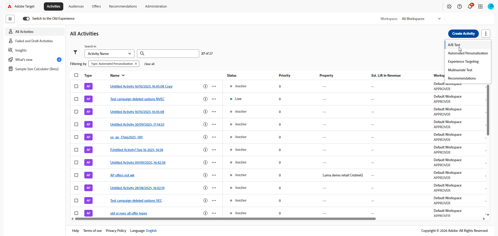
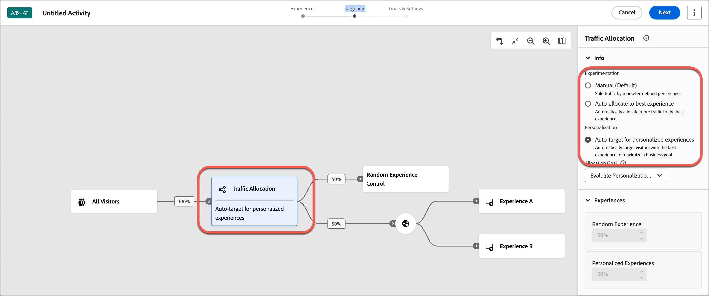

# Criar uma atividade de [!UICONTROL Direcionamento automático] {#create-auto-target-activity}

>[!BEGINSHADEBOX]

**Nesta página:** Saiba como criar uma atividade de **[!UICONTROL Direcionamento automático]** no **[!UICONTROL Visual Experience Composer]** (VEC). Você cria suas experiências, define o direcionamento, escolhe o método de alocação de tráfego de Direcionamento automático e define metas e configurações.

>[!ENDSHADEBOX]

Use o **[!UICONTROL Visual Experience Composer]** (VEC) no [!DNL Adobe Target] para criar sua atividade de **[!UICONTROL Direcionamento automático]** e **[!UICONTROL Teste A/B]** diretamente em uma página habilitada para [!DNL Target] e modificar partes da página no [!DNL Target].

>[!NOTE]
>
>O **[!UICONTROL Direcionamento automático]** está disponível como parte da solução [!DNL Target Premium]. Este recurso não está disponível no [!DNL Target Standard] sem uma licença do [!DNL Target Premium]. Para obter mais informações sobre os recursos avançados fornecidos por esta licença, consulte [Target Premium](/help/main/c-intro/intro.md).

A atividade segue o fluxo de trabalho guiado de três etapas no VEC:

1. [Criar experiências](#build-experiences)
1. [Definir direcionamento e alocação de tráfego](#set-targeting)
1. [Definir metas e configurações](#configure-goals-and-settings)

## Etapa 1: criar experiências {#build-experiences}

Crie a atividade e projete as experiências alternativas em que deseja testar o controle.

### Criar a atividade {#create-activity}

Abra a página que você deseja testar no **[!UICONTROL Visual Experience Composer]** e nomeie a atividade.

1. Na lista **[!UICONTROL Atividades]**, clique em **[!UICONTROL Criar atividade]** > **[!UICONTROL Teste A/B]**.

   

1. Na caixa de diálogo **[!UICONTROL Criar atividade de teste A/B]**, escolha seu Experience Composer:

   * **[!UICONTROL Visual]**.
   * **[!UICONTROL Experience Composer baseado em formulário]**, consulte [Experience Composer baseado em formulário](/help/main/c-experiences/form-experience-composer.md) para obter mais informações.

   >[!NOTE]
   >
   >Além do VEC e do **[!UICONTROL Experience Composer baseado em formulário]**, o [!DNL Target] oferece o VEC **[!UICONTROL Aplicativo de página única]**. Para obter mais informações sobre os vários composers, consulte [Experiências e ofertas](/help/main/c-experiences/experiences.md).
   >
   >Para obter informações sobre a solução de problemas do VEC, consulte [Solução de problemas do Visual Experience Composer](/help/main/c-experiences/c-visual-experience-composer/r-troubleshoot-composer/troubleshoot-composer.md).

1. (Condicional) Se você for um [cliente do Target Premium](/help/main/c-intro/intro.md#premium), na lista suspensa **[!UICONTROL Escolher Workspace]**, escolha um [espaço de trabalho](/help/main/administrating-target/c-user-management/property-channel/property-channel.md).

1. Na caixa **[!UICONTROL Inserir URL da atividade]**, especifique sua [URL da atividade](/help/main/c-activities/t-test-ab/t-test-create-ab/ab-activity-url.md).

   Se sua conta foi [configurada com um URL padrão](/help/main/administrating-target/visual-experience-composer-set-up.md), esse URL aparece por padrão. Você pode alterar o URL padrão para outro, se necessário.

1. Clique em **[!UICONTROL Criar]**. O **[!UICONTROL Visual Experience Composer]** é aberto, mostrando a página especificada no URL.

1. Para nomear a atividade, clique no ícone **[!UICONTROL Editar]** (  ) e especifique um nome descritivo para a atividade e clique em **[!UICONTROL Salvar]**.

   {{activity-name-rules}}

   

### Criar as experiências {#design-experiences}

Crie novas experiências alterando os elementos na página.

Depois que você cria uma nova atividade, o **[!UICONTROL Visual Experience Composer]** exibe duas guias no lado esquerdo: Experiência A e Experiência B.

* **Experiência A** é a experiência de controle. Você pode excluí-la se não quiser incluir uma experiência padrão do site como opção.
* **Experiência B** é a experiência alternativa que você adiciona ao teste. Seu foco está nessa guia, que pode ser modificada conforme desejado.

Para adicionar mais experiências ao teste, clique no ícone **[!UICONTROL Adicionar]** (  ).

Para obter mais informações sobre como adicionar ou modificar experiências no **[!UICONTROL Visual Experience Composer]**, consulte [Adicionar experiência](/help/main/c-activities/t-test-ab/t-test-create-ab/ab-add-experience.md#ab-add-experience).

## Etapa 2: definir o direcionamento e a alocação de tráfego {#set-targeting}

Depois de acessar o menu **[!UICONTROL Direcionamento]**, o diagrama de fluxo é aberto.

O diagrama do fluxo guia você pela atribuição de um público-alvo e sua porcentagem de tráfego, selecionando o método de alocação de tráfego e especificando a alocação de tráfego para cada experiência na atividade.

1. (Condicional) Clique no controle **[!UICONTROL Todos os visitantes]** para selecionar outro público-alvo para a atividade.

   O público-alvo **[!UICONTROL Todos os visitantes]** está definido como padrão. Se você selecionar outro público-alvo, o nome dele será exibido no controle mais à esquerda. Por exemplo, você pode limitar as entradas a 50% de todos os visitantes ou 45% do público-alvo na Califórnia.

   +++ Etapas para selecionar um público diferente

   O quadro direito é exibido, permitindo adicionar ou excluir um público-alvo e atribuir a porcentagem de visitante à atividade.

   1. Para alterar o público-alvo, clique no ícone **[!UICONTROL Substituir]** (  ) no quadro direito.
   1. Na caixa de diálogo **[!UICONTROL Adicionar público-alvo]**, [selecione o público-alvo desejado](/help/main/c-activities/t-test-ab/t-test-create-ab/ab-audience.md) e clique em **[!UICONTROL Atribuir público-alvo]**.

      Para criar um público-alvo que combine vários públicos-alvo, clique em **[!UICONTROL Combinar públicos-alvo]**. Para obter detalhes, consulte [Combinar vários públicos-alvo](/help/main/c-target/combining-multiple-audiences.md).

      Para criar um novo público-alvo que ainda não esteja na **[!UICONTROL Biblioteca de Público-alvo]**, clique em **[!UICONTROL Criar Público-alvo]**. No [fluxo de trabalho create-audience](/help/main/c-target/c-audiences/audiences.md), escolha uma das seguintes opções:

      * **[!UICONTROL Biblioteca de público-alvo]**: crie um público-alvo sob demanda que seja salvo na **[!UICONTROL Biblioteca de público-alvo]** e possa ser reutilizado em outras atividades.
      * **[!UICONTROL Somente esta atividade]**: crie um [público-alvo específico da atividade](/help/main/c-target/creating-activity-only-audience.md) que não esteja salvo na **[!UICONTROL Biblioteca de Público-alvo]** e possa ser usado somente na atividade atual.

   1. Clique em **[!UICONTROL Porcentagem de visitantes]** no quadro direito e escolha a porcentagem de visitantes qualificados que você deseja inserir na atividade.

   +++

1. Clique no controle **[!UICONTROL Alocação de tráfego]** e escolha o método de alocação de tráfego desejado no painel direito. Neste cenário, clique em **[!UICONTROL Direcionamento automático para experiências personalizadas]**.

   

   +++ Métodos de alocação de tráfego

   | Método | O que faz |
   |---|---|
   | **[!UICONTROL Manual (Padrão)]** | Especifique a porcentagem de participantes que deseja visualizar cada experiência. Você pode dividir os percentuais igualmente entre todas as experiências ou especificar percentuais maiores ou menores para cada experiência. O total de experiências deve ser igual a 100%. |
   | **[!UICONTROL Alocar automaticamente para a melhor experiência]** | A maioria dos participantes da atividade é direcionada automaticamente para experiências de maior desempenho. Alguns visitantes são alocados em todas experiências, para manter a exploração de experiências e reconhecer alterações em tendências de desempenho. Para obter mais informações, consulte [**[!UICONTROL Visão geral da Alocação automática ]**](/help/main/c-activities/automated-traffic-allocation/automated-traffic-allocation.md#concept_A1407678796B4C569E94CBA8A9F7F5D4). |
   | **[!UICONTROL Direcionamento automático para experiências personalizadas]** | O [!DNL Target] usa aprendizagem de máquina avançada para personalizar conteúdo e gerar conversões identificando várias experiências de alto desempenho definidas pelo profissional de marketing e depois apresentando a experiência mais personalizada para os visitantes com base no perfil individual do cliente e no comportamento de visitantes anteriores com perfil similares. Para obter mais informações, consulte [visão geral do Direcionamento automático](/help/main/c-activities/auto-target/auto-target-to-optimize.md). |

   +++

1. Clique em **[!UICONTROL Experiências]** no painel direito e especifique a alocação de tráfego desejada para cada experiência.

1. Quando estiver satisfeito com suas opções de público-alvo, experiência e alocação de tráfego, clique em **[!UICONTROL Avançar]** para ir até a terceira etapa do fluxo de trabalho guiado em três etapas.

## Etapa 3: definir metas e configurações {#configure-goals-and-settings}

Na página **[!UICONTROL Metas e configurações]**, você informa a [!DNL Target] como medir a atividade. As configurações disponíveis dependem se você usa o [!DNL Target] ou o [Analytics como a fonte de relatórios](/help/main/c-integrating-target-with-mac/a4t/a4t.md).

1. Especifique as [metas e configurações](/help/main/c-activities/t-test-ab/t-test-create-ab/ab-goals-and-settings.md) da atividade. Revise as seções da página e defina o que for necessário.

   | Seção | O que você definiu |
   |---|---|
   | **[!UICONTROL Configurações da atividade]** | Um objetivo opcional, a **[!UICONTROL Prioridade]** (usada quando várias atividades compartilham um local e um público) e a **[!UICONTROL Duração]** (datas de início e término). |
   | **[!UICONTROL Configurações da geração de relatórios]** | A fonte de relatórios, a métrica de meta (por exemplo, uma métrica **[!UICONTROL Conversão]**), métricas adicionais, públicos-alvo para relatórios e a metodologia estatística. |
   | **[!UICONTROL Configurações avançadas]** | Dependências entre métricas de sucesso, o que acontece depois que um visitante atinge a métrica de objetivo e como a contagem é incrementada. |
   | **[!UICONTROL Outros metadados]** | Observações sobre a atividade que são úteis para você ou para outros membros da equipe. |

   >[!NOTE]
   >
   >Se você quiser usar o [Analytics for Target](/help/main/c-integrating-target-with-mac/a4t/a4t.md) (A4T) com esta atividade, consulte informações importantes no [Suporte do A4T para atividades de Alocação automática e Direcionamento automático](/help/main/c-integrating-target-with-mac/a4t/a4t-at-aa.md).

1. Clique em **[!UICONTROL Salvar e fechar]** ou **[!UICONTROL Salvar]**.

Após criar a atividade, a guia **[!UICONTROL Visão geral]** mostra informações sobre a atividade, incluindo um diagrama da atividade.
