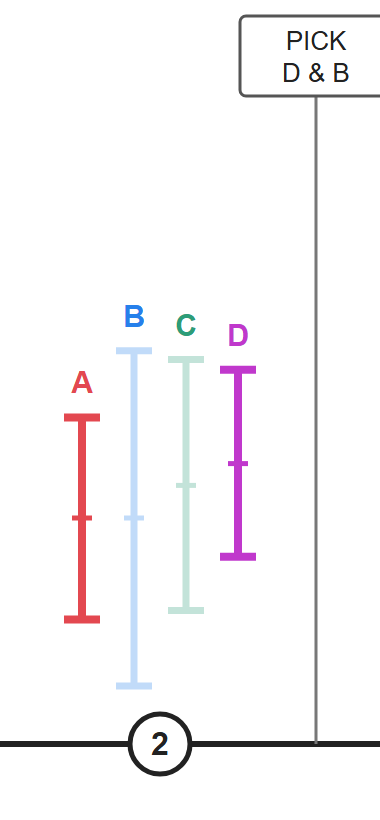

# Introdução à [!UICONTROL Alocação automática] {#auto-allocate-overview}

>[!BEGINSHADEBOX]

**Nesta página:** saiba como uma atividade de **[!UICONTROL Alocação automática]** identifica uma experiência vencedora e realoca tráfego para ela, quando usá-la, como o algoritmo funciona e o que considerar antes de usá-la.

>[!ENDSHADEBOX]

Uma atividade **[!UICONTROL Alocação automática]** em [!DNL Adobe Target] identifica um vencedor entre duas ou mais experiências e realoca automaticamente mais tráfego para o vencedor a fim de aumentar as conversões enquanto o teste continua a ser executado e aprendido.

Você cria uma atividade de **[!UICONTROL Alocação automática]** com o fluxo de trabalho guiado de três etapas de uma atividade A/B: escolha a opção **[!UICONTROL Alocar automaticamente para a melhor experiência]** na página **[!UICONTROL Direcionamento]** (etapa 2). Para as etapas, consulte [Criar uma atividade de alocação automática](/help/main/c-activities/automated-traffic-allocation/create-auto-allocate-activity.md).

## Por que usar a [!UICONTROL Alocação automática] {#why-auto-allocate}

Os testes A/B padrão têm um custo inerente. Você deve gastar o tráfego para medir o desempenho de cada experiência, e a distribuição de tráfego permanece fixa mesmo depois que algumas experiências tenham desempenho melhor que outras. O tamanho da amostra é complicado de determinar, a atividade deve executar todo o curso antes de você poder agir em um vencedor e ainda há uma chance de que o vencedor identificado não seja um verdadeiro vencedor.

Uma atividade de **[!UICONTROL Alocação automática]** reduz este custo e esta sobrecarga:

* Ele monitora o desempenho da métrica de meta de todas as experiências e envia proporcionalmente mais novos participantes para as experiências de alto desempenho. Há tráfego suficiente reservado para explorar as outras experiências.
* A otimização ocorre em paralelo ao aprendizado, para que você possa ver os benefícios em seus resultados enquanto a atividade ainda está em execução.
* Os visitantes avançam gradualmente em direção a experiências vencedoras, de modo que não é necessário aguardar até que a atividade termine. Você se beneficia do incentivo mais rapidamente porque os participantes da atividade que teriam sido enviados para experiências de menor sucesso recebem experiências vencedoras potenciais.

Principais benefícios:

* Preserva a rigidez de um teste A/B.
* Encontra um vencedor estatisticamente significativo mais rápido que um teste A/B manual.
* Fornece um aumento médio de campanha maior do que um teste A/B manual.

### Como a [!UICONTROL Alocação automática] identifica um vencedor {#true-winner}

Um teste A/B normal em [!DNL Target] compara cada desafiante somente com o controle. Por exemplo, se uma atividade tiver experiências A, B, C e D, em que A é o controle, o teste compara A versus B, A versus C e A versus D. A maioria dos produtos, incluindo o [!DNL Target], usa um [teste t de Welch](https://en.wikipedia.org/wiki/Welch%27s_t-test){target=_blank} para essas comparações para produzir confiança baseada em valor p. No entanto, o [!DNL Target] não executa automaticamente as comparações implícitas (B versus C, B versus D e C versus D) necessárias para encontrar a &quot;melhor&quot; experiência, portanto, você deve analisar os resultados manualmente.

**[!UICONTROL Alocação automática]** remove esta etapa manual:

* Ele executa todas as comparações implícitas entre experiências e produz um vencedor &quot;verdadeiro&quot;. Não há noção de experiência de &quot;controle&quot; no teste.
* Ela aloca novos visitantes às experiências até que o intervalo de confiança da melhor experiência não se sobreponha ao intervalo de confiança de qualquer outra experiência.
* Ele usa intervalos de confiança baseados na [Desigualdade de Bernstein](https://en.wikipedia.org/wiki/Bernstein_inequalities_%28probability_theory%29){target=_blank}, que compensa avaliações repetidas que normalmente produziriam falsos positivos.
* Quando ela pára, desde que não haja uma dependência de tempo substancial para os visitantes que chegam à página, há pelo menos 95% de chance de que ela retorne uma experiência cuja resposta verdadeira não seja pior do que 1% (relativa) menos do que a verdadeira resposta da experiência vencedora.

## Quando usar a [!UICONTROL Alocação automática] {#when-to-use}

Escolha entre as atividades de **[!UICONTROL Alocação automática]**, **[!UICONTROL Teste A/B]** e **[!UICONTROL Automated Personalization]** de acordo com sua meta:

| Atividade | Use-o quando | Como é diferente |
|---|---|---|
| **[!UICONTROL Alocação automática]** | Você deseja otimizar sua atividade desde o início e identificar as experiências vencedoras o mais rápido possível. | Ao veicular experiências de alto desempenho com mais frequência, o desempenho geral da atividade é aumentado. |
| [**[!UICONTROL Teste A/B]**](/help/main/c-activities/t-test-ab/test-ab.md#test-ab) | Você deseja caracterizar o desempenho de todas as experiências antes de otimizar o site. | Um teste A/B ajuda a classificar todas as suas experiências, enquanto a **[!UICONTROL Alocação automática]** encontra os melhores desempenhos, mas não garante a diferenciação entre os de baixo desempenho. |
| [**[!UICONTROL Personalização automatizada]**](/help/main/c-activities/t-automated-personalization/automated-personalization.md#automated-personalization-overview) | Você deseja algoritmos de otimização da mais alta complexidade, como modelos de aprendizado automatizado que fazem previsões com base em atributos de perfil individuais. | A **[!UICONTROL Alocação automática]** observa o comportamento agregado das experiências (assim como testes A/B padrão) e não diferencia os visitantes. |

## Como o algoritmo funciona {#how-it-works}

O algoritmo de **[!UICONTROL Alocação automática]** é uma abordagem de [bandit multi-armed](https://en.wikipedia.org/wiki/Multi-armed_bandit){target=_blank} para otimização, que equilibra o aprendizado exploratório e o aproveitamento desse aprendizado. Ele incorpora o desempenho medido (como a taxa de conversão) e os intervalos de confiança dos dados cumulativos. Ao contrário de um teste A/B padrão, em que o tráfego é dividido igualmente entre as experiências, a **[!UICONTROL Alocação automática]** altera a alocação de tráfego entre as experiências:

* 80% dos visitantes são alocados usando a lógica descrita nesta seção.
* 20% dos visitantes são atribuídos aleatoriamente em todas as experiências para se adaptar à mudança de comportamento do visitante.

A abordagem multi-armed bandit mantém algum tráfego livre para exploração enquanto explora as experiências que estão tendo um bom desempenho. Mais visitantes novos são colocados em experiências com melhor desempenho, enquanto a capacidade de reagir a condições em mudança é preservada. Os modelos são atualizados pelo menos uma vez por hora para garantir que reajam aos dados mais recentes.

À medida que mais visitantes entram na atividade, algumas experiências se tornam mais bem-sucedidas e recebem mais tráfego. 20% do tráfego continua sendo distribuído aleatoriamente para explorar todas as experiências. Se uma das experiências de baixo desempenho começar a funcionar melhor, mais tráfego será alocado para essa experiência. Se o sucesso de uma experiência de maior desempenho diminuir, menos tráfego será alocado a ela. Isso pode acontecer, por exemplo, quando um evento faz com que os visitantes procurem informações diferentes em seu site de mídia ou quando as vendas nos finais de semana em seu site de varejo fornecem resultados diferentes.

A ilustração a seguir representa como o algoritmo pode ser executado durante um teste com quatro experiências (clique para expandir a ilustração):

{width="600" zoomable="yes"}

A ilustração mostra como o tráfego alocado para cada experiência progride ao longo de várias rodadas do tempo de atividade até que um vencedor claro seja determinado.

| Arredondar | Descrição |
|--- |--- |
| {width="200" zoomable="yes"} | **Rodada de aquecimento (0)**: cada experiência recebe o mesmo tráfego até que cada experiência na atividade tenha um mínimo de 1.000 visitantes e 50 conversões.<ul><li>Experiência A=25%</li><li>Experiência B=25%</li><li>Experiência C=25%</li><li>Experiência D=25%</li></ul>Depois que cada experiência atinge 1.000 visitantes e 50 conversões, o [!DNL Target] inicia a alocação automática de tráfego. Todas as alocações ocorrem em rodadas e duas experiências são selecionadas para cada rodada. Apenas duas experiências avançam para a próxima rodada: D e C.<ul><li>Seguir em frente significa que as duas experiências recebem 80% do tráfego igualmente.</li><li>As outras duas experiências continuam a participar, mas são servidas apenas como parte da alocação de tráfego aleatório de 20% à medida que novos visitantes entram na atividade.</li><li>Todas as alocações são atualizadas a cada hora (mostradas pelos arredondamentos ao longo do eixo x acima). Após cada rodada, os dados acumulados são comparados.</li></ul> |
| {width="200" zoomable="yes"} | **Rodada 1**: 80% do tráfego é alocado às experiências C e D (40% cada). 20% do tráfego é alocado aleatoriamente para experiências A, B, C e D (5% cada). Durante esta rodada, a experiência A tem um excelente desempenho.<ul><li>O algoritmo escolhe a experiência D para avançar para a próxima rodada porque tem a taxa de conversão mais alta (conforme indicado pela escala vertical de cada atividade).</li><li>O algoritmo escolhe a experiência A para avançar também porque tem o limite superior mais alto do intervalo de confiança de 95% de Bernstein das experiências restantes.</li></ul>As experiências D e A seguem em frente. |
| {width="200" zoomable="yes"} | **Rodada 2**: 80% do tráfego é alocado às experiências A e D (40% cada). 20% do tráfego é alocado aleatoriamente, portanto, as experiências A, B, C e D recebem 5% do tráfego cada uma. Durante esta rodada, a experiência B tem um excelente desempenho.<ul><li>O algoritmo escolhe a experiência D para avançar para a próxima rodada porque tem a taxa de conversão mais alta (conforme indicado pela escala vertical de cada atividade).</li><li>O algoritmo escolhe a experiência B para avançar também porque tem o limite superior mais alto do intervalo de confiança de 95% de Bernstein das experiências restantes.</li></ul>As experiências D e B seguem em frente. |
| {width="200" zoomable="yes"} | **Rodada 3**: 80% do tráfego é alocado às experiências B e D (40% cada). 20% do tráfego é alocado aleatoriamente, portanto, as experiências A, B, C e D recebem 5% do tráfego cada uma. Durante esta ronda, a experiência D continua a ter um bom desempenho e a experiência C tem um excelente desempenho.<ul><li>O algoritmo escolhe a experiência D para avançar para a próxima rodada porque tem a taxa de conversão mais alta (conforme indicado pela escala vertical de cada atividade).</li><li>O algoritmo escolhe a experiência C para avançar também porque tem o limite superior mais alto do intervalo de confiança de 95% de Bernstein das experiências restantes.</li></ul>As experiências D e C seguem em frente. |
| {width="200" zoomable="yes"} | **Rodada 4**: 80% do tráfego é alocado às experiências C e D (40% cada). 20% do tráfego é alocado aleatoriamente, portanto, as experiências A, B, C e D recebem 5% do tráfego cada uma. Durante esta rodada, a experiência C tem um excelente desempenho.<ul><li>O algoritmo escolhe a experiência C para avançar para a próxima rodada porque tem a taxa de conversão mais alta (conforme indicado pela escala vertical de cada atividade).</li><li>O algoritmo escolhe a experiência D para avançar também porque tem o limite superior mais alto do intervalo de confiança de 95% de Bernstein das experiências restantes.</li></ul>As experiências C e D seguem em frente. |
| {width="200" zoomable="yes"} | **Rodada *n***: conforme a atividade avança, uma experiência de alto desempenho começa a surgir e o processo continua até que haja uma experiência vencedora. Quando o intervalo de confiança da experiência com a taxa de conversão mais alta não coincide com o intervalo de confiança de qualquer outra experiência, ele é rotulado como vencedor. Um selo de [é exibido na página da atividade vencedora](/help/main/c-activities/automated-traffic-allocation/determine-winner.md) e na lista de&#x200B;**[!UICONTROL &#x200B; Atividades &#x200B;]**.<ul><li>O algoritmo escolhe a experiência C como o vencedor claro.</li></ul>Nesse ponto, o algoritmo serve 80% do tráfego para a experiência C, enquanto 20% do tráfego continua a ser distribuído aleatoriamente para todas as experiências (A, B, C e D). No total, C recebe 85% do tráfego. No caso improvável de o intervalo de confiança do vencedor começar a se sobrepor novamente, o algoritmo reverte para o comportamento da rodada 4. **Importante**: se você escolher manualmente um vencedor no início do processo, seria fácil escolher a experiência errada. Por esse motivo, é uma prática recomendada esperar até que o algoritmo determine a experiência vencedora. |

>[!NOTE]
>
>Se uma atividade tiver apenas duas experiências, ambas as experiências obterão tráfego igual até que [!DNL Target] encontre uma experiência vencedora com 75% de confiança. Nesse ponto, dois terços do tráfego são alocados para o vencedor e um terço para o perdedor. Depois disso, quando uma experiência atinge a confiança de 95%, 90% do tráfego é alocado ao vencedor e 10% ao perdedor. [!DNL Target] sempre envia algum tráfego para a experiência &quot;perdida&quot; para evitar falsos positivos no final (ou seja, para manter alguma exploração).

Depois que uma atividade de **[!UICONTROL Alocação automática]** é ativada, as seguintes operações não são permitidas na interface do usuário [!DNL Target]:

* Alterando o modo **[!UICONTROL Alocação de Tráfego]** para **[!UICONTROL Manual]**.
* Alteração do tipo de métrica de meta.
* Alterando opções no painel **[!UICONTROL Configurações Avançadas]**.

Para obter mais informações, consulte [Como a alocação automática supera o desempenho de um teste manual](/help/main/c-activities/automated-traffic-allocation/faster-results-higher-revenue.md).

## Avisos {#caveats}

Considere as informações a seguir ao trabalhar com a **[!UICONTROL Alocação automática]**.

### Somente uma configuração de métrica avançada é compatível

O recurso **[!UICONTROL Alocação automática]** funciona somente com uma configuração de métrica avançada: **[!UICONTROL Aumentar Contagem e Manter Usuário na Atividade]**. Não há suporte para as seguintes configurações avançadas de métrica: **[!UICONTROL Contagem de Incremento]**, **[!UICONTROL Usuário de Liberação]**, **[!UICONTROL Permitir Reentrada e Contagem de Incremento]** e **[!UICONTROL Usuário de Liberação e Barra de Reentrada]**.

### Visitantes que retornam com frequência podem aumentar as taxas de conversão {#return-visitors}

Se um visitante que vê a experiência A retornar com frequência e converter várias vezes, a taxa de conversão (CR) da experiência A será aumentada artificialmente. Compare esse resultado com a experiência B, em que os visitantes convertem, mas não retornam com frequência. Como resultado, o CR da experiência A fica melhor que o CR da experiência B, portanto, novos visitantes têm mais probabilidade de ser alocados para A do que para B. Se você optar por contar uma vez por participante, o CR de A e o CR de B podem ser idênticos.

A lógica favorece os visitantes que convertem rapidamente ou visitam com mais frequência, pois esses visitantes inflam temporariamente o índice de conversão geral da experiência à qual pertencem. O algoritmo se ajusta frequentemente, então o aumento na taxa de conversão é amplificado a cada instantâneo.

Se visitantes recorrentes são distribuídos aleatoriamente, seu efeito nas taxas de conversão tem mais probabilidade de ser uniformizado. Para amenizar esse efeito, considere alterar o método de contagem da métrica de meta para contar somente uma vez por participante.

### A diferenciação está entre altos desempenhos, não entre baixos desempenhos

**[!UICONTROL A Alocação automática]** é boa para diferenciar entre experiências de alto desempenho (e encontrar um vencedor). Pode haver momentos em que você não tenha diferenciação suficiente entre as experiências com baixo desempenho.

Se você quiser produzir uma diferenciação estatisticamente significativa entre todas as experiências, considere usar o modo de alocação de tráfego manual.

### As taxas de conversão relacionadas ao tempo podem distorcer a alocação

Alguns fatores que podem ser ignorados durante um teste A/B padrão, pois afetam todas as experiências igualmente, não podem ser ignorados em uma atividade **[!UICONTROL Alocação automática]**. O algoritmo está sujeito às taxas de conversão observadas. Os seguintes fatores podem afetar o desempenho da experiência de forma desigual:

* Experiências com relevância contextual variável (tempo, local, gênero etc.).

  Por exemplo:

  * &quot;Graças a Deus é sexta-feira&quot; resulta em maiores conversões na sexta-feira.
  * &quot;Jump-start sua segunda-feira&quot; tem maior conversão na segunda-feira.
  * &quot;Prepare-se para um inverno na costa leste&quot; fornece uma conversão mais alta em locais da costa leste ou afetados pelo inverno.

  Usar experiências com relevância contextual variável pode distorcer os resultados em um teste **[!UICONTROL Alocação automática]** mais do que em um teste A/B, pois o teste A/B analisa os resultados em um período mais longo.

* Experiências com atrasos de conversão variáveis, possivelmente devido à urgência da mensagem.

  Por exemplo, &quot;a venda de 30% termina hoje&quot; sinaliza ao visitante para converter hoje, mas &quot;a primeira compra com 50% de desconto&quot; não cria a mesma sensação de urgência.

## Perguntas frequentes {#faq}

Consulte as seguintes perguntas e respostas ao trabalhar com atividades de **[!UICONTROL Alocação automática]**.

+++ O [!UICONTROL Analytics for Target] (A4T) é compatível com as atividades de [!UICONTROL Alocação automática]?

Sim. Para obter mais informações, consulte [Suporte ao A4T para atividades de Alocação automática e Direcionamento automático](/help/main/c-integrating-target-with-mac/a4t/a4t-at-aa.md).

+++

+++ Os visitantes recorrentes são realocados automaticamente a experiências de alto desempenho?

Não. Somente novos visitantes são alocados automaticamente. Os visitantes recorrentes continuam a ver sua experiência original para proteger a validade do teste A/B.

+++

+++ Como o algoritmo lida com falsos positivos?

O algoritmo garante uma confiança de 95% ou taxa de 5% de falso-positivo, se você esperar até que o emblema vencedor apareça.

+++

+++ Quando a [!UICONTROL Alocação automática] começa a alocar o tráfego?

O algoritmo começa a funcionar depois que todas as experiências na atividade têm um mínimo de 1.000 visitantes e 50 conversões.

+++

+++ Qual é o nível de dinamismo do aproveitamento pelo algoritmo?

80% do tráfego é distribuído usando a **[!UICONTROL Alocação automática]** e 20% do tráfego é distribuído aleatoriamente. Quando um vencedor é identificado, 80% do tráfego é direcionado a ele, enquanto todas as experiências continuam a receber algum tráfego como parte dos 20%, incluindo a experiência vencedora.

+++

+++ As experiências perdedoras são exibidas?

Sim. A abordagem multi-armed bandit garante que pelo menos 20% do tráfego seja reservado para explorar a mudança nos padrões ou nas taxas de conversão em todas as experiências.

+++

+++ O que acontece com atividades com longos atrasos de conversão?

Desde que todas as experiências que estão sendo otimizadas enfrentem atrasos semelhantes, o comportamento é o mesmo de uma atividade com um ciclo de conversão mais rápido. No entanto, demora mais para atingir o limite de 50 conversões antes do início do processo de alocação de tráfego.

+++

+++ Qual a diferença entre a [!UICONTROL Alocação automática] e a [!UICONTROL Automated Personalization]?

O **[!UICONTROL Automated Personalization]** usa os atributos de perfil de cada visitante para determinar a melhor experiência. Ao fazer isso, ele não apenas otimiza, mas também personaliza a atividade desse visitante.

A **[!UICONTROL Alocação automática]**, por outro lado, é um teste A/B que produz um vencedor agregado (a experiência mais popular, mas não necessariamente a experiência mais eficaz para cada visitante).

+++

+++ Os visitantes recorrentes aumentam a taxa de conversão de minha métrica de sucesso?

Sim, eles podem. Consulte [Visitantes que retornam com frequência podem aumentar as taxas de conversão](#return-visitors) para obter uma explicação e saber como atenuar esse efeito.

+++

+++ Posso usar a calculadora de tamanho de amostra com [!UICONTROL Alocação automática] para estimar quanto tempo a atividade leva para identificar o vencedor?

Você pode usar a [!DNL Adobe Target] [Calculadora de Tamanho da Amostra](/help/main/c-activities/t-test-ab/sample-size-determination.md#section_6B8725BD704C4AFE939EF2A6B6E834E6) existente para obter uma estimativa de quanto tempo o teste dura. Assim como no teste A/B tradicional, aplique a correção de Bonferroni se estiver testando mais de duas ofertas ou mais de uma métrica ou hipótese de conversão. Essa calculadora foi projetada para testes A/B tradicionais de horizonte fixo e fornece apenas uma estimativa. O uso da calculadora para uma atividade de **[!UICONTROL Alocação automática]** é opcional, pois **[!UICONTROL Alocação automática]** declara um vencedor para você. Não é necessário escolher um ponto fixo no tempo para ver os resultados do teste. Os valores fornecidos são sempre estatisticamente válidos.

Experimentos internos [!DNL Adobe] encontraram o seguinte:

* Ao testar exatamente duas experiências, a **[!UICONTROL Alocação automática]** encontra um vencedor mais rapidamente do que o teste de horizonte fixo (ou seja, o intervalo de tempo sugerido pela calculadora de tamanho de amostra) quando a diferença de desempenho entre as experiências é grande. No entanto, a **[!UICONTROL Alocação automática]** pode exigir tempo extra para identificar um vencedor quando a diferença de desempenho entre as experiências é pequena. Nesses casos, os testes de horizonte fixo normalmente terminariam sem um resultado estatisticamente significativo.
* Ao testar mais de duas experiências, a **[!UICONTROL Alocação automática]** encontra um vencedor mais rapidamente do que o teste de horizonte fixo (ou seja, o período sugerido pela calculadora de tamanho de amostra) quando uma única experiência tem um desempenho muito melhor do que todas as outras experiências. Quando duas ou mais experiências &quot;vencedoras&quot; em relação a outras experiências, mas são intimamente relacionadas entre si, a **[!UICONTROL Alocação automática]** pode exigir tempo extra para determinar qual é superior. Nesses casos, os testes de horizonte fixo normalmente terminariam concluindo que as experiências &quot;vencedoras&quot; eram melhores do que as experiências de baixo desempenho, mas não teriam identificado qual era superior.

+++

+++ Devo remover uma experiência com baixo desempenho de uma atividade de [!UICONTROL Alocação automática] para acelerar o processo de decisão de um vencedor?

Não há nenhum motivo real para remover uma experiência com baixo desempenho. A **[!UICONTROL Alocação automática]** serve automaticamente experiências de alto desempenho com mais frequência e experiências com baixo desempenho com menos frequência. Deixar uma experiência com baixo desempenho na atividade não afeta significativamente a velocidade de decisão de um vencedor.

20% dos visitantes são atribuídos aleatoriamente em todas as experiências. A quantidade de tráfego veiculada para uma experiência com baixo desempenho é mínima (20% dividido pelo número de experiências).

+++

+++ Posso alterar a métrica de meta durante uma atividade de [!UICONTROL Alocação automática]?

[!DNL Adobe] não recomenda que você altere a métrica de meta durante uma atividade. Embora seja possível alterar a métrica de meta durante uma atividade na interface do usuário do [!DNL Target], você sempre deve iniciar uma nova atividade. [!DNL Adobe] não garante o que acontece se você alterar a métrica de meta em uma atividade após sua execução.

Esta recomendação se aplica às atividades de **[!UICONTROL Alocação Automática]**, **[!UICONTROL Direcionamento Automático]** e **[!UICONTROL Automated Personalization]** que usam [!DNL Target] ou [!DNL Analytics] (A4T) como fonte de relatórios.

+++

+++ Posso alterar a fonte de relatórios no meio de uma atividade de [!UICONTROL Alocação automática]?

[!DNL Adobe] não recomenda que você altere a fonte de relatórios no meio de uma atividade. Embora seja possível alterar a fonte de relatórios (de [!DNL Target] para A4T ou o oposto) durante uma atividade na interface do usuário do [!DNL Target], você sempre deve iniciar uma nova atividade. [!DNL Adobe] não garante o que acontece se você alterar a fonte de relatórios em uma atividade após sua execução.

Esta recomendação se aplica às atividades de **[!UICONTROL Alocação Automática]**, **[!UICONTROL Direcionamento Automático]** e **[!UICONTROL Automated Personalization]** que usam [!DNL Target] ou [!DNL Analytics] (A4T) como fonte de relatórios.

+++

+++ Posso usar a opção [!UICONTROL Redefinir dados de relatório] ao executar uma atividade de [!UICONTROL Alocação automática]?

Não é sugerido usar a opção **[!UICONTROL Redefinir Dados de Relatório]** para atividades de **[!UICONTROL Alocação Automática]**. Embora ela remova os dados do relatório visíveis, essa opção não remove todos os registros de treinamento do modelo **[!UICONTROL Alocação automática]**. Em vez de usar a opção **[!UICONTROL Redefinir dados de relatório]**, crie uma nova atividade e desative a original. Esta orientação também se aplica às atividades de **[!UICONTROL Direcionamento automático]** e **[!UICONTROL Automated Personalization]**.

+++

+++ Como a [!UICONTROL Alocação automática] cria modelos em relação a ambientes?

A **[!UICONTROL Alocação automática]** cria modelos com base no comportamento de tráfego e conversão registrado somente no ambiente padrão. Por padrão, **[!UICONTROL Produção]** é o ambiente padrão, mas ele pode ser alterado em [!DNL Target] ([Administração > Ambientes](/help/main/administrating-target/environments.md)).

Se uma ocorrência ocorrer em outro ambiente (não padrão), o tráfego será distribuído de acordo com o comportamento de conversão observado no ambiente padrão. O resultado dessa ocorrência (conversão ou não conversão) é registrado para fins de relatório, mas não é considerado no modelo **[!UICONTROL Alocação automática]**.

Quando você seleciona outro ambiente, o relatório mostra o tráfego e as conversões desse ambiente. O ambiente selecionado padrão para um relatório é o padrão em toda a conta. O ambiente padrão não pode ser definido com base na atividade.

+++

+++ Uma atividade de [!UICONTROL Alocação automática] pode ajustar a janela de pesquisa ao longo de um teste para considerar a mudança de tendências com o passar do tempo?

Por exemplo, a atividade pode considerar o mês de dezembro para decidir como alocar o tráfego, em vez de analisar os dados do visitante de setembro (quando o teste começou)?

Não. **[!UICONTROL Alocação automática]** considera o desempenho de toda a atividade.

+++

+++ A [!UICONTROL Alocação automática] mostra uma experiência vencedora a um visitante recorrente se a experiência vencedora for diferente do que o visitante viu ao se qualificar para a atividade?

A **[!UICONTROL Alocação automática]** usa decisão fixa pelos mesmos motivos que **[!UICONTROL Teste A/B]** para atividades são fixos. A alocação de tráfego funciona somente para novos visitantes.

+++

## Vídeos de treinamento {#section_893E5B36DC4A415C9B1D287F51FCCB83}

Os vídeos a seguir contêm mais informações sobre os conceitos discutidos neste artigo.

### Fluxo de trabalho da atividade - Direcionamento (2:14) 

Este vídeo inclui informações sobre a configuração da alocação de tráfego.

* Designar um público-alvo para sua atividade
* Controle do tráfego
* Selecione seu método de alocação de tráfego
* Aloque o tráfego entre diferentes experiências

>[!VIDEO](https://video.tv.adobe.com/v/3507593?captions=por_br)

### Criação de testes A/B (8:36) 

Este vídeo monstra como criar um teste A/B usando o fluxo de trabalho orientado de três etapas do Target. **[!UICONTROL Alocação automática]** é discutida a partir de 4:45.

* Criar uma atividade A/B em [!DNL Adobe Target]
* Aloque o tráfego usando uma divisão manual ou automática

>[!VIDEO](https://video.tv.adobe.com/v/31295?captions=por_br)
