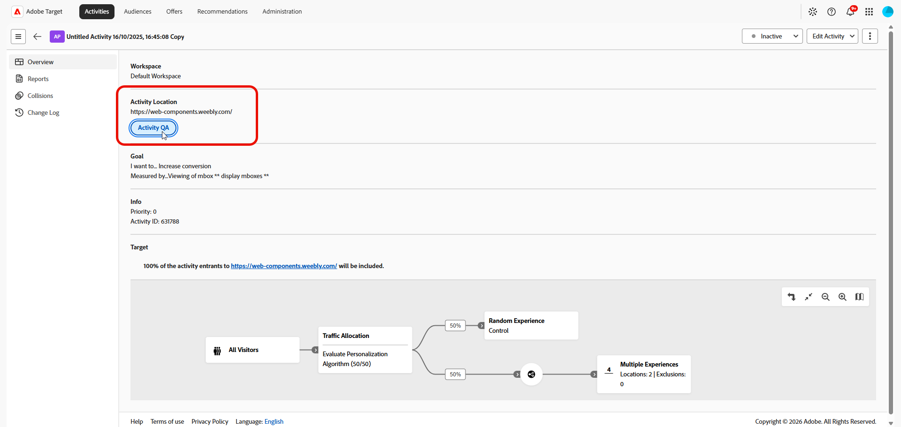

# Introdução ao Controle de qualidade de atividade {#activity-qa}

>[!BEGINSHADEBOX]

**Nesta página:** Saiba como usar os links de Controle de qualidade de atividade para testar uma atividade de ponta a ponta, revisar os relatórios de Controle de qualidade e liberar-se do modo de Controle de qualidade.

>[!ENDSHADEBOX]

O **[!UICONTROL Controle de qualidade da atividade]** permite que você teste completamente suas atividades do [!DNL Adobe Target] antes de iniciá-las ao vivo, com links de visualização que nunca mudam, direcionamento opcional de público-alvo e relatórios de controle de qualidade que permanecem separados dos dados de atividade ao vivo. A funcionalidade **[!UICONTROL Controle de qualidade da atividade]** inclui:

* **Links permanentes:** compartilha links com membros da equipe que nunca mudam ou exigem regeneração, independentemente das atualizações feitas nas experiências ou atividades.
* **Direcionamento opcional de público-alvo:** teste os critérios de direcionamento ou os ignore para verificar a aparência das experiências sem precisar atender às condições do público-alvo.
* **Relatórios de controle de qualidade separados:** Confirme se as métricas são incrementadas conforme esperado. Os dados do relatório de controle de qualidade são mantidos separados dos relatórios de produção (para relatórios não-A4T).
* **Visualizar com outras atividades:** visualize uma experiência de forma isolada ou com outras atividades ativas que atendam aos critérios de entrega (página/[!DNL Target] solicitação/público).
* **jornada completa do usuário:** Acesse seu site uma vez com o link de controle de qualidade e navegue pelo site inteiro enquanto estiver na **[!UICONTROL Garantia de qualidade da atividade]**. Você permanece no **[!UICONTROL Controle de qualidade da atividade]** até terminar a sessão ou até usar o [bookmarklet de Controle de qualidade do Target](/help/main/c-activities/c-activity-qa/activity-qa-bookmark.md) para forçar sua saída. Esse recurso é útil se você tiver uma atividade abrangendo várias páginas da Web.

  >[!NOTE]
  >
  >Essa funcionalidade é verdadeira para implementações da at.js com a versão 2.*x* ou posterior. Para implementações do at.js 1.*x*, essa funcionalidade será verdadeira somente se o navegador do visitante não bloquear cookies de terceiros.

## Acessar e compartilhar um URL de controle de qualidade {#section_1C59BAA247B247BDB125D1BE8EAD4547}

Os links de controle de qualidade da atividade permitem que você e sua equipe visualizem cada experiência de uma atividade no site antes que ela entre em vigor. O tráfego de controle de qualidade é relatado separadamente do tráfego ativo, portanto, o teste não afeta seus relatórios ativos.

1. Na página **[!UICONTROL Visão geral]** da atividade, clique em **[!UICONTROL Controle de qualidade da atividade]**.

   

1. Defina **[!UICONTROL Corresponder regras de público-alvo para ver experiências]** e escolher se os testadores devem se qualificar para o público-alvo. Ative-a para confirmar se a correspondência de público-alvo funciona ou desative para verificar a aparência da atividade.

   * **Em:** os testadores devem atender aos requisitos de direcionamento para ver as experiências. Para atividades de Direcionamento de experiência (XT), um único URL de atividade é fornecido, e a experiência que você vê depende da regra de direcionamento para a qual você está qualificado.
   * **Desativado:** os links mostram as experiências independentemente de você se qualificar. Você pode alternar entre as duas configurações a qualquer momento durante o controle de qualidade.

   

1. Defina **[!UICONTROL Mostrar conteúdo padrão para todas as outras atividades]** para escolher se outras atividades ativas devem aparecer na página.

   * **Ativado:** O conteúdo padrão é exibido para todas as outras atividades. A visualização é mostrada isoladamente, sem considerar as outras atividades ativas na mesma solicitação de página/[!DNL Target].
   * **Desativado:** se houver colisões entre a atividade que você está testando e outras atividades ao vivo, [as regras de prioridade normais](/help/main/c-activities/priority.md#priority) serão aplicadas, portanto, talvez você não veja a atividade que pretende testar o controle de qualidade. Aumento de métricas para as atividades visualizadas, mas apenas no ambiente de relatório de controle de qualidade.

1. Clique em **[!UICONTROL Concluído]** para salvar suas alterações.

1. Compartilhe os URLs de link de atividade com os membros de sua organização para testes.

   Cada URL de link (para a Experiência A, Experiência B e assim por diante) inicia a jornada do usuário a partir da experiência correspondente. Apenas um URL é gerado por experiência, mesmo que a experiência abranja várias páginas (teste de modelo ou teste de várias páginas).

   Os links nunca expiram e as alterações em uma atividade ou experiência não exigem que você os reenvie. No entanto, se você aplicar um público-alvo diferente da **[!UICONTROL Biblioteca de público-alvo]**, em vez de editar a atividade, será gerado um novo link que você deverá compartilhar novamente.

1. Clique no URL de uma experiência e navegue em seu site normalmente para ver as experiências em várias páginas (se houver várias páginas).

   Você pode navegar pelo site para ver as outras páginas porque o modo **[!UICONTROL Controle de qualidade da atividade]** persiste entre páginas. Isso é verdade para implementações da at.js com a versão 2.*x* ou posterior. Para implementações do at.js 1.*x*, isso é verdadeiro somente se o navegador do visitante não bloquear cookies de terceiros.

1. Para ver os relatórios gerados a partir das URLs do link de atividade, acesse a página **[!UICONTROL Relatórios]** da atividade, clique no ícone **[!UICONTROL Configurações]** (  ) e selecione **[!UICONTROL Tráfego do modo de controle de qualidade]** na lista suspensa **[!UICONTROL Ambiente]**.

   

## Sair do modo de QA da atividade

O modo **[!UICONTROL Controle de qualidade da atividade]** persiste até que você a saia. Depois de navegar em um site em **[!UICONTROL Controle de qualidade da atividade]**, você permanece no modo de controle de qualidade até que a sessão [!DNL Target] expire ou você se force a sair. É necessário sair do para exibir seu site como um visitante normal.

### at.js 2.*x*

Se o site tiver o at.js 2.*x* implantado, use o [bookmarklet de controle de qualidade do Target](/help/main/c-activities/c-activity-qa/activity-qa-bookmark.md) para forçar você a sair do **[!UICONTROL Controle de qualidade da atividade]**. O carregamento de uma página em seu site com um valor vazio, conforme descrito na próxima seção, *não* remove o cookie de controle de qualidade do navegador quando o at.js 2.*x* é implantado.

### at.js 1.*x*

Se o site tiver o at.js 1.*x* implantado, além de usar o [bookmarklet de controle de qualidade do Target](/help/main/c-activities/c-activity-qa/activity-qa-bookmark.md), você poderá forçar a sua saída manualmente carregando uma página em seu site com o parâmetro `at_preview_token` definido como um valor vazio. Por exemplo:

`https://www.mysite.com/?at_preview_token=`

### [!DNL Adobe Experience Platform Web SDK]

Se o site tiver o [[!UICONTROL Platform Web SDK]](https://experienceleague.adobe.com/docs/target-dev/developer/client-side/aep-web-sdk.html?lang=pt-BR){target=_blank} implantado, você poderá forçar a sua saída manualmente carregando uma página em seu site com o parâmetro `at_qa_mode` definido como um valor vazio. Por exemplo:

`https://www.mysite.com/?at_qa_mode=`

## Considerações {#section_B256EDD7BFEC4A6DA72A8A6ABD196D78}

### Disponibilidade e limites {#availability}

+++ URLs de visualização da experiência do Automated Personalization

O **[!UICONTROL Controle de qualidade da atividade]** agora está disponível para todos os tipos de atividades [!DNL Target]; portanto, o recurso &quot;Visualizar atividades do Automated Personalization com URLs de visualização de experiência&quot; não é mais necessário.

+++

+++ Analytics como origem de relatório (A4T)

**[!UICONTROL As URLs de garantia da qualidade da atividade]** estão disponíveis com atividades com o [Analytics como fonte de relatórios](/help/main/c-integrating-target-with-mac/a4t/a4t.md) (A4T). As ocorrências geradas durante a execução do controle de qualidade usando o **[!UICONTROL Controle de qualidade da atividade]** fluem para o mesmo conjunto de relatórios no qual os dados da atividade fluem, mesmo após a atividade ser ativada.

+++

+++ Atividades arquivadas ou encerradas

**[!UICONTROL O Controle de qualidade da atividade]** não exibe o conteúdo para atividades arquivadas ou atividades que estão além das datas de término. Se você desativar uma atividade finalizada, deverá salvá-la novamente para que o **[!UICONTROL Controle de qualidade da atividade]** funcione.

+++

+++ Atividades importadas

Atividades importadas para [!DNL Target Standard/Premium] (de [!DNL Target Classic], por exemplo) não suportam URLs de controle de qualidade.

+++

+++ Modelos de alocação automática e recomendações

Nas atividades de **[!UICONTROL Alocação automática]** e **[!UICONTROL Recomendações]**, o modelo não é afetado pelas visitas capturadas no **[!UICONTROL Controle de qualidade da atividade]**.

+++

### Links e navegação {#links-and-browsing}

+++ Atividades com uma condição &quot;URL é&quot;

Se você tiver especificado &quot;URL é&quot; ao criar a atividade no [refinamentos no Criador baseado em formulário](/help/main/c-experiences/form-experience-composer.md) ou nas [opções de entrega de página no Visual Experience Composer](/help/main/c-experiences/c-visual-experience-composer/viztarget-options.md), a URL de QA não funcionará, pois a **[!UICONTROL QA da atividade]** adiciona parâmetros de URL. Para resolver esse problema, clique no URL do Controle de qualidade para acessar seu site, remover os parâmetros anexados do URL e, em seguida, carregar o novo URL.

+++

+++ Navegadores que bloqueiam cookies de terceiros (at.js 1.*x*)

Se você tiver a at.js 1.*x*, o modo **[!UICONTROL Controle de qualidade da atividade]** não persistirá entre páginas se você usar o Safari ou outro navegador que bloqueie cookies de terceiros. Nesses casos, é necessário adicionar os parâmetros de visualização a cada URL para o qual você navega. O mesmo é verdadeiro se você implementou o [CNAME](https://experienceleague.adobe.com/docs/target-dev/developer/implementation/implement-cname-support-in-target.html){target=_blank}.

+++

+++ Atividades com vários públicos-alvo de experiência

Se uma atividade usar vários públicos-alvo de experiência (por exemplo, um site dos EUA e Reino Unido incluídos na mesma atividade), os links de controle de qualidade não serão gerados para as quatro combinações (Experiência A/Site dos EUA, Experiência A/Site do Reino Unido, Experiência B/Site dos EUA, Experiência B/Site do Reino Unido). Somente dois links de Controle de qualidade (Experiência A e Experiência B) são criados e os usuários devem se qualificar para o público-alvo apropriado para ver a página. Uma pessoa do Controle de qualidade do Reino Unido não pode ver o site dos EUA.

+++

+++ Atividades de várias páginas

A interface do usuário do **[!UICONTROL Modo de controle de qualidade do Target]** mostra somente a primeira URL de uma experiência em uma atividade de várias páginas. A suposição é que você esteja criando um teste de jornada e mova do URL 1 para URL 2. No entanto, se você quiser ir independentemente para o URL 2, copie todos os parâmetros de URL fornecidos para o URL 1 e aplique-os ao URL 2 após colocar um &quot;?&quot; como você vê no URL 1.

+++

### Visualizar links que não carregam {#preview-not-loading}

+++ Muitas atividades salvas

Os links de visualização de **[!UICONTROL Controle de qualidade da atividade]** para atividades salvas podem não ser carregados se houver muitas atividades salvas em sua conta. Tente novamente os links de pré-visualização. Para evitar que esse problema se repita, arquive as atividades salvas que não são mais usadas ativamente.

+++

+++ Parâmetros de visualização codificados duas vezes

Todos os parâmetros `at_preview` e valores já estão codificados com URL. Na maioria das vezes, tudo funciona conforme o esperado. No entanto, alguns clientes usam balanceadores de carga ou servidores da Web que tentam codificar os parâmetros da cadeia de caracteres de consulta novamente.

Com essa codificação dupla, [!DNL Target] não pode extrair o valor de token correto ao tentar decodificar `at_preview_token`, portanto, a visualização não funciona.

A [!DNL Adobe] recomenda que você converse com sua equipe de TI para garantir que todos os parâmetros de visualização sejam classificados para que esses valores não sejam transformados de forma alguma.

A tabela a seguir lista os parâmetros que podem ser classificados em seu domínio:

| Parâmetro | Tipo | Valor | Descrição |
|--- |--- |--- |--- |
| `at_preview_token` | Sequência de caracteres criptografada | Obrigatório; sem valor padrão | Uma entidade criptografada que contém a lista de IDs de campanha que podem ser executadas no modo de QA. |
| `at_preview_index` | String | Empty | O formato do parâmetro é `<campaignIndex>` ou `<campaignIndex>_< experienceIndex>` Ambos os índices começam com 1. |
| `at_preview_listed_activities_only` | Booleano (true/false) | Valor padrão: false | Se &quot;true&quot;, todas as campanhas especificadas nos parâmetros `at_preview_index` serão processadas. Se &quot;false&quot;, todas as campanhas da página serão processadas, mesmo que não tenham sido especificadas no token de visualização. |
| `at_preview_evaluate_as_true_audience_ids` | String | Empty | Lista de IDs de segmento separadas por sublinhado (&quot;_&quot;) que devem sempre (em nível de direcionamento e relatórios) ser avaliadas como &quot;true&quot; no escopo da solicitação [!DNL Target]. |
| `_AT_Debug` | String | Janela ou console | Logon no console ou nova janela. |
| `adobe_mc_ref` |  |  | Passa o URL de referência da página padrão para a nova página. Quando usado com a versão 2.1 (ou posterior) do `AppMeasurement.js`, o [!DNL Adobe Analytics] usa esse valor de parâmetro como o URL de referência na nova página. |
| `adobe_mc_sdid` |  |  | Passa a [!DNL Supplemental Data Id] (SDID) e a [!DNL Experience Cloud Org Id] da página padrão para a nova página. Transmitir essas IDs permite que o [!UICONTROL Analytics for Target] (A4T) &quot;junte&quot; a solicitação do [!DNL Target] na página padrão com a solicitação do [!DNL Analytics] na nova página. |

+++

## Compatibilidade da biblioteca de JavaScript do Target [!UICONTROL Modo de QA] {#compatibility}

[!DNL Target] dá suporte às seguintes bibliotecas JavaScript:

* [at.js 1.x](https://experienceleague.adobe.com/docs/target-dev/developer/client-side/at-js-implementation/at-js/how-atjs-works.html)
* [at.js 2.x](https://experienceleague.adobe.com/docs/target-dev/developer/client-side/at-js-implementation/at-js/how-atjs-works.html)
* [Adobe Experience Platform Web SDK](https://experienceleague.adobe.com/docs/target-dev/developer/client-side/aep-web-sdk.html?lang=pt-BR)

A tabela a seguir lista os vários tipos de atividades e indica se o modo **[!UICONTROL Controle de qualidade da atividade]** é compatível com cada biblioteca:

| Tipo de atividade | at.js 1.x | at.js 2.x | Platform Web SDK |
| --- | --- | --- | --- |
| [!UICONTROL Teste A/B] | Sim | Sim | Sim |
| [!UICONTROL Alocação automática] | Sim | Sim | Sim |
| [!UICONTROL Direcionamento automático] | Sim | Sim | Sim |
| [!UICONTROL Automated Personalization] (AP) | Sim | Sim | Sim |
| [!UICONTROL Direcionamento de experiência] (XT) | Sim | Sim | Sim |
| [!UICONTROL Teste multivariado] (MVT) | Sim | Sim | Sim |
| [!UICONTROL Recomendações] | Sim | Sim | Sim |
