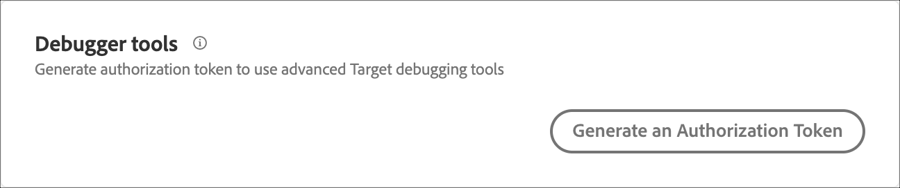
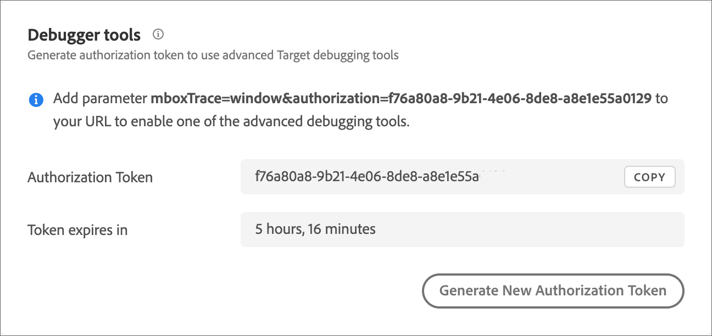

# Soluções de problemas da entrega de conteúdo {#content-trouble}

>[!BEGINSHADEBOX]

**Nesta página:** Saiba como depurar a entrega de conteúdo no [!DNL Adobe Target] quando a sua página não exibe o conteúdo esperado.

>[!ENDSHADEBOX]

Quando uma página não exibe o conteúdo esperado, a causa pode ser um erro no código da atividade, uma solicitação [!DNL Target] ausente ou no local errado ou um conflito com outra atividade. Verifique cuidadosamente o código da atividade ou campanha, pois um erro de digitação ou outro erro pode impedir a exibição do conteúdo esperado. Em seguida, use mboxTrace, mboxDebug ou o Adobe Experience Cloud Debugger para examinar a solicitação do [!DNL Target].

**mboxDebug** é particularmente útil quando você configura o [!DNL Target] na sua página, para garantir que a solicitação do [!DNL Target] seja disparada e que o cookie seja configurado. No entanto, não entra nos detalhes úteis ao depurar a entrega de conteúdo. Se a sua atividade não aparecer na sua página ou se aparecer conteúdo indesejado, use mboxTrace para examinar e depurar a página atentamente.

## Ferramentas de depuração {#debugging-tools}

### Recuperar o token de autorização {#section_BED130298E794D1FA229DB7C3358BA54}

A mboxTrace e a mboxDebug podem expor dados de campanha e dados de perfil a terceiros, portanto, um token de autorização é necessário. O token de autorização pode ser recuperado na interface de usuário do [!DNL Target]. O token é válido por seis horas.

Você deve ter uma das seguintes permissões de usuário para gerar um token de autenticação:

* Pelo menos a permissão **[!UICONTROL Editor]** (ou **[!UICONTROL Aprovador]**)

  Para obter mais informações para clientes do [!DNL Target Standard], consulte [Especificar funções e permissões](/help/main/administrating-target/c-user-management/c-user-management/user-management.md#roles-permissions) em *Usuários*. Para obter mais informações para clientes do [!DNL Target Premium], consulte [Configurar permissões corporativas](/help/main/administrating-target/c-user-management/property-channel/properties-overview.md).

* Função de administrador no nível de espaço de trabalho/perfil de produto

  Os espaços de trabalho estão disponíveis somente para clientes do [!DNL Target Premium]. Para obter mais informações, consulte [Configurar permissões corporativas](/help/main/administrating-target/c-user-management/property-channel/properties-overview.md).

* Direitos de administrador (permissão de Sysadmin) no nível do produto [!DNL Adobe Target]

Para recuperar o token de autorização:

1. Acessar **[!UICONTROL Administração]** > **[!UICONTROL Implementação]**.
1. Na seção Ferramentas de depuração, clique em **[!UICONTROL Gerar novo token de autenticação]**.

   

1. Adicione o token gerado como um parâmetro ao seu URL para habilitar uma das ferramentas de depuração avançadas.

   

### mboxTrace {#section_256FCF7C14BB435BA2C68049EF0BA99E}

A mboxTrace permite que você receba informações de rastreamento anexadas a respostas do [!DNL Target]. As informações de rastreamento refletem o resultado de uma chamada do [!DNL Target] (por exemplo, uma conversão ou uma impressão) e dados adicionais que podem ajudar a determinar por que esse resultado particular aconteceu, como um conjunto de ramificações disponíveis dentre as quais a seleção foi feita em uma campanha. Use essas informações para depurar a entrega de conteúdo.

Os seguintes parâmetros estão disponíveis:

| Opções de mboxTrace | Saída |
|--- |--- |
| `?mboxTrace=console` | Imprime no log do console como objetos.<br>Para a at.js, em vez de abrir uma nova janela no navegador ou configurar a saída para o console como na mbox.js (descontinuada), é preciso inspecionar a solicitação de rede e procurar em Visualização (Chrome) ou Resposta (Firefox). |
| `?mboxTrace=json` | Imprime no log do console como sequência de caracteres JSON literal |
| `?mboxTrace=window` | Imprime em uma janela pop-up como uma sequência de caracteres JSON |
| `?mboxTrace=disable` | Desativa o rastreamento do modo de sessão |

**Exemplo de chamada de mboxTrace**

`https://www.mysite.com/page.html?mboxTrace=window&authorization=f543abf-0111-4061-9619-d41d665c59a6`

A saída exibe informações detalhadas sobre o conteúdo. A mboxTrace mostra detalhes sobre sua campanha ou atividade e perfil. Ele também fornece um instantâneo do perfil antes da execução e um instantâneo do que foi alterado após a execução. Ela também mostra quais campanhas ou atividades foram avaliadas para cada local.

Algumas das informações incluem segmentos correspondentes ou não e IDs de direcionamento:

* **SegmentId**: as IDs dos segmentos, da biblioteca de segmentos reutilizáveis ou anônimas criadas para a campanha em particular.
* **TargetId**: as IDs dos direcionamentos, da biblioteca de expressões de destino ou de direcionamentos anônimos para qualquer segmento da campanha.
* **Unmatched**: a solicitação não estava qualificada nessa chamada para esses segmentos ou direcionamentos.
* **Matched**: a solicitação estava qualificada para os segmentos ou direcionamentos especificado.

**Uso da mboxTrace nas páginas de recomendações**: a adição da mboxTrace como um parâmetro de consulta em páginas com recomendações substitui o design do Recommendations na página por uma janela de detalhes da mboxTrace, que exibe informações detalhadas sobre suas recomendações, incluindo:

* Recomendações retornadas em relação às recomendações solicitadas
* A chave usada e se está gerando recomendações
* Recomendações geradas por critérios em relação a recomendações de backup
* Configurações de critérios
* Exclusões e inclusões aplicadas
* Regras de coleção

Não é necessário incluir `=console`, `=json` ou `=window` no parâmetro de consulta. Quando terminar com os detalhes do mboxTrace, adicione `=disable` e pressione **[!UICONTROL Enter]** para retornar ao modo normal de exibição.

mboxTrace não altera o funcionamento e a aparência normais do site. Os visitantes verão o design normal do Recomendações.

### mboxDebug {#mboxdebug}

Para usar mboxDebug, inclua um parâmetro mboxDebug no fim do seu URL. A tabela a seguir contém informações sobre parâmetros de URL relacionados à resposta do [!DNL Target].

Observe que alguns parâmetros mboxDebug estão disponíveis com ou sem autenticação.

| Parâmetros de URL | Propósito |
|--- |--- |
| `mboxDebug=1` | Depurador<br>A adição desse parâmetro a qualquer URL com solicitações do Target definidas abre uma janela pop-up com detalhes de depuração valiosos. Informações sobre cookies, PCid e valores de ID de sessão aparecem escritos e todos os URLs de são visíveis. Clique em um URL de solicitação do Target para mostrar a resposta à solicitação do [!DNL Target]. Mais detalhes estão disponíveis em [mbox_debug.pdf](/help/main/assets/mbox_debug.pdf). |
| `mboxDisable=1` | Desabilitar mboxes na página |
| `mboxOverride.browserIp=<Insert IP address>` | Testar geolocalização<br>Teste a geolocalização com este parâmetro de URL. Digite um endereço IP como valor para este atributo e o geolocalização [!DNL Target] avalia o endereço IP para compará-lo com qualquer geolocalização ou segmentação definida em uma campanha. |

>[!NOTE]
>
>Verifique se o fragmento do URL está após os parâmetros da sequência de consulta. Qualquer item depois do primeiro `#` é um identificador de fragmento e faz com que os parâmetros de depuração não funcionem corretamente.

### Adobe Experience Cloud Debugger {#section_A2798ED3A431409690A4BE08A1BFCF17}

O Adobe Experience Cloud Debugger ajuda você a entender a implementação do [!DNL Target]. Você pode exibir a configuração da biblioteca, verificar se os parâmetros personalizados foram passados corretamente, ativar o log do console e desativar todas as solicitações [!DNL Target]. Após a autenticação na Experience Cloud, é possível usar a mboxTrace para inspecionar as qualificações de atividade e público, bem como o perfil do visitante.

Para obter mais informações, consulte os [vídeos de treinamento](#training-videos) no final desta página e [Depurar a at.js usando o Adobe Experience Cloud Debugger](https://experienceleague.adobe.com/docs/target-dev/developer/client-side/at-js-implementation/functions-overview/target-debugging-atjs.html){target=_blank}.

## Problemas comuns {#common-problems}

+++ Os melhores vendedores não aparecem no Recomendações

A chamada *`SiteCatalyst: purchase`* não pode ser usada para dados de tráfego de algoritmo de compra. Em vez disso, use a chamada *`orderConfirmPage`*.

+++

</br>

+++ As atividades baseadas em formulários colidem com as atividades do Target Classic

As atividades com base em formulários criadas com o [!DNL Target Standard/Premium] podem entrar em conflito com atividades criadas na interface do [!DNL Target Classic] que têm a mesma prioridade e usam a mesma solicitação do [!DNL Target]. Para obter mais informações, consulte [Prioridade de atividade](/help/main/c-activities/priority.md).

+++

</br>

+++ O cookie [!DNL Target] não é definido

Se o seu site tiver um subdomínio, como [!DNL us.domain.com], mas você precisar que o cookie [!DNL Target] seja definido em [!DNL domain.com] (em vez de [!DNL us.domain.com]), você deve substituir a configuração `cookieDomain`. Para obter mais informações, consulte [targetGlobalSettings()](https://experienceleague.adobe.com/docs/target-dev/developer/client-side/at-js-implementation/functions-overview/targetglobalsettings.html?lang=pt-BR){target=_blank}.

+++

</br>

+++ O conteúdo cintila ou não é exibido quando um elemento também faz parte da personalização do Adobe Experience Manager

Se um elemento DOM fizer parte do direcionamento de personalização do Adobe Experience Manager (AEM) e de uma atividade [!DNL Target], o conteúdo [!DNL Target] poderá cintilar ou não ser exibido.

Para corrigir essa situação, você pode desabilitar a personalização do AEM nas páginas em que o [!DNL Target] está sendo executado.

+++

</br>

+++ Falha no fornecimento de ofertas remotas e de redirecionamento devido a um URL inválido

Se a oferta remota ou de redirecionamento usar um URL inválido, poderá ocorrer uma falha no fornecimento.

* Para ofertas de redirecionamento, a resposta do [!DNL Target] pode conter `/* invalid redirect offer URL */`.
* Para ofertas remotas, a resposta do [!DNL Target] pode conter `/* invalid remote offer URL */`.

Você pode verificar a resposta do [!DNL Target] no navegador ou usando a mboxTrace. Consulte [https://tools.ietf.org/html/std66](https://tools.ietf.org/html/std66) para obter mais informações sobre URLs válidos.

+++

</br>

+++ [!DNL Target] solicitações não estão sendo disparadas em meu site

A at.js não dispara solicitações [!DNL Target] se você estiver usando um tipo de documento inválido. A at.js exige o doctype HTML 5.

+++

## Atividades com parâmetros de sequência de consulta no URL {#query-strings}

A **[!UICONTROL URL da atividade]** determina a página que qualifica os visitantes para a atividade e renderiza as experiências da atividade para os usuários. Quando solicitado durante a criação da atividade, digitar o URL completo nem sempre garante que o conteúdo será entregue na página do site, especialmente com URLs que contenham parâmetros de sequência de consulta.

Por padrão, o [!UICONTROL Visual Experience Composer] (VEC) abre a página especificada nas suas [configurações do Visual Experience Composer](/help/main/administrating-target/visual-experience-composer-set-up.md). Você também pode especificar uma página diferente durante a criação da atividade.

Para exibir uma página diferente após a abertura do VEC, clique no **[!UICONTROL ícone de Configuração]** > selecione **[!UICONTROL Entrega de página]** > e especifique a URL desejada no campo **[!UICONTROL URL da atividade]**.


Quando o URL contém parâmetros de sequência de consulta, a página pode não se qualificar para a atividade ou exibir o conteúdo personalizado. Independentemente do público-alvo, você pode incluir regras de modelo, além do URL básico para definir os parâmetros de consulta.

As seguintes opções podem ser usadas para incluir regras de modelo adicionais:

* **Opção 1:** Replicar a URL e mantê-la na regra de modelo com a opção &quot;contém&quot;

  +++ Exibir a configuração de regra de modelo

  Essa opção garante que esse URL se qualifica para a atividade. Mas saiba que há casos de exceção anexados a ela que podem influenciar seus dados de relatório com registros adicionais para URLs que contêm o URL de base.

  Nesse cenário, o URL é `https://shopping.mycart.com?type=Summers%20Offers` e regras de modelo adicionais “contêm” o mesmo URL, separado por um operador OU:

  

  +++

* **Opção 2:** Restringir a condição &quot;contém&quot; da URL somente com a cadeia de caracteres de consulta

  +++ Exibir a configuração de regra de modelo

  O caso de exceção discutido na opção anterior é aplicado nesta opção, mas aqui a configuração condicional é limitada somente à sequência de consulta.

  Nesse cenário, o URL é `https://shopping.mycart.com?type=Summers%20Offers` e as regras de modelo adicionais “contêm” somente a sequência de consulta, separadas por um operador OU:

  

  +++

* **Opção 3:** Em vez de direcionar a URL completa, aproveite uma parte específica da URL

  +++ Exibir a configuração de regra de modelo

  Neste cenário, a URL é `https://shopping.mycart.com?type=Summers%20Offers` e regras de modelo adicionais especificam uma **[!UICONTROL Consulta]** com **[!UICONTROL tipo]** > **[!UICONTROL é (diferencia maiúsculas de minúsculas)]** > tipo=Verões%20Ofertas, separadas por um operador OU:

  

  +++

## Evitar aspas duplas nos valores de atributo do perfil {#escape}

Ao enviar valores contendo aspas duplas em um atributo de perfil [!DNL Target], você deve usar o recurso de escape duplo como mostrado abaixo.

```
adobe.target.trackEvent({
    "mbox": "data-collection",
    "params":    {
        "profile.tagLine": "Escape \\\"Double Quotes\\\" like this."
    }
});
```

## Vídeos de treinamento {#training-videos}

Os vídeos a seguir contêm mais informações sobre os conceitos discutidos neste artigo.

### Adicione a Extensão 

>[!VIDEO](https://video.tv.adobe.com/v/33296?captions=por_br)

### Depuração básica do Adobe Target 

>[!VIDEO](https://video.tv.adobe.com/v/33298?captions=por_br)

### Mbox Trace 

>[!VIDEO](https://video.tv.adobe.com/v/33345?captions=por_br)
