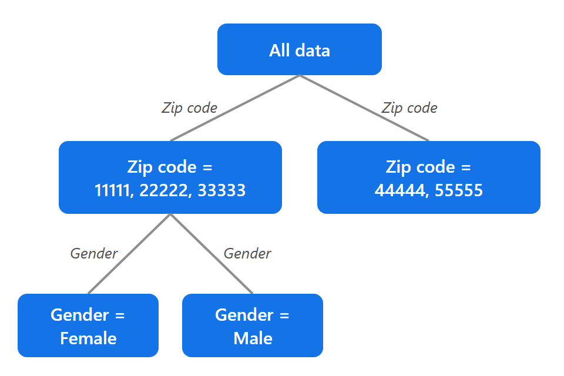

# Algoritmo Random Forest {#random-forest-algorithm}

>[!BEGINSHADEBOX]

**Nesta página:** Saiba como o [!DNL Target] usa o algoritmo Random Forest para criar os modelos de personalização das atividades do **[!UICONTROL Automated Personalization]** e do **[!UICONTROL Direcionamento automático]**.

>[!ENDSHADEBOX]

O principal algoritmo de personalização usado nas atividades do **[!UICONTROL Automated Personalization]** (AP) e do **[!UICONTROL Direcionamento automático]** é o Random Forest. É um método de classificação ou regressão que opera construindo uma variedade de árvores de decisão quando está sendo treinado.

Random Forest é um método de conjunto. Quando você pensa em estatísticas, um único modelo de regressão usado para prever um resultado pode vir à mente. As últimas pesquisas da ciência de dados sugerem que &quot;métodos de conjunto&quot;, onde vários modelos são criados a partir do mesmo conjunto de dados e depois combinados de forma inteligente, produzem melhores resultados do que a previsão baseada em um único modelo ou do que poderia ser obtido a partir de qualquer um dos algoritmos de aprendizagem constituintes.

## O que é uma árvore de decisão? {#section_7F5865D8064447F4856FED426243FDAC}

Uma árvore de decisão divide em grupos todos os dados de visita com os quais um sistema pode aprender. As visitas em cada grupo são o mais semelhantes possível entre si no que diz respeito à métrica de objetivo (por exemplo, taxa de conversão), e as visitas entre grupos são o mais diferentes possível. Para fazer isso, a árvore observa as variáveis no conjunto de treinamento e divide os dados em uma forma Mutuamente Exclusiva Coletivamente Exaustiva (MECE) em grupos (ou &quot;folhas&quot;) que maximizam essa meta.

No exemplo simples a seguir, a métrica de meta é a conversão e há duas variáveis de entrada:

* Gênero (com dois valores possíveis, Masculino ou Feminino)
* Código postal (com cinco valores potenciais no conjunto de dados pequeno: 11111, 22222, 3333, 44444 ou 55555)

### Primeira divisão {#first-split}

A árvore determina primeiro qual das duas variáveis explica a maior variação na taxa de conversão dos dados de visita. Suponha que o código postal seja mais preditivo. Essa variável forma a primeira &quot;ramificação&quot; da árvore. A árvore divide os dados de visita em grupos, conforme descrito acima. Suponha que 11111, 2222 e 33333 sejam uma divisão e 44444 e 55555 sejam uma segunda divisão.

{width="440" align="center"}

### Dividir em cada ramificação {#second-split}

A árvore coloca a questão: &quot;Qual é a variável mais preditiva?&quot; novamente, e conclui um exercício semelhante para dividir os dados *em cada ramificação*. Apenas o gênero permanece, então essa é a resposta aqui. No ramo de 11111, 2222 e 33333, assume-se que há uma diferença na conversão entre homens e mulheres. Há então duas folhas (homens e mulheres), e este ramo está completo. No ramo 44444 e 55555, suponha que não haja diferença estatística entre a forma como mulheres e homens se convertem. Nesse caso, a primeira divisão é a divisão final.

{width="480" align="center"}

## Como as árvores de decisão são usadas pelo Random Forest? {#section_536C105EF9F540C096D60450CAC6F627}

As árvores de decisão são uma ferramenta estatística útil. No entanto, elas têm algumas desvantagens. Mais importante ainda, eles podem &quot;ajustar em excesso&quot; os dados, de modo que uma árvore individual preveja mal os dados futuros que não foram usados para criar a árvore inicial. Este desafio é conhecido como [compensação de viés-variância](https://en.wikipedia.org/wiki/Bias%E2%80%93variance_tradeoff) na aprendizagem estatística.

Florestas aleatórias ajudam a superar esse desafio. Uma floresta aleatória é uma coleção de centenas de árvores decisórias que são construídas de forma um pouco diferente no mesmo conjunto de dados e que &quot;votam&quot; juntas para produzir um modelo melhor do que uma árvore individual. As árvores são construídas selecionando aleatoriamente um subconjunto de registros de visita com substituição (conhecido como ensacamento) e selecionando aleatoriamente um subconjunto dos atributos, de modo que a floresta consiste em árvores de decisão ligeiramente diferentes. Esse método introduz pequenas variações nas árvores. Adicionar essa quantidade controlada de variação ajuda a melhorar a precisão preditiva do algoritmo.

## Como os algoritmos de personalização do [!DNL Target] usam o Random Forest? {#section_32FB53CAD8DF40FB9C0F1217FBDBB691}

### Como os modelos são criados

O [!DNL Target] usa dados coletados automaticamente e dados personalizados fornecidos por você para criar seus algoritmos de personalização. O diagrama a seguir resume como os modelos são criados para as atividades de **[!UICONTROL Direcionamento automático]** e **[!UICONTROL Automated Personalization]**:

{width="850" zoomable="yes"}

1. [!DNL Target] coleta dados sobre visitantes enquanto disponibiliza experiências ou ofertas aleatoriamente.
1. Depois que [!DNL Target] atingir uma massa crítica de dados, [!DNL Target] executa a engenharia de recursos.
1. [!DNL Target] cria modelos de Random Forest para cada experiência ou oferta.
1. [!DNL Target] valida o modelo verificando se ele atende a uma pontuação de qualidade limite.
1. [!DNL Target] envia o modelo para produção para personalizar o tráfego futuro.

Esses modelos preveem a melhor experiência ou oferta para mostrar aos visitantes. Geralmente, um modelo é criado por experiência (em uma atividade **[!UICONTROL Direcionamento automático]**) ou por oferta (em uma atividade **[!UICONTROL Automated Personalization]**). [!DNL Target] então exibe a experiência ou oferta que produz a maior métrica de sucesso prevista (por exemplo, taxa de conversão). Os modelos devem ser treinados em visitas disponibilizadas aleatoriamente antes de serem usados para previsão. Como resultado, mesmo os visitantes que estão no grupo personalizado recebem aleatoriamente diferentes experiências ou ofertas quando uma atividade é iniciada pela primeira vez, até que os algoritmos de personalização estejam prontos.

Os modelos são validados com base em sua Área sob a curva (AUC), para garantir que cada modelo seja bom para prever o comportamento dos visitantes antes de ser usado na atividade. O momento exato em que um modelo começa a veicular experiências personalizadas depende dos detalhes dos dados, pois o modelo deve ser validado primeiro. Na prática, e para fins de planejamento de tráfego, geralmente é necessário mais do que o número mínimo de conversões antes que cada modelo seja válido.

Quando um modelo se torna válido para uma experiência ou oferta, o ícone do relógio à esquerda do nome da experiência ou oferta muda para uma caixa de seleção verde. Quando há modelos válidos para pelo menos duas experiências ou ofertas, algumas visitas começam a se tornar personalizadas.

### Transformação de recursos

Antes de os dados passarem pelo algoritmo de personalização, eles passam por uma transformação de recurso, que pode ser considerada como a preparação dos dados coletados nos registros de treinamento para uso pelos modelos de personalização. A transformação depende do tipo de atributo (ou &quot;recurso&quot;, como os cientistas de dados às vezes o descrevem):

| Tipo de recurso | Descrição | Transformação |
|---|---|---|
| **Categórico** | Não pode ser contado, mas pode ser classificado em grupos diferentes, como país, gênero ou código postal. | Um conjunto de todos os recursos possíveis é mantido e a transformação de probabilidade é usada para reduzir o tamanho dos dados. |
| **Numérico** | Podem ser medidas ou contadas, como idade ou renda. | O redimensionamento garante que os recursos sejam comparáveis em todos os segmentos. |

### Equilíbrio entre aprendizagem e personalização com o multi-armed bandit.

Depois que [!DNL Target] criar os modelos de personalização, você enfrentará uma compensação para futuros visitantes da sua atividade. Você pode personalizar todo o tráfego com base no modelo atual ou continuar a aprender com novos visitantes apresentando ofertas aleatórias a eles. O algoritmo de personalização deve sempre conhecer as novas tendências em seus visitantes, enquanto personaliza a maior parte do tráfego. O bandit multi-armado é como o [!DNL Target] atende a essa meta: ele garante que o modelo sempre &quot;gasta&quot; uma pequena fração de tráfego para continuar a aprender ao longo da vida da atividade e para evitar a exploração excessiva de tendências aprendidas anteriormente.

No mundo da ciência de dados, o problema do bandido multi-armado é um exemplo clássico do dilema exploração versus exploração, no qual é dada uma coleção de bandidos armados, cada um com uma probabilidade de recompensa desconhecida. A ideia principal é desenvolver uma estratégia que resulte no braço com a maior probabilidade de sucesso sendo jogado, de modo que a recompensa total obtida seja maximizada. O multi-armed bandit é usado no sistema para pontuação online após a construção dos modelos online. Esse processo ajuda no aprendizado online durante a exploração. O algoritmo multi-armed atual é um algoritmo epsilon (ε) greedy. Neste algoritmo, com probabilidade 1 - ε, o melhor braço é escolhido. Com probabilidade ε, qualquer outro braço é escolhido aleatoriamente.
