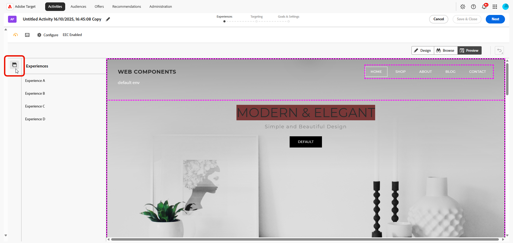

# Visualizar experiências em atividades do [!UICONTROL Automated Personalization] no [!UICONTROL Visual Experience Composer] (VEC) {#preview-ap-experiences}

>[!BEGINSHADEBOX]

**Nesta página:** Saiba como visualizar cada experiência de uma atividade do **[!UICONTROL Automated Personalization]** no **[!UICONTROL Visual Experience Composer]** e como excluir ou incluir experiências.

>[!ENDSHADEBOX]

As atividades de [!DNL Adobe Target] **[!UICONTROL Automated Personalization]** (AP) comparam várias ofertas em uma página, portanto, é útil visualizar a página com cada experiência. A visualização mostra como as ofertas se combinam em cada experiência, para que você possa decidir se deseja mantê-la ou excluí-la.

1. No **[!UICONTROL Visual Experience Composer]** (VEC), clique em **[!UICONTROL Visualizar]**.

   

1. Clique no ícone **[!UICONTROL Mostrar Experiências]** () para exibir a lista de todas as experiências no quadro esquerdo.

   

1. Clique em uma experiência específica na lista para exibi-la.

1. (Opcional) Para excluir ou incluir experiências, clique no ícone **[!UICONTROL Gerenciar Conteúdo]** () para exibir a caixa de diálogo **[!UICONTROL Gerenciar Conteúdo]**.

   

1. É possível excluir uma experiência que mostra variações conflitantes ou que não esteja esteticamente equilibrada. Em seguida, siga um destes procedimentos:

   * Para excluir uma experiência, clique no ícone **[!UICONTROL Mais Ações]** () ao lado da experiência e clique em **[!UICONTROL Excluir]**.
   * Para excluir várias experiências, marque as caixas de seleção das experiências e clique em **[!UICONTROL Excluir]**.
   * Para incluir várias experiências que foram excluídas, marque as caixas de seleção das experiências e clique em **[!UICONTROL Incluir]**.
