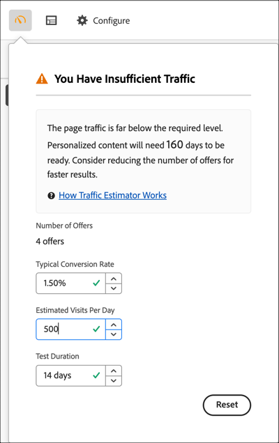

# Estimativa de tráfego exigido para o sucesso {#traffic-estimator}

>[!BEGINSHADEBOX]

**Nesta página:** Saiba como usar o **[!UICONTROL Avaliador de Tráfego]** para verificar se a atividade do **[!UICONTROL Automated Personalization]** tem tráfego suficiente para ser bem-sucedida.

>[!ENDSHADEBOX]

O [!DNL Adobe Target] **[!UICONTROL Avaliador de Tráfego]** fornece feedback que permite saber se você tem tráfego suficiente para que sua atividade do **[!UICONTROL Automated Personalization]** (AP) tenha êxito. As atividades de AP usam várias combinações de ofertas, portanto, é importante saber quanto tráfego é necessário para fornecer resultados significativos. O **[!UICONTROL Avaliador de tráfego]** usa estatísticas sobre sua página e o número de experiências que estão sendo testadas para estimar a quantidade de tráfego e a duração do teste necessárias para tornar a atividade bem-sucedida.

O **[!UICONTROL Avaliador de Tráfego]** determina se há tráfego suficiente para gerar modelos personalizados, comparando as impressões de página estimadas e o índice de conversão típico das páginas. Idealmente, para uma atividade bem-sucedida, o tamanho de amostra correto garante que o conteúdo personalizado esteja pronto em 50% da duração da atividade ou 14 dias, o que for menor. Esse processo permite tempo suficiente para obter conteúdo personalizado e saber qual conteúdo fornecer.

[!DNL Target] fornece experiências aleatoriamente até que os algoritmos de personalização sejam compilados. O ícone de marca de seleção ao lado de cada oferta mostra quando o modelo dessa oferta está pronto e o [!DNL Target] pode começar a fornecer conteúdo personalizado. O aumento é esperado somente depois que os modelos estiverem prontos, portanto, a indicação visual permite que você defina a expectativa correta. Use o **[!UICONTROL Avaliador de Tráfego]** no **[!UICONTROL Visual Experience Composer]** (VEC) para obter uma diretriz de quando os modelos estarão prontos.

>[!NOTE]
>
>Um modelo personalizado nem sempre é implantado, mesmo quando seu tráfego é suficiente. [!DNL Target] compila e testa o modelo, mas implanta o modelo somente se tiver melhor desempenho do que uma seleção aleatória de experiências. Se o modelo não for melhor que aleatório, as ofertas provavelmente não serão diferentes o suficiente entre si. Nesse caso, torne as ofertas visualmente diferentes se a mensagem for semelhante ou altere a própria mensagem.

## Usar o Avaliador de tráfego {#use-traffic-estimator}

Enquanto você cria uma atividade do **[!UICONTROL Automated Personalization]**, o **[!UICONTROL Avaliador de Tráfego]** permite que você verifique se o tráfego para a sua página é suficiente para que os modelos personalizados estejam prontos a tempo. Executar essa verificação antes de iniciar a atividade ajuda a evitar um teste que não pode alcançar visitantes suficientes para fornecer conteúdo personalizado e mostra como ajustar o número de combinações de ofertas ou a duração da atividade se o tráfego não for suficiente.

1. Na atividade do **[!UICONTROL Automated Personalization]**, acesse a página **[!UICONTROL Experiências]** do **[!UICONTROL Visual Experience Composer].

1. Clique no ícone **[!UICONTROL Tráfego]** ().

   O **[!UICONTROL Avaliador de Tráfego]** se abre. Para sair da janela, clique no ícone novamente.

   

1. Especifique o índice de conversão típico (ou o índice de conversão que você espera dessa atividade), as impressões de atividade estimadas por dia e a duração do teste.

   O **[!UICONTROL Avaliador de tráfego]** usa essas métricas para determinar quais ajustes são necessários para executar um teste bem-sucedido.

   | Métrica | Descrição |
   | --- | --- |
   | **[!UICONTROL Número de Ofertas]** | Essa métrica é calculada automaticamente com base no número de experiências que estão sendo criadas como parte da atividade, após as exclusões. |
   | **[!UICONTROL Taxa de conversão típica]** | Essa métrica é expressa como uma porcentagem, com base na estimativa ou dados anteriores do sistema de análise. |
   | **[!UICONTROL Visitas Estimadas Por Dia]** | Essa métrica é o número de visitas por dia dos visitantes que podem visualizar a atividade com base nos critérios de direcionamento. Essa métrica pode se basear nos dados de análise. Esse número deve ser de visitas, não de visitantes únicos. |
   | **[!UICONTROL Duração do teste]** | A quantidade de dias de duração da execução da atividade. |

1. Revise os resultados. A estimativa muda, à medida que você muda os números.

   Por exemplo, se você estiver testando muitas combinações e sua taxa de conversão e impressões estiverem muito baixas, o **[!UICONTROL Avaliador de tráfego]** mostra por quanto tempo o teste deve ser executado para ser bem-sucedido. Ou, se o tráfego for baixo, o **[!UICONTROL Avaliador de tráfego]** pode sugerir um número menor de combinações de ofertas para que você possa executar o teste pelo número desejado de dias.

   

1. Se você não tiver tráfego suficiente, considere as seguintes opções:

   * Use uma atividade de [**[!UICONTROL Direcionamento automático]**](/help/main/c-activities/auto-target/auto-target-to-optimize.md) em vez do **[!UICONTROL Automated Personalization]** para criar experiências com várias alterações de oferta em uma variação de experiência.
   * Reduza o número de combinações de ofertas na atividade do **[!UICONTROL Automated Personalization]**.
   * Aumente a duração da atividade.

1. Ajuste os números até que o **[!UICONTROL Avaliador de tráfego]** indique que você tem tráfego suficiente e, em seguida, crie seu teste adequadamente.

   Se o tráfego for suficiente, o ícone **[!UICONTROL Tráfego]** mostrará uma marca de seleção verde. Se não for suficiente, o ícone mostrará um rótulo de aviso vermelho.

   
