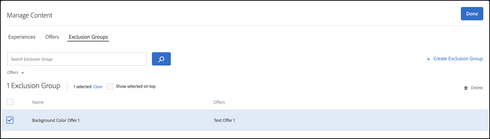

# Criar uma atividade do [!UICONTROL Automated Personalization] {#create-ap-activity}

>[!BEGINSHADEBOX]

**Nesta página:** Saiba como criar uma atividade do **[!UICONTROL Automated Personalization]** (AP) no **[!UICONTROL Visual Experience Composer]** (VEC). Você cria suas experiências, define o direcionamento e um grupo de controle, depois define metas e configurações.

>[!ENDSHADEBOX]

O fluxo de trabalho da atividade **[!UICONTROL Automated Personalization]** em [!DNL Target] varia do fluxo de trabalho dos outros tipos de atividade. Ele segue o fluxo de trabalho guiado de três etapas no **[!UICONTROL Visual Experience Composer]**:

1. [Criar experiências](#build-experiences)
1. [Definir direcionamento](#set-targeting)
1. [Definir metas e configurações](#configure-goals-and-settings)

## Antes de começar {#before-you-begin}

Para um desempenho ideal, mantenha suas atividades do **[!UICONTROL Automated Personalization]** e do **[!UICONTROL Direcionamento automático]** dentro destes limites:

* De 4 a 6 locais, com 4 a 6 ofertas por local.
* Menos de 5.000 experiências totais para obter melhores resultados. O limite rígido é de 30.000, e o mesmo limite se aplica quando a opção **[!UICONTROL Não Permitir Duplicatas]** está habilitada.

O número total de experiências cresce com a combinação cartesiana de locais e ofertas. Configurações maiores podem resultar em carregamento ou edição lento no **[!UICONTROL Visual Experience Composer]**.

## Etapa 1: criar experiências {#build-experiences}

Defina o pool de variações de conteúdo que o **[!UICONTROL Automated Personalization]** pode personalizar. Quanto mais ricas e distintas forem suas experiências e ofertas, melhor o algoritmo poderá corresponder ao conteúdo correto para cada visitante.

### Criar a atividade {#create-activity}

Inicie a atividade e abra a página que deseja personalizar no **[!UICONTROL Visual Experience Composer]** (VEC).

1. Na lista [!DNL Target] **[!UICONTROL Atividades]**, clique em **[!UICONTROL Criar Atividade]** > **[!UICONTROL Automated Personalization]**.

   

1. Escolha seu Experience Composer:

   * Para usar o **[!UICONTROL Visual Experience Composer]** (VEC), clique em **[!UICONTROL Visual]**.

   * Para usar o **[!UICONTROL Experience Composer baseado em formulário]**, selecione **[!UICONTROL Formulário]**. Consulte [Experience Composer baseado em formulário](/help/main/c-experiences/form-experience-composer.md) para obter mais informações.

     >[!NOTE]
     >
     >Além do VEC e do **[!UICONTROL Experience Composer baseado em formulário]**, o [!DNL Target] oferece o **[!UICONTROL VEC para aplicativos de página única]**. Para obter mais informações sobre os vários composers, consulte [Experiências e ofertas](/help/main/c-experiences/experiences.md). Para obter informações sobre a solução de problemas do VEC, consulte [Solução de problemas do Visual Experience Composer](/help/main/c-experiences/c-visual-experience-composer/r-troubleshoot-composer/troubleshoot-composer.md).

     

1. (Condicional) [Escolha um espaço de trabalho](/help/main/administrating-target/c-user-management/property-channel/property-channel.md).

1. Na caixa **[!UICONTROL Inserir URL da atividade]**, especifique sua [URL da atividade](/help/main/c-activities/t-test-ab/t-test-create-ab/ab-activity-url.md). Se sua conta foi [configurada com um URL padrão](/help/main/administrating-target/visual-experience-composer-set-up.md), esse URL aparece por padrão. Você pode alterar o URL padrão para outro, se necessário.

   Observe que [!DNL Target] não diferencia os protocolos de URL ([!DNL https] e [!DNL http]). Como resultado, [!DNL `http://www.adobe.com/br`] e [!DNL `https://www.adobe.com/br`] são correspondentes.

1. Em seguida, clique em **[!UICONTROL Criar]**. A página com o URL especificado é aberta no VEC.

1. Para nomear a atividade, clique no ícone **[!UICONTROL Editar]** (  ) e especifique um nome descritivo para a atividade e clique em **[!UICONTROL Salvar]**.

   {{activity-name-rules}}

   

### Projetar o conteúdo {#design-content}

Configure o conteúdo que o algoritmo pode combinar e exclua as experiências que você não deseja.

1. Modifique os elementos da página conforme explicado em [opções do Visual Experience Composer](/help/main/c-experiences/c-visual-experience-composer/viztarget-options.md).

   * Para visualizar várias imagens rapidamente, selecione várias imagens de uma só vez no gerenciador de ativos. Em seguida, você pode visualizar a página com cada uma das imagens configuradas para a atividade.
   * Para alterar o texto em suas ofertas, edite o elemento de texto diretamente na página.

   Ao editar um elemento, barras são exibidas nesse elemento para indicar que você o alterou.

1. Clique no ícone **[!UICONTROL Gerenciar Conteúdo]** (  ) para configurar as combinações disponíveis.

   A caixa de diálogo **[!UICONTROL Gerenciar Conteúdo]** é aberta com duas guias: **[!UICONTROL Experiências]** e **[!UICONTROL Ofertas]**.

   

1. Na guia **[!UICONTROL Experiências]**, revise a lista de conteúdos e o local a que cada um está atribuído.

1. (Opcional) Para excluir experiências da atividade, marque a caixa de seleção de cada experiência que deseja excluir e clique no ícone **[!UICONTROL Excluir]**.

   Para obter mais opções, consulte [Gerenciando exclusões](/help/main/c-activities/t-automated-personalization/managing-exclusions.md).

   

1. (Condicional) Clique na guia **[!UICONTROL Ofertas]** para gerenciar as ofertas na atividade.

   * Para organizar as ofertas para relatórios, selecione partes de conteúdo e as atribua a grupos de relatórios. Para obter mais informações, consulte [Oferecer grupos de relatórios no Automated Personalization](/help/main/c-activities/t-automated-personalization/offer-reporting-groups-in-automated-personalization.md).
   * Para limitar quem vê uma oferta, use o direcionamento para permitir que apenas alguns visitantes vejam essa oferta.

<!--
1. (Conditional) Click **[!UICONTROL Exclusion Groups]** to choose any combination of elements that you want to exclude from the activity.

   

   Although you can create up to 30,000 experiences in an AP test, the algorithm performs its best when fewer than 10,000 distinct experiences are used. This same limit is applied even when the activity has enabled the **[!UICONTROL Disallow Duplicates]** option.

   If you do not currently have any exclusion groups included in your activity, click **Create Exclusion Group**. You can filter to create a list that shows only the combinations you want to exclude. Name your exclusion group, then click **Save**.

   To edit an existing exclusion group, hover over the group you want to edit, then click the pencil icon.
-->

1. Clique em **[!UICONTROL Concluído]** quando terminar de configurar o conteúdo de sua atividade.

## Etapa 2: definir o direcionamento {#set-targeting}

Decida quais visitantes entram na atividade e quanto do seu tráfego é exposto. Emparelhe-os com um grupo de controle para que [!DNL Target] possa medir o aumento que a personalização oferece.

1. Clique em **[!UICONTROL Direcionamento]** na parte superior do **[!UICONTROL Visual Experience Composer]** para ir até a próxima etapa do fluxo de trabalho guiado de três etapas.

   

1. (Condicional) Clique no controle **[!UICONTROL Todos os visitantes]** para [selecionar outro público-alvo](/help/main/c-activities/t-test-ab/t-test-create-ab/ab-audience.md) para a atividade e definir sua porcentagem de visitantes.

   O público-alvo **[!UICONTROL Todos os visitantes]** está definido como padrão. Se você selecionar outro público-alvo, o nome dele será exibido no controle mais à esquerda. Por exemplo, você pode limitar as entradas a 50% de todos os visitantes ou 45% do público-alvo na Califórnia.

1. Clique no controle **[!UICONTROL Alocação de tráfego]** e escolha uma das seguintes opções:

   

   +++Opções de Meta de alocação de tráfego

   | Opções | Quando usar |
   |--- |--- |
   | **[!UICONTROL Avaliar Algoritmo Personalization (50/50)]** | Seu objetivo é testar o algoritmo. Os visitantes são divididos 50/50 entre o controle e o algoritmo de destino. Essa divisão fornece a estimativa mais precisa do aumento e é a maneira mais rápida e precisa de testar se o algoritmo tem melhor desempenho do que nenhuma personalização (por exemplo, um controle disponibilizado aleatoriamente). Recomenda-se usar com &quot;experiências aleatórias&quot; como controle. |
   | **[!UICONTROL Maximizando o Tráfego do Personalization (90/10)]** | Seu objetivo é criar uma atividade &quot;sempre ativa&quot;. 10% dos visitantes vão para o controle, o que garante que haja dados suficientes para que os algoritmos continuem aprendendo ao longo do tempo. Essa é a maneira mais rápida e precisa de maximizar a quantidade de tráfego que é personalizada quando você está menos preocupado com o aumento exato. A compensação é que você tem menos precisão em qual é o aumento exato. Independentemente da meta, essa opção é a divisão de tráfego recomendada ao usar uma experiência específica como controle. |
   | **[!UICONTROL Alocação personalizada]** | Você deseja dividir a porcentagem manualmente. |

   +++

1. (Condicional) Na lista suspensa **[!UICONTROL Controle]**, [selecione uma experiência específica a ser usada como controle](/help/main/c-activities/t-automated-personalization/experience-as-control.md) ou selecione **[!UICONTROL Experiência Aleatória]**.

   A experiência de controle fornece uma comparação para determinar a quantidade de elevação proporcionada pelo teste automatizado. O **[!UICONTROL Automated Personalization]** sempre mede o desempenho em relação a um grupo de controle. A prática recomendada é colocar, pelo menos, 10% dos participantes no grupo de controle.

   >[!NOTE]
   >
   >Em atividades do **[!UICONTROL Automated Personalization]**, os critérios de entrada (direcionamento por URL, regras de modelo e público-alvo) são avaliados para cada solicitação. Nas versões anteriores, os critérios de entrada eram avaliados uma vez por sessão.

## Etapa 3: definir metas e configurações {#configure-goals-and-settings}

Conte a [!DNL Target] como é o sucesso. A meta de otimização escolhida é a métrica para a qual o algoritmo de personalização é treinado, portanto, escolha o resultado mais importante para essa atividade.

1. Clique em **[!UICONTROL Avançar]** para exibir a página **[!UICONTROL Metas e Configurações]**.

1. Configure a atividade com as seguintes configurações e clique em **[!UICONTROL Salvar e fechar]**.

   | Configuração | Descrição |
   |--- |--- |
   | **[!UICONTROL Nome]** | Nomeie a atividade. Nomeie a atividade de forma descritiva o suficiente para que os membros da equipe possam reconhecê-la na lista **[!UICONTROL Atividades]**. Siga as regras de nome de atividade descritas em [Etapa 1: criar experiências](#build-experiences). |
   | **[!UICONTROL Objetivo]** | (Opcional) Digite o objetivo do teste. O objetivo ajuda a lembrar o propósito da atividade. |
   | **[!UICONTROL Prioridade]** | Decide qual atividade é exibida quando várias atividades compartilham um local e um público-alvo. Consulte [Definir a prioridade](#set-priority). |
   | **[!UICONTROL Duração]** | Defina as datas de início e fim da atividade. Você pode selecionar **[!UICONTROL Quando ativado]** ou especificar uma data e hora específicas. |
   | **[!UICONTROL Meta de otimização]** | A métrica em que o algoritmo de personalização é treinado. Consulte [Definir a meta de otimização](#set-optimization-goal). |
   | **[!UICONTROL Métrica de conversão]** | Por padrão, a métrica de conversão é igual à métrica de meta de otimização. No entanto, é possível definir uma métrica de conversão separada ao desmarcar a opção **[!UICONTROL Igual à meta de otimização]**. |
   | **[!UICONTROL Métricas adicionais]** | Adicione outras métricas de relatório que deseja usar. É possível adicionar métricas de conversão ou receita.
**Observação**: a métrica **[!UICONTROL Envolvimento]** não é suportada como uma métrica adicional. A interface do usuário do [!DNL Target] pode permitir a seleção da métrica **[!UICONTROL Envolvimento]**, mas os dados não são exibidos com precisão nos relatórios. |
   | **[!UICONTROL Públicos-alvo para relatórios]** | Adicione públicos-alvo para permitir a filtragem por público-alvo nos relatórios. Por padrão, o relatório mostra os resultados para todos os visitantes qualificados. Adicione públicos para filtrar os resultados de subconjuntos de visitantes mais específicos.
**Observação**: diferentemente de outros tipos de atividades, o **[!UICONTROL Automated Personalization]** não pode usar o **[!UICONTROL Adobe Analytics]** como sua fonte de relatórios (A4T). |
   | **[!UICONTROL Notas]** | Digite quaisquer informações sobre sua atividade que sejam úteis para você ou para outros membros da equipe. O painel **[!UICONTROL Notas]** é redimensionável. |

   Ao nomear ou renomear uma métrica, os seguintes caracteres não são permitidos: `/`, `?`, `#`, `:`, `=`, `+`, `-` e `@`.

### Definir a prioridade {#set-priority}

A prioridade é usada se várias atividades forem atribuídas para o mesmo local com o mesmo público-alvo. Se duas ou mais atividades forem atribuídas ao local, a atividade com a maior prioridade é exibida.

Dependendo das configurações, a interface do usuário do [!DNL Target] e as opções de **[!UICONTROL Prioridade]** variam:

* **Prioridades herdadas (padrão):** Se as prioridades otimizadas não estiverem habilitadas, especifique uma prioridade **[!UICONTROL Baixa]**, **[!UICONTROL Medium]** ou **[!UICONTROL Alta]**.
* **Prioridades otimizadas:** Especifique um valor de 0 a 999, onde 0 = Baixo e 999 = Alto. Para habilitar esta opção, clique em **[!UICONTROL Administração]** > **[!UICONTROL Relatórios]** e alterne a opção **[!UICONTROL Habilitar Prioridades Otimizadas]** para a posição &quot;Ativado&quot;.

Para atividades criadas em versões anteriores do [!DNL Target Standard/Premium], a prioridade **[!UICONTROL Baixa]** é convertida para 0, a prioridade **[!UICONTROL Medium]** é convertida para 5 e a prioridade **[!UICONTROL Alta]** é convertida para 10. É possível ajustar esses valores conforme necessário.

>[!NOTE]
>
>Antes de poder desabilitar prioridades otimizadas após usá-las, todas as prioridades devem ser ajustadas novamente para 0, 5 e 10.

### Definir a meta de otimização {#set-optimization-goal}

A meta de otimização consiste em dois parâmetros:

* O que você deseja medir com a atividade
* A ação realizada por um participante da atividade que mostra que a meta foi alcançada

Você pode optar por nomear a meta de otimização selecionando os três pontos à direita de **[!UICONTROL Minha meta principal]**. As atividades de **[!UICONTROL Automated Personalization]** podem medir **[!UICONTROL Conversão]** ou **[!UICONTROL Receita]**. A conversão pode ser obtida ao visualizar uma página ou ao visualizar uma mbox. Os cliques também podem ser monitorados.

A meta primária torna-se também a métrica de modelagem usada pelo sistema de modelagem para calcular o sucesso da experiência.

Os visitantes podem ser mantidos na atividade para fins de rastreamento depois de atingir a meta de modelagem. Por exemplo, uma atividade **[!UICONTROL Automated Personalization]** é frequentemente usada para melhorar taxas de clique, e isso é definido como a meta de modelagem. No entanto, é importante ver como o aumento das taxas de clique leva à conversão final, portanto, rastrear a conversão final é essencial.

#### Fazer uma métrica depender de outra {#add-dependency}

É possível fornecer dependência em várias métricas, juntamente com a flexibilidade para escolher se a métrica deve ser alcançada ou não para que a contagem seja incrementada. Você deve definir ambas as métricas de sucesso (ou várias) para poder tornar uma dependente da outra. A opção **[!UICONTROL Adicionar dependência]** permite que a métrica de sucesso seja incrementada se outra métrica de sucesso for ou não alcançada.

Para adicionar uma dependência:

1. Depois de adicionar outras métricas, clique em **[!UICONTROL Configurações avançadas]** no menu de três pontos à direita de **[!UICONTROL Meta adicional]**.

1. Clique na opção **[!UICONTROL Adicionar dependência]** na parte inferior da seção **[!UICONTROL Configurações de relatório]**.

1. Arraste e solte as métricas desejadas do painel esquerdo para o painel direito e clique em **[!UICONTROL Alcançado]** para alternar a configuração entre **[!UICONTROL Alcançado]** e **[!UICONTROL Não alcançado]**.

É possível editar ou remover dependências depois de adicioná-las.

## Visualizar suas experiências {#preview-experiences}

Verifique a aparência de suas experiências no site antes de iniciar a atividade.

1. Depois de clicar em **[!UICONTROL Salvar e fechar]**, a página **[!UICONTROL Visão geral]** da atividade é exibida. Clique em **Visualizar experiências**.

1. No pop-up exibido, visualize e compartilhe links para as suas experiências de AP no site. Esses links fornecem uma &quot;visualização verdadeira&quot; das experiências fora do **[!UICONTROL Target]** **[!UICONTROL Visual Experience Composer]** (VEC).

   >[!NOTE]
   >
   >É necessário compartilhar os links da mensagem para compartilhar a visualização. Clicar em um link e, em seguida, copiar o URL diretamente do navegador não funciona. Copiar o link faz com que o URL contenha um parâmetro que exibe a página corretamente somente quando você acessa a página do link na mensagem.

Para obter informações sobre relatórios, consulte [Relatórios do Automated Personalization](/help/main/c-reports/personalization-reports/reports-ap.md).
