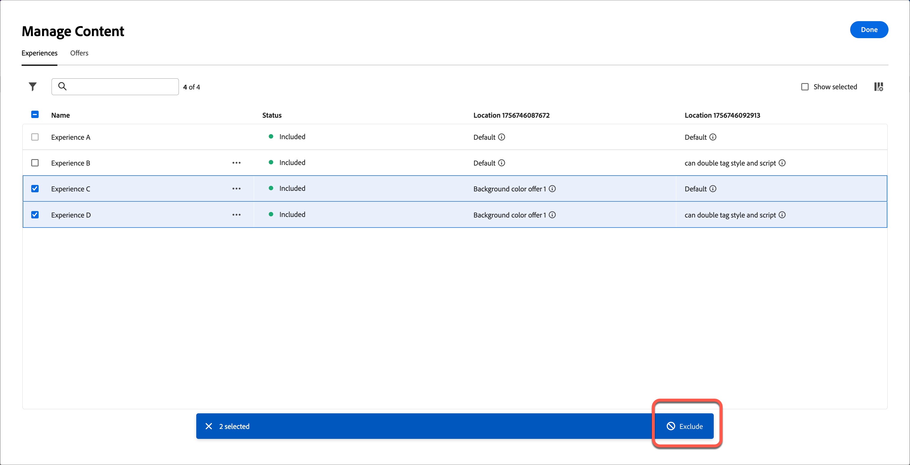
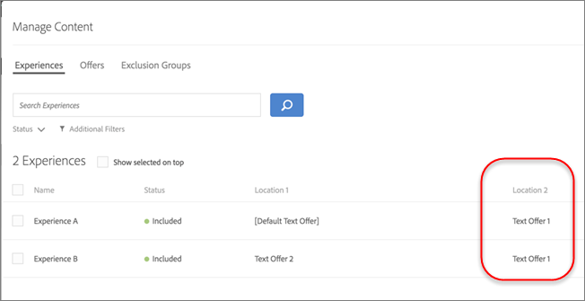

# Gerenciar exclusões {#manage-exclusions}

>[!BEGINSHADEBOX]

**Nesta página:** saiba como evitar ofertas duplicadas, excluir experiências específicas e excluir conteúdo padrão em atividades do **[!UICONTROL Automated Personalization]**.

>[!ENDSHADEBOX]

As exclusões controlam quais ofertas e experiências uma atividade de **[!UICONTROL Automated Personalization]** (AP) serve. Elas impedem que a mesma oferta seja exibida duas vezes, removem combinações de ofertas que não funcionam juntas e removem o conteúdo padrão, para que a atividade forneça experiências mais claras e relevantes que se alinhem às suas metas e público-alvo.

## Permitir ou não ofertas duplicadas {#allow-duplicate-offers}

Evite que as ofertas da biblioteca de ofertas sejam duplicadas quando usadas em locais diferentes nas atividades AP.

Uma atividade pode ter, por exemplo, seis locais em uma página com 12 ofertas, portanto, a mesma oferta pode ser colocada em mais de um local. Não permitir ofertas duplicadas impede que a mesma oferta seja exibida ao mesmo tempo em locais diferentes na mesma atividade.

1. Ao [criar ou editar uma atividade de AP](/help/main/c-activities/t-automated-personalization/create-ap-activity.md#create-ap-activity), clique no ícone **[!UICONTROL Configurar]** (  ).

1. Clique em **[!UICONTROL Permitir Ofertas Duplicadas]** para ativar ou desativar esse recurso, dependendo das suas necessidades.

   

## Excluir experiências específicas {#exclude-experiences}

Exclua experiências específicas para remover determinadas combinações de ofertas da atividade de AP. Algumas combinações podem não funcionar juntas ou você pode limitar o número de experiências testadas para diminuir os requisitos de tráfego da atividade.

1. Ao [criar ou editar uma atividade de AP](/help/main/c-activities/t-automated-personalization/create-ap-activity.md#create-ap-activity), clique no ícone **[!UICONTROL Gerenciar conteúdo]** (  ).

   A lista **[!UICONTROL Experiências]** mostra cada experiência gerada com permutas de todas as opções de conteúdo e locais.

1. Exclua as experiências que você não deseja testar.

   * Para excluir uma única experiência, clique no ícone **[!UICONTROL Mais Ações]** (  ) e clique em **[!UICONTROL Excluir]**.
   * Para excluir várias experiências de uma só vez, marque a caixa de seleção de cada experiência e clique em **[!UICONTROL Excluir]**. O ícone **[!UICONTROL Excluir]** é exibido quando uma ou mais experiências são selecionadas.

   

   As experiências foram excluídas da atividade e seu **[!UICONTROL Status]** é exibido como **[!UICONTROL Excluídos]**.

## Excluir conteúdo padrão {#exclude-default-content}

Exclua o conteúdo padrão quando não quiser que ele faça parte da atividade de AP, para que um local contenha apenas uma oferta que seja diferente do conteúdo padrão. Essa abordagem também permite alterar a aparência do restante da página para atender às ofertas testadas. Por exemplo, para corresponder à paleta de cores das ofertas, é possível alterar a cor do plano de fundo da página e excluir a cor de plano de fundo padrão.

1. Ao [criar ou editar uma atividade de AP](/help/main/c-activities/t-automated-personalization/create-ap-activity.md#create-ap-activity), selecione o conteúdo que deseja substituir e clique em **[!UICONTROL Alterar Texto/HTML]**, **[!UICONTROL Alterar Oferta de Imagem]** ou **[!UICONTROL Alterar Cor de Fundo]**. As opções disponíveis variam dependendo do tipo de conteúdo.

   

1. Crie seu novo conteúdo.

1. Clique no ícone **[!UICONTROL Mais Ações]** (  ) e clique na opção **Excluir Oferta Padrão/Incluir Oferta Padrão** para excluir ou incluir a oferta padrão.

   <!--
   Depending on the content or offer type, the [!UICONTROL Include] checkbox is in a slightly different place. 

   For Text/HTML content: 

   

   For Image/Video content: 

   

   For background color: 

   
   -->

<!--
1. Click **[!UICONTROL Save]**.

   You can see the experiences created from the offers you specified under [!UICONTROL Manage Content]. You notice that no experiences are created in [!UICONTROL Manage Content] using the default offer you excluded. 

   

**To exclude default content using the [!UICONTROL Form-Based Experience Composer]:** 

1. While creating or editing an AP activity, click **[!UICONTROL Change Text/HTML]** or **[!UICONTROL Change Image Offer]** under **[!UICONTROL Content]**. 
1. In the dialog box, create your new content and uncheck **[!UICONTROL Include]** to the right of the default content (or uncheck the Default Image/Video in the [!UICONTROL Select Content] screen). 

   Depending on the content or offer type, the [!UICONTROL Include] checkbox is in a slightly different place. 

   For Text/HTML content: 

   

   For Image/Video content: 

   

1. Click **[!UICONTROL Save]**. 

   You can see the experiences created from the offers you specified under [!UICONTROL Manage Content]. You notice that no experiences are created in [!UICONTROL Manage Content] using the default offer you excluded. 

   
-->
