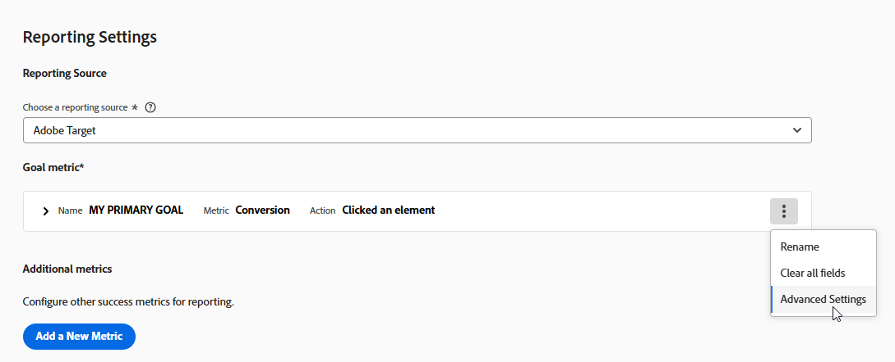

# Metas e Configurações {#ab-goals-and-settings}

>[!BEGINSHADEBOX]

**Nesta página:** saiba o que você pode definir na página **[!UICONTROL Metas e configurações]** de uma atividade A/B, de Direcionamento de experiência (XT) ou de Teste multivariado (MVT): as configurações da atividade, as configurações de relatórios, as configurações avançadas e as observações.

>[!ENDSHADEBOX]

A página **[!UICONTROL Metas e Configurações]** em [!DNL Adobe Target] é onde você especifica informações sobre as metas da atividade.

As configurações disponíveis dependem se você usa o Target ou o [Analytics como a fonte de relatórios](/help/main/c-integrating-target-with-mac/a4t/a4t.md).

As mesmas configurações se aplicam às atividades de [!UICONTROL Direcionamento de experiência] (XT) e [!UICONTROL Teste multivariado] (MVT), com exceção da [Metodologia estatística](#section_statistical-methodology), que está disponível somente para atividades A/B.

* [Configurações da atividade](#section_DCBDC354261F420EBD4B43EA34947BAC): objetivo, prioridade e duração
* [Configurações de relatórios](#section_13119392051044FBA6387D9B3B1C43CF): fonte de relatórios, métrica de meta, métricas adicionais e públicos-alvo
* [Configurações avançadas](#section_E2FE441AFB324E498793ABB025ED9974): dependências e o que acontece depois que um visitante atinge a meta
* [Metodologia Estatística](#section_statistical-methodology): como os resultados são analisados
* [Outros metadados](#section_2E8917BEFB954480A4206B9E9E917F80): observações

## [!UICONTROL Configurações da atividade] {#section_DCBDC354261F420EBD4B43EA34947BAC}

A seção **[!UICONTROL Configurações da Atividade]** da página **[!UICONTROL Metas e Configurações]** permite configurar as seguintes opções.

### Objetivo {#objective}

Digite um objetivo opcional. O objetivo pode ser qualquer informação que ajude você e os membros da equipe a identificar a atividade.

### Prioridade {#priority}

A prioridade é usada se várias atividades forem atribuídas para o mesmo local com o mesmo público-alvo. Se duas ou mais atividades forem atribuídas ao local, a atividade com a maior prioridade é exibida.

Dependendo das configurações, a interface do usuário do [!DNL Target] e as opções de **[!UICONTROL Prioridade]** variam:

* **Prioridades herdadas (padrão):** Se esta opção não estiver habilitada em **[!UICONTROL Administration]** (padrão), especifique uma prioridade de **[!UICONTROL Low]**, **[!UICONTROL Medium]** ou **[!UICONTROL High]**.
* **Prioridades otimizadas:** Especifique um valor de 0 a 999, onde 0 = **[!UICONTROL Baixo]** e 999 = **[!UICONTROL Alto]**.

  Para habilitar [prioridades otimizadas](/help/main/administrating-target/reporting.md), acesse **[!UICONTROL Administração]** > **[!UICONTROL Relatórios]** e alterne a opção **[!UICONTROL Habilitar Prioridades Otimizadas]**.

Para atividades criadas em versões anteriores do [!DNL Target], a prioridade **[!UICONTROL Baixa]** é convertida para 0, a **[!UICONTROL Medium]** é convertida para 5 e a **[!UICONTROL Alta]** é convertida para 10. É possível ajustar esses valores conforme necessário.

>[!NOTE]
>
>Antes de poder desabilitar prioridades otimizadas após usá-las, todas as prioridades devem ser ajustadas novamente para 0, 5 e 10.

### Duração {#duration}

A atividade pode começar quando aprovada ou você pode definir data e hora específicas. Da mesma maneira, a atividade não pode terminar quando é desativada, ou você pode definir uma data e hora.

O seletor de hora usa um relógio de 24 horas, sendo 00h a meia-noite. O fuso horário é definido para o que foi configurado no navegador. Para usar um fuso horário diferente, defina o navegador para outro fuso horário e reinicie-o.

## [!UICONTROL Configurações da geração de relatórios] {#section_13119392051044FBA6387D9B3B1C43CF}

A seção **[!UICONTROL Configurações de Relatórios]** da página **[!UICONTROL Metas e Configurações]** permite configurar as seguintes opções.

### Fonte de geração de relatórios {#reporting-source}

Especificar de qual solução os dados são coletados:

* [!DNL Adobe Target]

* [!DNL Adobe Analytics]

  +++ Mais informações sobre o Analytics como fonte de relatórios

  Consulte [Adobe Analytics como fonte de relatório para o Target](/help/main/c-integrating-target-with-mac/a4t/a4t.md) para saber quais são as diferenças entre as soluções de relatório e as vantagens de cada uma. Ao selecionar [!DNL Analytics] como fonte de relatórios para [!DNL Target], você seleciona um conjunto de relatórios [!DNL Analytics] para receber os dados de atividade [!DNL Target].

  Para especificar uma fonte de relatórios, primeiro escolha uma das [!DNL Analytics] empresas às quais sua conta está vinculada e, em seguida, selecione o conjunto de relatórios apropriado para a atividade. Somente conjuntos de relatórios provisionados para conexão com [!DNL Adobe Target] estão disponíveis para seleção. Se você não vir os conjuntos de relatórios esperados, primeiro tente fazer logout e fazer logon novamente no [!DNL Adobe Experience Cloud] para tentar novamente. Se o conjunto de relatórios ainda estiver ausente na lista, entre em contato com o Atendimento ao cliente.

  O [!DNL Analytics for Target] (A4T) requer um servidor de rastreamento para relatar os resultados corretamente. Um servidor de rastreamento padrão é exibido no campo **[!UICONTROL Servidor de rastreamento]**. Se você usar mais de um servidor de rastreamento, inclua o servidor de rastreamento correto neste campo. Consulte [Usando um servidor de rastreamento do Analytics](/help/main/c-integrating-target-with-mac/a4t/analytics-tracking-server.md#task_72077BA7E93C4A65A715A18F32228823) para obter mais informações.
  +++

* [!DNL Adobe Customer Journey Analytics]

  +++ Mais informações sobre o Customer Journey Analytics como fonte de relatórios

  Consulte [[!DNL Target] relatórios em [!DNL Adobe Customer Journey Analytics]](/help/main/c-integrating-target-with-mac/cja/target-reporting-in-cja.md) para obter os tipos de atividades, sandbox e seleção de visualizações de dados com suporte, métricas de meta e configuração de relatórios em [!DNL Customer Journey Analytics].
  +++

Se uma fonte de relatórios for especificada nas [configurações da conta](/help/main/administrating-target/reporting.md), a fonte especificada será usada e essa configuração não ficará visível.

Não é possível alterar sua fonte de relatórios após a atividade entrar em vigor para manter os relatórios consistentes.

### Métrica de objetivo {#goal-metric}

>[!NOTE]
>
>Se a solução de relatório for definida como [!DNL Analytics], a única métrica de meta disponível será **[!UICONTROL Conversão]**. [!DNL Analytics] métricas não podem ser selecionadas como uma meta.

Selecione a ação executada por um visitante para atingir a meta. Por exemplo, escolha uma métrica de **[!UICONTROL Conversão]** e defina os parâmetros que determinam quando o sucesso é obtido.

Para obter mais informações sobre como configurar métricas, consulte [Definir métricas](/help/main/c-activities/t-test-ab/t-test-create-ab/ab-set-metrics.md).

Para obter mais opções, clique no ícone **[!UICONTROL Mais]** ao lado da métrica de meta e clique em **[!UICONTROL Configurações Avançadas]**. Consulte [Configurações Avançadas](#section_E2FE441AFB324E498793ABB025ED9974).

Se estiver habilitado, o campo **[!UICONTROL Valor estimado de Conversão]** fornece um valor para a meta, mas não para outras métricas. Os seguintes pontos se aplicam a este campo:

* O valor permite que [!DNL Target] calcule o aumento estimado da receita.
* O campo é opcional; no entanto, a receita incremental para qualquer métrica que não seja de receita não pode ser calculada sem ele.
* O campo não está disponível para as métricas **[!UICONTROL Pontuação da página]**.
* Para todas as métricas de receita (**[!UICONTROL Receita por visitante]**, **[!UICONTROL Valor médio de pedido]**, **[!UICONTROL Vendas totais]** e **[!UICONTROL Pedidos]**), a estimativa usa **[!UICONTROL Receita por visitante]**. O tipo de dados é a moeda.

### Métricas adicionais {#additional-metrics}

Esta configuração não estará disponível se a solução de relatório estiver definida como [!DNL Analytics]. Nesse caso, as métricas definidas para o conjunto de relatórios [!DNL Analytics] são aplicadas.

### Públicos-alvo para geração de relatórios {#audiences-for-reporting}

Por padrão, os relatórios mostram os resultados para todos os visitantes qualificados. Você pode adicionar públicos-alvo do relatório para mostrar informações somente sobre públicos-alvo específicos.

Observe que esta configuração não estará disponível se você escolher [!DNL Analytics] como sua solução de relatório. A audiência definida para o conjunto de relatórios [!DNL Analytics] é aplicada.

## Configurações avançadas {#section_E2FE441AFB324E498793ABB025ED9974}

A seção **[!UICONTROL Configurações Avançadas]** da página **[!UICONTROL Metas e Configurações]** permite configurar as opções avançadas.

Para especificar configurações avançadas, clique no ícone **[!UICONTROL Mais]** (  ) na seção **[!UICONTROL Minha Meta Primária]** e clique em **[!UICONTROL Configurações Avançadas]**.

>[!NOTE]
>
>Se você usa o [!DNL Adobe Analytics] como a fonte de geração de relatórios, as configurações são gerenciadas pelo servidor do [!DNL Analytics]. A opção de configurações avançadas não está disponível.

### Qual métrica de sucesso deve ser atingida antes do aumento dessa métrica? {#dependencies}

Use essa opção para contar apenas alguém que atingiu a métrica de sucesso se já tiver atingido uma métrica de sucesso diferente. Por exemplo, uma conversão de atividade só pode ser válida se o visitante clicar na oferta ou acessar uma página específica antes da conversão.

É possível fornecer dependência em várias métricas, juntamente com a flexibilidade para escolher se a métrica deve ser alcançada ou não para que a contagem seja incrementada. Defina ambas as métricas de sucesso (ou várias) para poder tornar uma dependente da outra. A opção **[!UICONTROL Adicionar dependência]** permite que a métrica de sucesso seja incrementada se outra métrica de sucesso for ou não alcançada.

Para adicionar uma dependência:

1. Depois de adicionar outras métricas, clique em **[!UICONTROL Configurações avançadas]**.

1. Clique na opção **[!UICONTROL Adicionar dependência]**.

1. Arraste e solte as métricas desejadas e clique em **[!UICONTROL Alcançado]** para alternar a configuração entre **[!UICONTROL Alcançado]** e **[!UICONTROL Não alcançado]**.

É possível editar ou remover dependências depois de adicioná-las.

### O que acontece depois que um usuário atinge esta métrica de meta? {#after-goal}

Após atingir o objetivo da atividade, um visitante continua vendo o conteúdo da atividade, a menos que o visitante esteja qualificado para uma atividade de prioridade mais alta. Se o visitante atingir o objetivo novamente, será contado como outra conversão. Isso é diferente do comportamento padrão em [!DNL Target Classic], que contava os visitantes como novos se visualizassem a atividade novamente.

Há três opções para o que acontece depois que um visitante atinge a métrica de meta:

* **[!UICONTROL Incrementar contagem e manter usuário na atividade]** para especificar como a contagem é incrementada.
* **[!UICONTROL Incrementar contagem, liberar usuário e permitir reentrada]** para especificar a experiência que o usuário vê ao entrar na atividade novamente.
* **[!UICONTROL Incrementar contagem, liberar usuário e impedir sua reentrada]** para especificar o que o usuário vê em vez do conteúdo da atividade.

### De que maneira a contagem será incrementada? {#count-increment}

Existem três opções de como a contagem é incrementada:

* **[!UICONTROL Uma vez por participante]**
* **[!UICONTROL Em Todas as Impressões (Excluindo atualizações de página)]**
* **[!UICONTROL Em Todas As Impressões]**

Consulte [Métricas de sucesso](/help/main/c-activities/r-success-metrics/success-metrics.md#overview) para obter mais informações sobre configurações avançadas.

## Metodologia estatística {#section_statistical-methodology}

A seção **[!UICONTROL Metodologia Estatística]** da página **[!UICONTROL Metas e Configurações]** permite escolher como os resultados do experimento são analisados.

### Opções de metodologia {#methodology-options}

Esta opção determina a estrutura estatística, as métricas de resultados e os critérios de decisão usados para a métrica de meta **[!UICONTROL Conversão]** desta atividade:

* **[!UICONTROL Bayesiano]:** Decisão baseada em probabilidade que atualiza crenças conforme os dados chegam e oferece suporte a monitoramento contínuo e tamanhos de amostra menores. Os resultados são expressos como a probabilidade de uma variante ser melhor que outra, por exemplo &quot;92% de probabilidade de a Variante B vencer o Controle&quot;.
  * Mais adequado para amostras menores, monitoramento contínuo, participantes que preferem probabilidades ou quando você tem conhecimento prévio de testes anteriores para aplicar.
  * Não é ideal quando você precisa de aprovação normativa ou de conformidade rígida, ou precisa de valores p tradicionais.
  * Os relatórios mostram **[!UICONTROL Chance de Superar o Controle]** e um intervalo de credibilidade em vez da coluna **[!UICONTROL Confidence]** frequencista.
* **[!UICONTROL Teste t de Welch (Frequentista)]:** a metodologia tradicional existente de teste de hipóteses. Usa valores p e requer um tamanho de amostra fixo. Os relatórios mostram uma porcentagem de **[!UICONTROL Confiança]** e um intervalo de confiança.

Esta configuração só está disponível para atividades cuja métrica de meta principal é **[!UICONTROL Conversão]**. Atividades com uma meta principal **[!UICONTROL Receita]** ou **[!UICONTROL Envolvimento]** sempre usam o teste t de **[!UICONTROL Welch]**.

Para obter mais informações sobre como cada metodologia é calculada e relatada, consulte [Cálculos estatísticos em testes A/Bn](/help/main/c-reports/statistical-methodology/statistical-calculations.md).

### Configuração Bayesiana {#bayesian-configuration}

Esta configuração é exibida somente quando **[!UICONTROL Bayesiano]** é selecionado como a **[!UICONTROL Metodologia Estatística]**. Configure as seguintes opções:

* **[!UICONTROL Intervalo de Credibilidade]**: Define o intervalo no qual se espera que o efeito verdadeiro caia.
* **[!UICONTROL Limite de Decisão]**: define a probabilidade mínima que uma variante deve atingir, relativa a **[!UICONTROL Controle]**, antes de ser declarada vencedora.
* **[!UICONTROL Usar conhecimento anterior de testes anteriores?]**: Ative esta opção para fornecer conhecimento anterior de desempenho anterior para informar o cálculo **[!UICONTROL Bayesiano]**.

## Outros metadados {#section_2E8917BEFB954480A4206B9E9E917F80}

A seção **[!UICONTROL Outros metadados]** da página **[!UICONTROL Metas e configurações]** permite especificar qualquer informação sobre a sua atividade que seja útil para manter disponível para você mesmo ou para outros membros da equipe.
