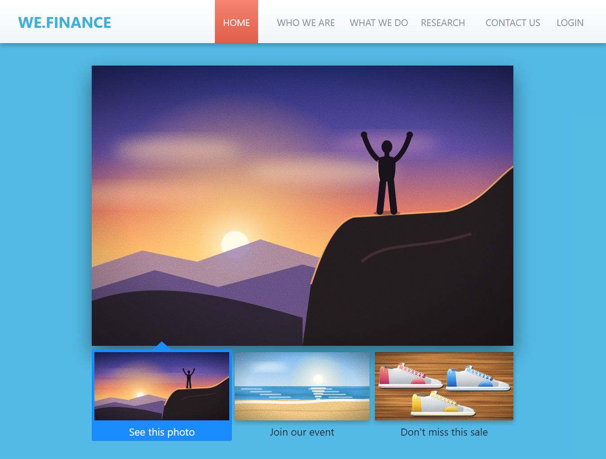

# Modelos de experiência {#experience-templates}

>[!BEGINSHADEBOX]

**Nesta página:** Encontre os [!DNL Adobe Target] Modelos de Experiência disponíveis para uso no código personalizado e para que cada modelo é usado normalmente.

>[!ENDSHADEBOX]

[!DNL Adobe Target] Modelos de experiência são amostras pré-codificadas com entradas configuráveis, usadas para executar casos de uso comuns de profissionais de marketing. Elas são fornecidas gratuitamente para desenvolvedores e profissionais de marketing como ponto de partida para executar casos de uso comuns, por meio do VEC ou do Experience Composer baseado em formulário.

Os seguintes modelos estão disponíveis no GitHub do Adobe Marketing Cloud: [Target-Experience-Templates](https://github.com/Adobe-Marketing-Cloud/target-experience-templates).

## A galeria de banner Carousel com miniaturas {#banner-carousel-thumbnails}

O modelo de experiência da [Galeria do banner com miniaturas é um carrossel giratório](https://github.com/Adobe-Marketing-Cloud/target-experience-templates/tree/master/banner-carousel-thumbnails), comumente usado em páginas iniciais e páginas de aterrissagem ou outras páginas de entrada de alto volume. Esse carrossel não gira automaticamente pelas imagens. Ele pode ter interação direta clicando nas imagens menores abaixo da imagem principal.

## Galeria do banner {#banner-carousel}

O modelo de experiência da [Galeria do banner é um carrossel giratório](https://github.com/Adobe-Marketing-Cloud/target-experience-templates/tree/master/banner-carousel), comumente usado em páginas iniciais e páginas de aterrissagem ou outras páginas de entrada de alto volume. Esse carrossel não gira automaticamente pelas imagens. Ele pode ter interação direta clicando nas setas para a esquerda e para a direita.

## Contagem regressiva do banner {#banner-countdown}

O [modelo de experiência da Contagem regressiva do banner](https://github.com/Adobe-Marketing-Cloud/target-experience-templates/tree/master/banner-countdown) é um banner grande com uma contagem regressiva central, comumente usado em páginas iniciais e páginas de aterrissagem ou outras páginas de entrada de alto volume.

## Criador de botão {#button-builder}

O [modelo de experiência do Criador de botão](https://github.com/Adobe-Marketing-Cloud/target-experience-templates/tree/master/button) é um pequeno botão com um texto de chamada para a ação. O botão é configurável. Ele pode ser colocado em qualquer lugar da página para adicionar uma nova call to action ou para substituir um botão existente por uma alternativa mais configurável.

## Lightbox com contagem regressiva {#lightbox-countdown}

O [modelo de experiência do Lightbox com contagem regressiva](https://github.com/Adobe-Marketing-Cloud/target-experience-templates/tree/master/lightbox-countdown) é um pop-up de sobreposição de lightbox com uma contagem regressiva central, comumente usado em páginas iniciais e páginas de aterrissagem ou outras páginas de entrada de alto volume.

## Lightbox com intenção de saída {#lightbox-exit-intent}

O [Lightbox com intenção de saída](https://github.com/Adobe-Marketing-Cloud/target-experience-templates/tree/master/lightbox-exit-intent) é um pop-up de sobreposição de lightbox acionado na intenção de saída (mover o mouse para o canto superior direito da tela). Ele pode ser implantado em qualquer propriedade da Web onde se deseja uma última chance de capturar atenção.

## Lightbox {#lightbox}

O [modelo de experiência do Lightbox](https://github.com/Adobe-Marketing-Cloud/target-experience-templates) é um pop-up de sobreposição do lightbox com atraso integrado, usado em geral nas páginas iniciais e de aterrissagem ou outras páginas de entrada de alto volume.

## Fita {#ribbon}

O [modelo de experiência de Faixa](https://github.com/Adobe-Marketing-Cloud/target-experience-templates/tree/master/ribbon) é uma faixa de opções de 100% de largura inserida na parte superior da página da Web. Normalmente, é usado para indicar uma promoção rápida, frete grátis, um evento de segurança ou meteorológico, ou outro anúncio importante.

