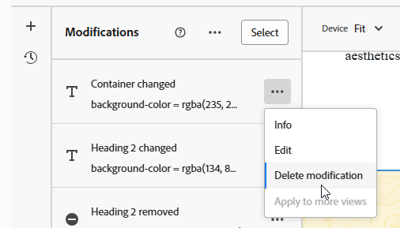
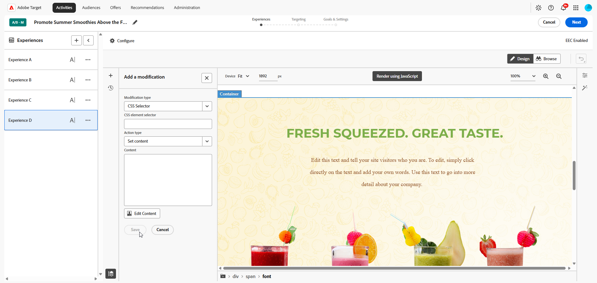

# Introdução a modificações {#vec-code-editor}

>[!BEGINSHADEBOX]

**Nesta página:** Saiba como exibir, editar, excluir e adicionar modificações no painel **[!UICONTROL Modificações]** do [!UICONTROL Visual Experience Composer] (VEC) e como usar código personalizado.

>[!ENDSHADEBOX]

O painel **[!UICONTROL Modificações]** em [!DNL Adobe Target] mostra todas as alterações feitas na página no [!UICONTROL Visual Experience Composer] (VEC) e permite alterações adicionais clicando em cada elemento da página e [selecionando uma ação](/help/main/c-experiences/c-visual-experience-composer/viztarget-options.md). Cada alteração aparece como uma ação ou elemento separado na lista **[!UICONTROL Modificações]**. As modificações também podem ser adicionadas diretamente, dentre os seguintes tipos: Seletor de CSS, Mbox e Código personalizado.

## Visão geral das modificações {#modifications-overview}

A página **[!UICONTROL Modificações]** faz pequenas alterações no seletor que [!DNL Target] escolhe quando o VEC configura como o conteúdo é entregue. O conteúdo ou um atributo do HTML podem ser alterados. O código também pode ser editado para criar o equivalente a uma oferta do HTML em uma mbox.


A página **[!UICONTROL Modificações]** pode ser usada para:

* Exibir uma ação realizada no visual composer.

  O painel 

* Editar uma ação existente. Acesse o menu avançado e selecione **[!UICONTROL Editar]**.

  

  Faça as alterações.

  

* Excluir uma ação existente. Acesse o menu avançado e selecione **[!UICONTROL Excluir modificação]**.

  Painel 

* Adicione uma nova modificação. Acesse o menu avançado **[!UICONTROL Modificações]**, selecione **[!UICONTROL Adicionar uma modificação]** e especifique as alterações conforme descrito em [Adicionar modificações](#add-modifications).

  

## Adicionar modificações {#add-modifications}

As modificações são adicionadas pelo painel **[!UICONTROL Modificações]** para a experiência selecionada no VEC.

1. Para exibir as **[!UICONTROL Modificações]**, clique em **[!UICONTROL Mostrar Modificações]**.

   

   Para abrir o painel **[!UICONTROL Modificações]** no Experience Composer baseado em formulário, crie ou edite uma oferta do HTML. Para obter mais informações, consulte [Experience Composer baseado em formulário](/help/main/c-experiences/form-experience-composer.md).

1. Para adicionar uma modificação:

   * Se não houver modificações anteriores na experiência, clique em **[!UICONTROL Adicionar modificação]** no painel **[!UICONTROL Modificações]**.
   * Se houver modificações anteriores na experiência, acesse o menu avançado **[!UICONTROL Modificações]** e selecione **[!UICONTROL Adicionar uma modificação]**.

   O painel **[!UICONTROL Modificações]** exibe:

   

1. Na lista suspensa **[!UICONTROL Tipo de modificação]**, escolha o tipo desejado:

   | Tipo de modificação | Detalhes |
   |--- |--- |
   | Seletor de CSS | Na caixa **[!UICONTROL Seletor de Elemento CSS]**, especifique o elemento CSS a ser modificado, selecione um tipo de ação (**[!UICONTROL Definir Conteúdo]** ou **[!UICONTROL Definir Atributo]**) e preencha as informações necessárias e o conteúdo desejado. |
   | Mbox | Especifique o nome da mbox e o conteúdo desejado. |
   | Código personalizado | Especifique um nome opcional, selecione ou desmarque a caixa de seleção **[!UICONTROL Adicionar código na `<HEAD>` Seção]**, conforme desejado, e em seguida adicione o código personalizado. Para obter mais informações, consulte [Código personalizado](#custom-code). |

   >[!NOTE]
   >
   >Não há mais suporte para mboxes no VEC em páginas que usam at.js 2.*x*. Como soluções alternativas:
   >
   >* Se estiver usando at.js 2.*x*, adicione uma modificação do Seletor de CSS, em vez de uma modificação da Mbox, e adicione o conteúdo no seletor que a mbox estava usando.
   >* Use atividades baseadas em formulário (funciona com mboxes e at.js 1.*x* e at.js 2.*x*).
   >* Use at.js 1.*x* no VEC.

1. Adicione modificações adicionais conforme necessário.

## Código personalizado {#custom-code}

O código personalizado oferece uma interface não visual para exibir,editar e adicionar novas ações no VEC, no Experience Composer baseado em formulário e no editor de ofertas HTML. O painel oferece uma visualização de código de uma experiência, para ajudar a criar experiências mais complexas, ajustar experiências existentes e solucionar problemas.

O código personalizado destina-se a usuários avançados familiarizados com HTML, JavaScript e CSS. A visualização de código pode ajudar a ajustar ou ajustar as alterações ou corrigir problemas do seletor. Ela também pode ser usada para adicionar novos códigos e ações personalizadas. Mais de um código personalizado pode ser adicionado e cada um pode ser nomeado opcionalmente.


O código personalizado se comporta da seguinte maneira:

* Quando **[!UICONTROL Adicionar código na `<HEAD>` Seção]** é selecionado, o código personalizado é adicionado à seção `<head>` e sua execução não espera por eventos body ou page-load. Adicionar apenas os elementos `<script>` e `<style>`. Adicionar `<div>` marcas e outros elementos pode fazer com que os `<head>` elementos restantes apareçam em `<body>`. Se a at.js for usada, todas as ofertas serão entregues de forma assíncrona.
* Quando a opção **[!UICONTROL Adicionar código na `<HEAD>` Seção]** é desmarcada, o código personalizado é executado imediatamente após a marca `<body>`. Adicione todo o código em um único `<div>` para preservar a estrutura DOM. Se a at.js for usada, todas as ofertas serão entregues de forma assíncrona.
* Se o HTML para `<BODY>` contiver `<SCRIPT>` e `<DIV>`, então `<DIV>` será acrescentado a `<BODY>` e `<SCRIPT>` será executado em `<HEAD>`. Um `<SCRIPT>` que carrega um arquivo externo também é anexado a `<HEAD>`.
* Os scripts são executados de forma assíncrona. Isso significa que `document.write` e métodos de script semelhantes não podem ser usados.
* O código personalizado está disponível somente para atividades A/B e de Direcionamento de experiência (XT). O código personalizado está desabilitado para sobreposição e se outra oferta de redirecionamento for aplicada.

O código personalizado oferece suporte aos seguintes casos de uso:

* Adicionar JavaScript, HTML ou CSS personalizados para serem executados na parte superior da página
* Exibir ou editar o código gerado pelo VEC após fazer modificações
* Definir o conteúdo HTML para um seletor (apenas seletores CSS)
* Definir um atributo em um elemento HTML
* Adicionar um conteúdo de oferta para ser entregue em uma mbox regional
* Ative o DOM pronto usando jQuery
* Trocar para modo pronto para DOM, sem jQuery (não suporta Internet Explorer 8)
* Troque com o modo de consulta de DOM por meio do plug-in &quot;elementOnLoad&quot;
* Redirecionamento personalizado

O código personalizado fornece:

* Números de linha para melhorar a usabilidade.
* Realce de sintaxe para ajudar a evitar sintaxe incorreta para ofertas do HTML.
* A capacidade de criar vários códigos personalizados e fornecer um nome opcional para cada um deles. Criar vários códigos personalizados facilita futuras depurações. Por exemplo, em vez de criar um único código personalizado para realizar várias modificações, um código personalizado separado pode ser criado para cada modificação, com um nome descritivo. Códigos personalizados separados tornam as modificações mais modulares e gerenciáveis. Não há garantias de que a execução de vários códigos personalizados em uma atividade ocorra na sequência em que foram criados.

O painel **[!UICONTROL Modificações]** divide a tela entre o modo visual e o modo de código. Ambos os modos permanecem sincronizados. Todas as modificações feitas visualmente têm uma linha correspondente na exibição do código. Da mesma forma, todas as alterações executadas na exibição de código são exibidas na experiência visual. Clicar em qualquer linha na visualização de código seleciona o elemento correspondente na página visual.

O código personalizado oferece suporte a HTML, scripts e estilos. Qualquer código ou script HTML válido pode ser adicionado ou editado.

## Exemplos de código personalizado {#custom-code-examples}

O painel **[!UICONTROL Código personalizado]** contém o código executado no início do carregamento de página. O código JavaScript pode ser executado na tag `<head>`. A execução do código não espera que a tag `<body>` esteja presente no DOM. Os seletores para ações visuais subsequentes dependem dos elementos HTML adicionados nessa guia.

O painel **[!UICONTROL Código personalizado]** é usado com frequência para adicionar JavaScript ou CSS à parte superior da página.

Use a guia **[!UICONTROL Código personalizado]** para:

* Usar JavaScript em linha ou vincular a um arquivo JavaScript externo

  Por exemplo, para alterar a cor de um elemento:

  ```javascript
  <script type="text/javascript"> 
  document.getElementById("element_id").style.color = "blue"; 
  </script> 
  ```

* Configurar um estilo em linha ou vincular a uma folha de estilo externa

  Por exemplo, para definir uma classe para um elemento de sobreposição:

  ```html
  <style> 
  .overlay 
  { position: absolute; top:0; left: 0; right: 0; bottom: 0; background: red; } 
  </style> 
  ```

* Adicionar trechos de HTML para definir novos elementos

  Por exemplo, use o seguinte trecho HTML para criar uma sobreposição `<div>` que use a classe CSS definida acima:

  ```html
  <div class="overlay"></div>
  ```

* Ative o DOM pronto usando jQuery

  O exemplo a seguir presume que o site do cliente tenha o jQuery disponível na página quando [!DNL Target] executa as ofertas.

  ```javascript
  <style>#default_content {visibility:hidden;}</style> 
  <script> 
  jQuery( document ).ready(function() { 
      jQuery("#default_content").html( "<span style='color:red'>Hello <strong>Again</strong></span>" ); 
      jQuery("#default_content").css("visibility","visible"); 
  }); 
  </script> 
  ```

* Trocar para modo pronto para DOM, sem jQuery (não suporta Internet Explorer 8)

  ```javascript
  <style>#default_content {visibility:hidden;}</style> 
  <script> 
  document.addEventListener("DOMContentLoaded", function(event) {  
      document.getElementById("default_content").innerHTML = "<span style='color:red'>Hello <strong>Again</strong></span>"; 
      document.getElementById("default_content").style.visibility="visible"; 
  }); 
  </script> 
  ```

* Redirecionamento personalizado que passa os parâmetros existentes, o parâmetro `s_tnt` (para a integração herdada com o Analytics), o parâmetro de referenciador e a sessão da mbox

  ```javascript
  <style type="text/css">body{display:none!important;}</style> 
  <script type="text/javascript"> 
   var qs='';window.location.search?qs=window.location.search+'&':qs='?'; 
   window.location.replace('//www.mywebsite.com/'+qs+'s_tnt=${campaign.id}:${campaign.recipe.id}:${campaign.recipe.trafficType}&s_tntref='+encodeURIComponent(document.referrer)+'&mboxSession='+mboxFactoryDefault.getSessionId().getId()+''+window.location.hash+''); 
  </script> 
  ```

* Adicionar Modelos de Experiência do [!DNL Adobe Target] para uso no código personalizado

  Os Modelos de experiência são amostras pré-codificadas com entradas configuráveis, usadas para executar casos de uso comuns de profissionais de marketing. Elas são fornecidas gratuitamente para desenvolvedores e profissionais de marketing como ponto de partida para executar casos de uso comuns, por meio do VEC ou do Experience Composer baseado em formulário. Os casos de uso incluem lightboxes, carrosséis, contagens regressivas e muito mais. Para obter mais informações, consulte [Modelos de experiência](/help/main/c-experiences/c-visual-experience-composer/c-vec-code-editor/experience-templates.md).

## Práticas recomendadas do código personalizado {#custom-code-best-practices}

* **Sempre envolva o código personalizado em um elemento.**

  Por exemplo:

```html
<div id="custom-code"> 
// My Code goes here 
</div>
```

Se forem necessárias modificações, faça as alterações dentro desse container. Se o código personalizado não for mais necessário, deixe este container vazio, mas não o remova. Isso garante que outras modificações na experiência não sejam afetadas.

* **Não use a ID de elemento &quot;CDQID&quot; para modificações na página feitas no Editor de códigos.**

  [!DNL Target] aplica uma nova ID de elemento com o valor &quot;CDQID&quot; a qualquer elemento na página modificado por [!DNL Target]. Esta ID é aplicada por [!DNL Target], portanto, não deve ser usada para modificações ou ajustes adicionais no Editor de Códigos.

* **Não executar `document.write` ações em scripts de código personalizados.**

  Os scripts são executados de modo assíncrono. Isso frequentemente faz com que as ações `document.write` apareçam no lugar errado na página. Não é recomendado o uso de `document.write` em scripts criados no código personalizado.

* **Se um elemento for criado e depois modificado, não exclua o elemento original.**

  Cada alteração cria um novo elemento no painel **[!UICONTROL Modificações]**. A segunda ação modifica o Elemento 1; portanto, se o Elemento 1 for excluído, essa ação não terá mais nada para modificar e a alteração não funcionará mais. Consulte [Solução de problemas de código personalizado](#troubleshooting-custom-code) para obter mais informações.

* **Tenha cuidado ao usar o recurso de código personalizado para duas atividades direcionadas à mesma URL.**

  Quando o recurso de código personalizado é usado para duas atividades que direcionam o mesmo URL, o JavaScript é inserido na página a partir de ambas as atividades. [!DNL Target] determina automaticamente a ordem do conteúdo entregue. Verifique se o código não depende de posicionamento. O autor do código é responsável por garantir que não haja conflitos no código.

## Solução de problemas do código personalizado {#troubleshooting-custom-code}

+++ Por que o código personalizado não é executado ao usar `triggerView`?

As ofertas de Code personalizado no VEC não são renderizadas novamente quando `triggerView()` é chamado com `{page: false}` como a opção.

+++

+++ O que significa o aviso de que uma ação não pode ser aplicada devido a alterações estruturais em uma página?

Essa mensagem indica que a estrutura da página foi alterada desde que a atividade foi salva pela última vez.


Os seletores ausentes podem ser acessados usando o modo de Navegação. A Adobe recomenda excluir e depois recriar cada experiência para garantir que o conteúdo tenha a aparência esperada, conforme indicado na mensagem de aviso.

+++

+++ O que significa o aviso &quot;Excluir esta ação pode afetar as ações subsequentes&quot;?

Por exemplo, duas ações podem ter sido executadas:

* Adicionou uma classe ao Elemento 1
* Editou o HTML do Elemento 1

Cada alteração cria um novo elemento no painel **[!UICONTROL Modificações]**. A segunda ação modifica o Elemento 1; portanto, se o Elemento 1 for excluído, a segunda ação não terá mais nada para modificar e a alteração não funcionará mais.

Em outras palavras, se um elemento for adicionado com texto e o elemento for editado com texto diferente em uma ação separada, o painel **[!UICONTROL Modificações]** mostrará as duas ações como elementos separados. Editar o elemento cria um novo elemento que modifica o original e contém o texto editado. Se o elemento original for excluído, o texto editado não poderá encontrar o elemento que foi editado e não será exibido. O segundo elemento permanece na lista de elementos, mas não afeta a página, pois o elemento que ele altera não existe mais.

+++

+++ Por que um elemento criado com `document.write` em um script não aparece onde o esperado?

Os scripts são executados de modo assíncrono. Isso frequentemente faz com que as ações `document.write` apareçam no lugar errado na página. A Adobe não recomenda usar `document.write` em scripts criados no código personalizado.

+++

+++ Por que o JavaScript exibe erros no código personalizado?

Qualquer JavaScript embutido que não seja válido para o JavaScript mostra erros no código personalizado.

+++

+++ Por que uma alteração no código personalizado não pode ser desfeita?

No momento, não há suporte para desfazer em ações de edição e exclusão do painel **[!UICONTROL Modificações]** e no código personalizado. Desfazer um dessas operações pode fazer com que a experiência no VEC pareça incompatível com as ações visíveis no código personalizado. No entanto, as ações no código personalizado estão no estado correto e não há impacto no delivery. Esse é um problema de interface do usuário. Para atualizar a experiência, salve-a e abra-a novamente ou vá para a próxima etapa e volte. Qualquer uma dessas ações recarregará a experiência, de modo que seja exibida conforme esperado e seja consistente com as ações no painel **[!UICONTROL Modificações]**.

+++

+++ Por que o código personalizado não produz os resultados esperados no Internet Explorer 8?

[!DNL Target] não dá mais suporte ao Internet Explorer 8.

+++
