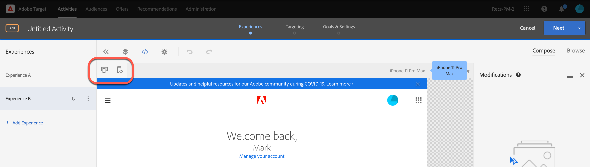

# Visores móveis para experiências responsivas {#mobile-viewports}

>[!BEGINSHADEBOX]

**Nesta página:** saiba como configurar visores móveis e usá-los para visualizar e criar experiências para telas de vários tamanhos.

>[!ENDSHADEBOX]

Os visores móveis exibem [!DNL Adobe Target] atividades nos tamanhos de tela de vários dispositivos. Elas foram projetadas para sites responsivos, que se adaptam automaticamente a desktops, notebooks, tablets e telefones celulares, e permitem verificar se uma experiência é bem-sucedida em cada um deles.

>[!NOTE]
>
> * Use visores móveis quando o site for responsivo e a página móvel reutilizar os elementos da página de desktop em um layout diferente. Quando o site móvel for separado e tiver sua própria estrutura, como `m.mysite.com`, use uma [atividade multipáginas](/help/main/c-experiences/c-visual-experience-composer/multipage-activity.md#multipage-activity).
>
>* Os visores móveis não estão disponíveis quando uma sobreposição de oferta de redirecionamento os sobrepõe.

## Visores e pontos de interrupção de CSS

Uma janela de visualização é a área da tela que uma página da Web preenche: o tamanho da janela do navegador, menos as barras de rolagem e as barras de ferramentas. Os navegadores o medem em pixels CSS, de modo que em muitos dispositivos, como aqueles com telas retina, o visor é menor do que a resolução do dispositivo anunciada. Sempre usar o tamanho do visor em [!DNL Target]. A tabela a seguir lista ambos os valores para dispositivos populares.

+++ Visores e resoluções de dispositivos populares

>[!NOTE]
>
>Vários sites listam os tamanhos da janela de visualização de dispositivos populares. Por exemplo, consulte `https://viewportsizer.com/devices/`. Consulte o site do fabricante do dispositivo para obter as informações mais precisas e atualizadas.
>
>Tamanhos de visores marcados como &quot;est&quot;. são estimativas.

| Dispositivo | Tamanho da janela de visualização (largura x altura) | Resolução do dispositivo (largura × altura) |
|---|---|---|
| iPhone 18 Pro Max | 440 x 956 | 1320 x 2868 |
| iPhone 18 Pro | 402 x 874 | 1206 x 2622 |
| iPhone 17 Pro Max | 440 x 956 | 1320 x 2868 |
| iPhone 17 Pro | 402 x 874 | 1206 x 2622 |
| iPhone Air | 420 x 912 | 1260 x 2736 |
| iPhone 17 | 402 x 874 | 1206 x 2622 |
| iPhone 16e | 390 x 844 | 1170 x 2532 |
| iPad (A16) | 820 x 1180 | 1640 x 2360 |
| iPad mini (A17 Pro) | 744 x 1133 | 1488 x 2266 |
| iPad Air 11″ (M3 / M4) | 820 x 1180 | 1640 x 2360 |
| iPad Pro 11″ (M5) | 834 x 1210 | 1668 x 2420 |
| Google Pixel 11 | 412 x 924 (EST) | 1080 x 2424 |
| Google Pixel 11 Pro | 410 x 914 (est.) | 1280 x 2856 |
| Google Pixel 11 Pro XL | 448 x 997 (est.) | 1344 x 2992 |
| Google Pixel 10 | 412 x 924 | 1080 x 2424 |
| Google Pixel 10 Pro | 410 x 914 (est.) | 1280 x 2856 |
| Google Pixel 10 Pro XL | 448 x 997 (est.) | 1344 x 2992 |
| Samsung Galaxy S26 | 360 x 780 | 1080 x 2340 |
| Samsung Galaxy S26 Ultra | 412 x 891 | 1440 x 3120 |
| iPhone Duo (não dobrado) | 890 x 626 (est.) | 2670 x 1878 |
| iPhone Duo (dobrado) | 466 x 678 (est.) | 1398 x 2034 |
| Samsung Galaxy Z Dobra 7 (dobrada) | 412 x 960 (est.) | 1080 x 2520 |
| Samsung Galaxy Z Flip 8 | 360 x 840 (est.) | 1080 x 2520 |
| Google Pixel 11 Pro Fold (não dobrado) | 791 x 820 (est.) | 2076 x 2152 |

+++

Um site responsivo alterna para um layout diferente em tamanhos de tela específicos. Esses tamanhos são chamados de pontos de interrupção de CSS ou [consultas de mídia](https://developer.mozilla.org/pt-BR/docs/Web/CSS/Media_Queries/Using_media_queries). Salvar os pontos de interrupção de CSS do site em [!DNL Target] possibilita a visualização de cada exibição e clicar em uma janela ao longo da parte superior da exibição abre a exibição para esse tamanho de tela.

Para entregar uma atividade a um dispositivo específico, selecione o público-alvo desse dispositivo no diagrama de atividades e edite a página desse dispositivo no Mobile Web Composer. A mesma ferramenta é usada para exibir um site que não é responsivo quando a atividade é direcionada a um dispositivo específico. Para executar uma atividade em todos os dispositivos, aplique nenhuma direcionamento e visualize a atividade em cada tamanho de tela com visores móveis.

>[!IMPORTANT]
>
>As experiências podem ser editadas nos visores móveis, mas as alterações se aplicam a todos os visores e dispositivos, não apenas ao visor em uso. Da mesma forma, editar uma experiência na exibição de desktop altera a página para todos os tamanhos de tela. No momento, [!DNL Target] não oferece suporte a alterações de página específicas do visor.

## Configuração do visor móvel {#task_B4B161499DC0470584ED922A4D20FCAB}

Defina as janelas de visualização móvel que estão disponíveis ao criar experiências.

1. Clique em **[!UICONTROL Administração]** > **[!UICONTROL Visual Experience Composer]**.
1. Na seção **[!UICONTROL Configuração de visores móveis]**, clique em **[!UICONTROL Adicionar]**.

   

   Ou

   Para alterar a configuração de um visor móvel existente, selecione o visor e clique no ícone **[!UICONTROL Editar]** (lápis).

1. Digite um nome descritivo para a janela de visualização móvel. O nome pode ter até 36 caracteres.
1. Insira o tamanho da tela do dispositivo móvel. A largura pode ser de 150 a 968 pixels e a altura pode ser de 150 a 1280 pixels.
1. (Opcional) Selecione o sistema operacional do dispositivo.

   Opções:

   * Android
   * iOS
   * Windows
   * Symbian
   * BlackBerry

   Se o [Enhanced Experience Composer](/help/main/c-experiences/c-visual-experience-composer/experience-composer-best-practices.md#enable-eec) estiver habilitado e um sistema operacional estiver selecionado, o [!DNL Target] emulará esse dispositivo quando a página for exibida. Por exemplo, se o site responsivo tiver uma aparência diferente para o Android e para o iOS, [!DNL Target] imita esse comportamento.

1. Clique em **[!UICONTROL Salvar]**.

>[!NOTE]
>
>A tentativa de excluir um visor móvel que está em uso exibe a seguinte mensagem: &quot;Este visor está atualmente associado a uma ou várias atividades. Você precisa remover o visor dessas atividades antes de poder exclui-lo.&quot;

## Criar uma experiência responsiva {#task_D6332438B5EE48CCA8AF199270F1CAEF}

Adicione visores móveis a atividades do [!DNL Target] para criar experiências responsivas para telas móveis.

1. Crie a [atividade desejada](/help/main/c-activities/activities.md).
1. No **[!UICONTROL Visual Experience Composer]** (VEC), clique no ícone de engrenagem **[!UICONTROL Configurações]** e selecione **[!UICONTROL Adicionar janelas de visualização móvel]**.

   

1. Clique no ícone **[!UICONTROL Dispositivos]** e habilite cada dispositivo com um visor móvel.

   

   As janelas de visualização móvel estão listadas da menor para a maior de acordo com a largura.

1. Edite a experiência nos visores móveis conforme necessário. Qualquer alteração se aplica à experiência em todos os dispositivos, por exemplo, uma alteração no texto de um cabeçalho. Passe o mouse sobre o nome de uma janela para ver o tamanho da janela.

   

1. (Opcional) Alterne entre os modos retrato e paisagem ao clicar no ícone de orientação.

   

## Vídeos de treinamento

Os vídeos a seguir contêm mais informações sobre visores móveis.

### Visual Experience Composer (2 de 2) (7:29) 

O vídeo de demonstração a seguir inclui informações sobre o uso do Visual Experience Composer para trabalhar com visores móveis:

* Renomear e duplicar uma experiência
* Criar uma experiência de redirecionamento
* Direcionar uma atividade para um único URL ou um grupo de URLs
* Criar uma atividade multipáginas
* Visualizar e criar a experiência para sites responsivos
* Use sobreposições para destacar tipos de elementos

>[!VIDEO](https://video.tv.adobe.com/v/17401)

### Preferências da conta no Adobe Target 

Este vídeo inclui informações sobre como configurar visores móveis, a partir de 4:40, no vídeo.

>[!VIDEO](https://video.tv.adobe.com/v/17379)
