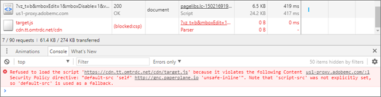

# Solução de problemas relacionados ao [!DNL Adobe Target] [!UICONTROL Visual Experience Composer] e [!UICONTROL Enhanced Experience Composer] {#vec-eec-issues}

>[!BEGINSHADEBOX]

**Nesta página:** Saiba como resolver os problemas que afetam o **[!UICONTROL Visual Experience Composer]** (VEC) e o **[!UICONTROL Enhanced Experience Composer]** (EEC).

>[!ENDSHADEBOX]

Problemas de exibição e outros problemas ocorrem às vezes no [!DNL Target] **[!UICONTROL Visual Experience Composer]** (VEC) e no **[!UICONTROL Enhanced Experience Composer]** (EEC) sob determinadas condições. Os itens a seguir descrevem os problemas que afetam ambos os compositores e como resolvê-los.

## Navegador e segurança

### Políticas de cookies do Google Chrome para SameSite {#samesite}

As políticas de imposição de cookie SameSite de [!DNL Google Chrome] afetam o VEC e o EEC nas versões a seguir.

>[!NOTE]
>
>A alteração a seguir se aplica a todas as três versões. O VEC não pode ser usado em páginas protegidas por senha do site, a menos que a [extensão auxiliar do VEC](/help/main/c-experiences/c-visual-experience-composer/r-troubleshoot-composer/visual-editing-helper-extension.md) esteja instalada e habilitada. Os cookies de logon do site são considerados cookies de terceiros, portanto, não são enviados com solicitações de logon dentro do editor do VEC no modo **[!UICONTROL Procurar]**. A única exceção ocorre quando os cookies de logon já têm os atributos `SameSite=None` e `Secure` definidos.

* **Chrome 94 (21 de setembro de 2021):** Para todos os usuários com Chrome 94 e posterior, o sinalizador de linha de comando `--disable-features=SameSiteByDefaultCookies,CookiesWithoutSameSiteMustBeSecure` foi removido.
* **Chrome 91 (25 de maio de 2021):** Para todos os usuários com Chrome 91 e posterior, os sinalizadores `#same-site-by-default-cookies` e `#cookies-without-same-site-must-be-secure` foram removidos de `chrome://flags`. Esse comportamento agora está ativado por padrão.
* **Chrome 80 (agosto de 2020):** Para todos os usuários com Chrome 80 e posterior:

  * Não é possível baixar bibliotecas [!DNL Target] enquanto uma atividade está sendo editada, caso elas ainda não estejam no site. A chamada de download é feita do domínio do cliente para um domínio [!DNL Adobe] seguro e é rejeitada como não autenticada.
  * O EEC não funciona, pois não é possível definir o atributo SameSite para cookies no domínio `adobemc.com`. Sem esse atributo, o navegador rejeita esses cookies, causando falha no EEC.

+++ Determinar quais cookies estão bloqueados

Para determinar quais cookies são bloqueados pelas políticas de imposição de cookies SameSite, use o [!DNL Developer Tools] em [!DNL Chrome].

1. Ao exibir o VEC em [!DNL Chrome], clique no ícone **[!UICONTROL reticências]** no canto superior direito do Chrome > **[!UICONTROL Mais Ferramentas]** > **[!UICONTROL Ferramentas do Desenvolvedor]**.
1. Clique na guia **[!UICONTROL Rede]** e procure cookies bloqueados.

   >[!NOTE]
   >
   >Use a caixa de seleção **[!UICONTROL Tem cookies bloqueados]** para facilitar a localização de cookies bloqueados.

+++

+++ Os cabeçalhos da Política de Segurança de Conteúdo (CSP) bloqueiam as bibliotecas [!DNL Target] no site

Se os cabeçalhos CSP do site bloquearem as bibliotecas do [!DNL Target], o site será carregado, mas a edição não será permitida. Verifique se as bibliotecas [!DNL Target] não estão bloqueadas.

>[!NOTE]
>
>Além das seguintes informações, a [extensão de navegador do Adobe Target VEC Helper](/help/main/c-experiences/c-visual-experience-composer/r-troubleshoot-composer/vec-helper-browser-extension.md) para [!DNL Google Chrome] pode ser usada.

Como solução alternativa, configure uma regra [!DNL Requestly] para remover os cabeçalhos da CSP, conforme mostrado na ilustração a seguir.

Uma regra [!DNL Requestly] semelhante pode ser configurada para qualquer cabeçalho que faça com que um recurso não seja carregado dentro do VEC. Sempre que os cabeçalhos precisarem ser removidos com [!DNL Requestly], siga um destes procedimentos:

* Adicione regras de URL para que o URL seja aberto no VEC, para que os cabeçalhos sejam removidos apenas para esses URLs.
* Ative a regra ao editar no VEC e desative a regra quando o VEC não estiver em uso.

+++

+++ Não há suporte para iframes de vários níveis

[!DNL Target] não dá suporte a iframes de vários níveis. Se o site carregar um iframe que tenha um iframe secundário, a at.js interagirá somente com o iframe principal. As bibliotecas [!DNL Target] não interagem com o iframe secundário.

Como solução, adicione uma página na experiência com o URL do iframe secundário.

+++

+++ As experiências não podem ser editadas em um site de edição de iFrame ou em páginas sem a implementação [!DNL Target]

Habilite o **[!UICONTROL Enhanced Experience Composer]** (EEC) para resolver este problema. Clique em **[!UICONTROL Administração]** > **[!UICONTROL Visual Experience Composer]** e marque a caixa de seleção que habilita o **[!UICONTROL Enhanced Experience Composer]**.

O EEC usa um proxy gerenciado por [!DNL Adobe] para carregar a página para edição. Esse proxy permite a edição em sites que impedem o uso de iFrame e em sites e páginas nos quais o código [!DNL Adobe Target] ainda não foi adicionado. As atividades não são entregues ao site antes de o código ser adicionado. Alguns sites podem não ser carregados pelo EEC, nesse caso, desmarcar essa opção carregará a página por meio de um iFrame.

>[!NOTE]
>
>Páginas hospedadas localmente e páginas que não podem ser acessadas fora da rede não estão acessíveis ao servidor proxy [!DNL Adobe] e não podem ser abertas no EEC. Essas páginas podem incluir URLs de preparação, URLs de Teste de aceitação do usuário (UAT) ou páginas hospedadas localmente.

+++

## Carregamento e exibição de página

+++ Um ponteiro é exibido em vez da página quando uma página é editada

Essa situação pode acontecer se o URL contiver um caractere #. Para corrigir o problema, alterne para o modo **[!UICONTROL Procurar]** no VEC ou no EEC e alterne para o modo **[!UICONTROL Compor]**. O ponteiro deverá sumir e a página deverá ser carregada.

+++

+++ O VEC ou o EEC aparecem interrompidos ou não inicializam quando uma atividade salva é editada novamente

Se o site tiver sido alterado fora do VEC após a definição da experiência, os seletores nos quais as ações foram executadas anteriormente não poderão ser encontrados quando a atividade for aberta para reedição. A página parece quebrada e nenhum aviso é exibido.

+++

+++ A rotação de banners e outros conteúdos que contêm JavaScript não são exibidos no VEC ou no EEC

Por padrão, o VEC bloqueia elementos do JavaScript. Desabilitar o JavaScript possibilita trabalhar com esses elementos. Dependendo do modo como o site estiver configurado, alguns itens poderão continuar sendo exibidos incorretamente ou permanecer indisponíveis.

+++

+++ Para atividades do Automated Personalization, a troca de imagem aparece quebrada no VEC ou no EEC

A adição de uma oferta de imagem a um local obtém a dimensão completa do espaço de imagem original no VEC ou no EEC. Na entrega, a imagem não é expandida e é mostrada como está, de modo que não há impacto na entrega.

+++

## Edição de resultados

+++ Alterar um elemento na página altera vários elementos

Se a mesma ID de elemento DOM for usada em vários elementos na página, a alteração desses elementos modificará todos os elementos com essa ID. Para evitar isso, use uma ID apenas uma vez em cada página. Essa é uma prática recomendada de HTML padrão. Para obter mais informações, consulte [Cenários de modificação da página](/help/main/c-experiences/c-visual-experience-composer/r-troubleshoot-composer/vec-scenarios.md#vec-scenarios).

+++

+++ Os estilos de texto em negrito e itálico não são exibidos ou o texto desaparece após a aplicação de Editar texto/Editar HTML ou Alterar texto/Alterar HTML

Quando o **[!UICONTROL Editar Texto]**/**[!UICONTROL Editar HTML]** é usado no VEC para atividades de **[!UICONTROL Teste A/B]** ou **[!UICONTROL Direcionamento de Experiência]** ou **[!UICONTROL Alterar Texto]**/**[!UICONTROL Alterar HTML]** é usado para atividades de **[!UICONTROL Automated Personalization]** ou **[!UICONTROL Teste Multivariado]**, para colocar o texto em negrito ou itálico, os estilos podem não ser aplicados na página ou o texto pode desaparecer da página no VEC. Isso acontece porque a maneira como o editor de rich text aplica esses estilos pode interferir na marcação do site.

Se esse problema ocorrer:

1. Clique no botão **[!UICONTROL HTML]** no editor de rich text para entrar no modo de edição de fonte.
1. Encontre os elementos de texto estilizados.

   * Para texto em negrito, altere os elementos `<strong>` para `<b>`.
   * Para texto em itálico, altere os elementos `<em>` para `<i>`.

+++
