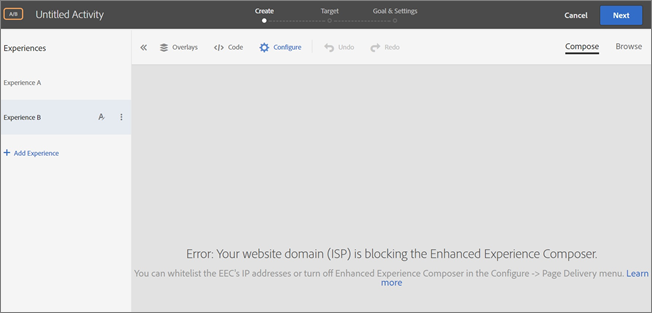

# Solução de problemas relacionados ao [!UICONTROL Enhanced Experience Composer] {#eec-issues}

>[!BEGINSHADEBOX]

**Nesta página:** Saiba como resolver os problemas que afetam somente o **[!UICONTROL Enhanced Experience Composer]** (EEC), como páginas que não carregam porque os endereços IP do proxy EEC estão bloqueados.

>[!ENDSHADEBOX]

Problemas de exibição às vezes ocorrem no [!DNL Adobe Target] **[!UICONTROL Enhanced Experience Composer]** (EEC) sob determinadas condições. Os itens a seguir descrevem os problemas que afetam apenas o EEC e como resolvê-los.

## Incluir na lista de permissões os endereços IP do proxy EEC {#eec-ip-addresses}

O EEC não carrega um URL interno de controle de qualidade que não esteja acessível em um endereço IP público. O Incluir na lista de permissões dos endereços IP do servidor [!DNL Adobe] usado para o proxy EEC resolve esse problema. Esses endereços IP são necessários somente para a edição de atividades, e os visitantes do site não precisam deles. Solicite à equipe de TI que inclua na lista de permissões os seguintes endereços IP.

### EUA (va7)

```
40.70.154.136/29
52.254.106.240/28
52.254.106.160/28
52.254.107.16/28
20.186.185.181
20.22.83.112
20.186.185.227
52.254.106.192/28
52.254.106.0/28
52.254.107.128/28
52.254.107.80/28
52.254.106.176/28
52.254.107.32/28
52.254.105.192/28
52.254.107.64/28
52.254.106.208/28
52.254.107.0/28
52.254.106.224/28
20.14.241.153
20.186.185.239
4.152.211.251
52.254.107.144/28
52.254.106.144/28
```

### EMEA (nld2)

```
51.138.17.16/28
51.138.17.48/28
51.138.16.128/28
51.138.17.32/28
51.138.16.240/28
51.138.17.112/28
51.138.16.160/28
51.138.16.208/28
51.138.17.80/28
51.138.17.0/28
51.138.17.96/28
51.138.16.144/28
20.31.145.248
20.126.189.248
51.138.16.224/28
51.138.16.192/28
51.138.12.94
51.138.12.11
51.138.16.176/28
51.138.12.100
51.138.17.64/28
51.138.12.160/28
```

### APAC (aus)

```
20.43.104.160/28
20.227.35.177
20.40.188.227
20.43.104.112/28
20.43.104.128/28
20.43.104.144/28
20.40.188.166
20.53.206.128
20.43.104.80/28
20.43.104.16/28
20.43.105.48/28
20.43.104.96/28
20.43.104.48/28
20.40.188.194
20.43.104.32/28
20.40.191.224/28
20.43.105.16/28
20.40.191.96/28
20.43.104.176/28
20.40.191.240/28
20.43.104.64/28
20.43.105.32/28
20.43.104.192/28
20.43.105.0/28
20.43.104.0/28
```

### Endereços IP herdados

Os endereços IP herdados a seguir devem continuar sendo migrados até notificação adicional.

```
34.254.77.200
54.73.207.147
54.229.152.123
3.224.194.242
54.90.51.39
34.228.136.112
54.150.116.11
18.178.142.8
54.199.107.77
99.80.139.221
54.78.56.224
54.247.179.246
54.80.219.243
34.201.235.54
54.196.224.236
35.75.212.45
52.199.184.130
18.180.161.176
```

+++ O EEC exibe uma mensagem de erro informando que o domínio do site está bloqueando o acesso

A seguinte mensagem de erro pode ser exibida em [!DNL Target]:

`Error: Your website domain (ISP) is blocking the Enhanced Experience Composer. You can allowlist the Enhanced Experience Composer's IP addresses or turn off Enhanced Experience Composer in Configure > Page Delivery menu.`



Essa mensagem de erro tem duas causas possíveis:

* O domínio do site (ISP) bloqueia o EEC. Para resolver o problema, inclua na lista de permissões os endereços IP listados em [Incluir na lista de permissões os endereços IP do proxy EEC](#eec-ip-addresses).
* Os endereços IP são classificados, mas o site não é compatível com TLS 1.2. Para resolver o problema, consulte o seguinte item.

+++

+++ O EEC não é carregado nas páginas seguras de um site que usa TLS 1.0

A mensagem de erro descrita no item anterior pode ser exibida quando os endereços IP forem resolvidos, mas o site não for compatível com TLS 1.2. [!DNL Target] atualmente usa a versão 1.2 como configuração padrão. Antes do [!DNL Target] 18.4.1 (25 de abril de 2018), a configuração padrão era compatível com o TLS 1.0. Para obter mais informações, consulte [Alterações na criptografia do TLS (Transport Layer Security)](https://experienceleague.adobe.com/docs/target-dev/developer/implementation/tls-transport-layer-security-encryption.html){target=_blank}.

Para verificar a versão TLS de um site no Firefox (outros navegadores têm etapas semelhantes):

1. Abra o site afetado no Firefox.
1. Clique no ícone **[!UICONTROL Mostrar Informações do Site]** na barra de endereços do navegador.

   

1. Clique em **[!UICONTROL Mostrar detalhes da conexão]** > **[!UICONTROL Mais informações]**.

   

1. Examine as informações de versão do TLS em **[!UICONTROL Detalhes Técnicos]**.

   

1. Se o site mostrar TLS 1.0, consulte [Alterações de Criptografia de TLS (Transport Layer Security)](https://experienceleague.adobe.com/docs/target-dev/developer/implementation/tls-transport-layer-security-encryption.html){target=_blank} para obter informações sobre a política de suporte TLS de [!DNL Target]. Para solucionar a situação por enquanto (válida até 12 de setembro de 2018), acesse o [Atendimento ao cliente](/help/main/cmp-resources-and-contact-information.md#reference_ACA3391A00EF467B87930A450050077C) para obter a configuração com a versão TLS e o domínio.

+++

+++ Os tempos limite ou erros de &quot;acesso negado&quot; são exibidos quando os sites são carregados com o proxy ativado

Verifique se os endereços IP de proxy não estão bloqueados no ambiente. Os endereços estão listados em [Incluir na lista de permissões os endereços IP do proxy EEC](#eec-ip-addresses).

+++
