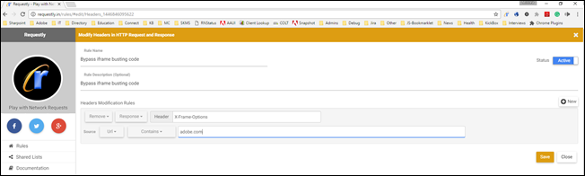

# Solução de problemas relacionados ao [!UICONTROL Visual Experience Composer] {#vec-issues}

>[!BEGINSHADEBOX]

**Nesta página:** Saiba como resolver os problemas que afetam somente o **[!UICONTROL Visual Experience Composer]** (VEC).

>[!ENDSHADEBOX]

Problemas de exibição às vezes ocorrem no [!DNL Adobe Target] **[!UICONTROL Visual Experience Composer]** (VEC) sob determinadas condições. Os itens a seguir descrevem os problemas que afetam somente o VEC e como resolvê-los.

+++ As bibliotecas do [!DNL Target] não são carregadas quando o site é aberto no VEC

Quando um site é aberto no **[!UICONTROL Visual Experience Composer]**, o [!DNL Target] adiciona os parâmetros `mboxEdit=1` e `mboxDisable=1` à URL.

Um site que elimina ou remove esses parâmetros ao navegar de uma página para outra sem um recarregamento de página, especialmente um Aplicativo de Página Única, interrompe a funcionalidade [!DNL Target] e as bibliotecas [!DNL Target] não são carregadas. Para evitar esse problema, mantenha ambos os parâmetros no URL.

+++

+++ Uma página não abre no EEC ou é carregada lentamente, ou as atividades e experiências são carregadas lentamente no VEC

Vários problemas podem afetar o desempenho da página nos Experience Composers [!DNL Target]. Os mais comuns são:

* A página não tem mbox.
* O site usa bloqueio de proxy, o que impede que a página seja aberta no Experience Composer.
* O site não permite que ele mesmo seja aberto em um iFrame.

Quando ocorrer um problema no **[!UICONTROL Enhanced Experience Composer]**, desative-o e use o **[!UICONTROL Visual Experience Composer]**. Para fazer isso, vá para **[!UICONTROL Administração]** > **[!UICONTROL Visual Experience Composer]** e desative a opção **[!UICONTROL Habilitar Enhanced Experience Composer]**.

A seguinte mensagem de erro pode ser exibida no console:

Quando nenhum dos compositores funciona, uma extensão de navegador que substitui o cabeçalho X-Frame-Options do site, como [!DNL Requestly] ([!DNL Chrome] ou [!DNL Firefox]) ou Modificar Cabeçalhos de Resposta ([!DNL Firefox]), permite que o site seja carregado em iFrames e habilita o VEC. Quando não for possível usar extensões de navegador, use o [Experience Composer baseado em formulário](/help/main/c-experiences/form-experience-composer.md). A extensão [[!DNL Adobe Target] **[!UICONTROL Auxiliar de Edição Visual ]**](/help/main/c-experiences/c-visual-experience-composer/r-troubleshoot-composer/visual-editing-helper-extension.md) para [!DNL Google Chrome] também pode ser usada, além dos procedimentos a seguir.

>[!NOTE]
>
>Essas extensões são destinadas apenas à edição no VEC.
>
>Com [!DNL Requestly], sempre que os cabeçalhos precisarem ser removidos, siga um destes procedimentos:
>
>* Adicione regras de URL para que o URL seja aberto no VEC, para que os cabeçalhos sejam removidos apenas para esses URLs.
>* Ative a regra ao editar no VEC e desative a regra quando o VEC não estiver em uso.
>
>Com **[!UICONTROL Modificar Cabeçalhos de Resposta]** ([!DNL Firefox]), as regras de URL não estão disponíveis, portanto, a regra deve ser habilitada durante a edição no VEC e desabilitada quando o VEC não estiver em uso.

Depois que uma extensão é configurada, as páginas são carregadas no **[!UICONTROL Visual Experience Composer]** mesmo quando o **[!UICONTROL Enhanced Experience Composer]** está desativado.

+++

+++ Remova o cabeçalho X-Frame-Options com Requestly (Chrome ou Firefox)

1. Desative o **[!UICONTROL Enhanced Experience Composer]**.
1. Instale a extensão de navegador [!DNL Requestly] em [!DNL Chrome] ou [!DNL Firefox].
1. Abra a extensão e selecione **[!UICONTROL Modificar cabeçalhos]**.
1. Insira um nome de regra.
1. Nas regras de modificação, crie uma regra que remova o cabeçalho:

   * Alterne **[!UICONTROL Adicionar]** para **[!UICONTROL Remover]**.
   * Alterne **[!UICONTROL Solicitação]** para **[!UICONTROL Resposta]**.
   * Digite &quot;X-Frame-Options&quot; como o nome do cabeçalho.

1. Repita a etapa anterior e digite &quot;x-frame-options&quot; como o nome do cabeçalho.

   >[!NOTE]
   >
   >Os cabeçalhos manipulados com [!DNL Requestly] diferenciam maiúsculas de minúsculas.

1. Altere **[!UICONTROL Igual]** para **[!UICONTROL Contém]** como a condição para a URL de origem e insira a URL da atividade a ser carregada no VEC.

   

1. Clique em **[!UICONTROL Salvar]**.

   

A página agora deve carregar rapidamente no **[!UICONTROL Visual Experience Composer]**.

+++

+++ Remova o cabeçalho X-Frame-Options com Modificar cabeçalhos de resposta (Firefox)

1. Instale a extensão [!DNL Modify Response Headers] em [!DNL Firefox] e reinicie o navegador.
1. Nas extensões [!DNL Firefox], selecione a extensão [!DNL Modify Response Headers].
1. Clique em **[!UICONTROL Preferências]**.
1. Selecione **[!UICONTROL Filtro]** na lista suspensa **[!UICONTROL Ação]**.
1. No campo **[!UICONTROL Nome do Cabeçalho]**, digite **[!UICONTROL X-Frame-Options]**.
1. Repita as duas etapas anteriores para adicionar um filtro com **[!UICONTROL x-frame-options]**.
1. Clique em **[!UICONTROL Adicionar]**.
1. Clique em **[!UICONTROL Iniciar]**.

+++

+++ Uma página não é exibida no VEC

Verifique as seguintes causas:

* **Versão da extensão:** a versão mais recente da [[!DNL Adobe Experience Cloud] **[!UICONTROL extensão Auxiliar de Edição Visual ]**](/help/main/c-experiences/c-visual-experience-composer/r-troubleshoot-composer/visual-editing-helper-extension.md) fornece a melhor compatibilidade com o VEC. Para verificar a versão instalada, vá para**[!UICONTROL  Extensões ]**>**[!UICONTROL  Gerenciar Extensões ]**e clique em**[!UICONTROL  Detalhes ]**.
* **Bibliotecas de criação:** o VEC precisa de bibliotecas de criação para modificar a página da Web. Eles são incorporados à biblioteca da at.js, que a extensão baixa dos servidores do [!DNL Adobe] sempre que o VEC é usado, independentemente de a at.js ou o [!DNL Adobe Experience Platform Web SDK] já estar ou não na página. Verifique se os cabeçalhos at.js configurados em **[!UICONTROL Administração]** > **[!UICONTROL Implementação]** não contêm alterações inválidas.
* **Solicitações bloqueadas:** a página não deve bloquear as solicitações obrigatórias para carregamento quando estiver incorporada em um iFrame. Esse bloqueio inclui `frame-ancestors` diretivas CSP, código JavaScript personalizado no site, tags meta HTML e o cabeçalho `x-frame-options`.
* **Nomes de arquivos reservados:** o JavaScript da página não deve interferir nas bibliotecas de criação. Não use ou inclua arquivos com os seguintes nomes reservados:

  * `target-vec-helper.js`
  * `target-vec.js`
  * `target.js`
  * `admin.css`
  * `sizzle.js`
  * `mixContentCheck.html`

  Substituir acidentalmente variáveis ou eventos definidos nesses arquivos também pode causar problemas com o VEC.

* **Página não segura em um site seguro:** o navegador bloqueia a página. Clique no ícone à esquerda do URL na barra de endereços e clique em **[!UICONTROL Desabilitar proteção nesta página]**.
* **URL inválida:** a URL inserida é inválida.
* **Cookies:** se o site não carregar no VEC ou se comportar inesperadamente, aceitar seus cookies no navegador antes de carregar o site no [!DNL Target] pode resolver o problema.

+++

+++ O VEC aparece interrompido no modo Procurar

No modo **[!UICONTROL Procurar]**, o VEC aparece interrompido quando é aberta uma URL que não tem as bibliotecas [!DNL Target] ([at.js](https://experienceleague.adobe.com/docs/target-dev/developer/client-side/at-js-implementation/overview.html?lang=pt-BR){target=_blank} ou [Adobe Experience Platform Web SDK](https://experienceleague.adobe.com/docs/target-dev/developer/client-side/aep-web-sdk.html?lang=pt-BR){target=_blank}) ou que contém um cabeçalho frame-buster. Por motivos de segurança do navegador, o [!DNL Target] não pode acessar corretamente a URL para a qual foi navegado, ou a URL do VEC não é atualizada de forma consistente quando a página é carregada.

O VEC carrega a página da Web em um `<iframe>`, e os mecanismos de segurança atuais dos navegadores impedem que a interface do usuário [!DNL Target] acesse os elementos do quadro na política de mesma origem. Os navegadores bloqueiam scripts que tentam acessar um quadro com uma origem diferente, incluindo informações como `location.href`.

Use a nova [extensão Auxiliar de Edição Visual](/help/main/c-experiences/c-visual-experience-composer/r-troubleshoot-composer/visual-editing-helper-extension.md) para inserir a biblioteca [!DNL Target] nas páginas, de forma que as páginas possam ser navegadas de forma ideal.

+++

+++ Problemas são causados por conflitos CSS no VEC

Verifique se algum arquivo CSS afeta a visibilidade enquanto a página é carregada no editor. Por exemplo, a propriedade `overflow: hidden` no corpo da página pode causar problemas de rolagem ou acionar eventos de clique que interferem no menu de criação.

+++
