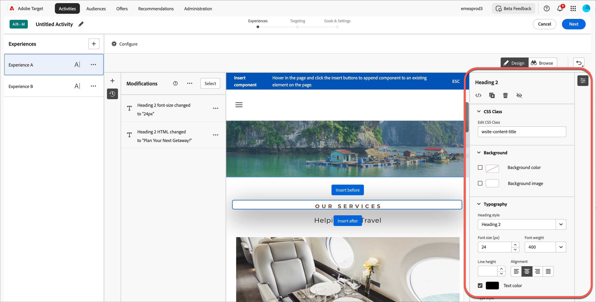

# [!UICONTROL Alterações do Visual Experience Composer] {#vec-changes}

>[!BEGINSHADEBOX]

**Nesta página:** Saiba como o [!UICONTROL Visual Experience Composer] (VEC) atualizado introduzido na versão [!DNL Adobe Target Standard/Premium] 25.2.1 é diferente da versão anterior.

>[!ENDSHADEBOX]

A versão [!DNL Adobe Target Standard/Premium] 25.2.1 (17 de fevereiro de 2025) apresenta o [!UICONTROL Visual Experience Composer] (VEC) atualizado. Este artigo explica as diferenças entre as versões anteriores e atualizadas do VEC.

>[!IMPORTANT]
>
>O [!UICONTROL Visual Experience Composer] atualizado requer a [!DNL Adobe Experience Cloud] [**[!UICONTROL extensão de Auxiliar de Edição Visual &#x200B;]**](/help/main/c-experiences/c-visual-experience-composer/r-troubleshoot-composer/visual-editing-helper-extension.md) disponível no [!DNL Chrome Web Store].

O VEC é exibido quando uma atividade é criada ou uma atividade existente é editada.

## Principais alterações no VEC

As seções a seguir explicam as principais alterações no VEC atualizado em comparação à versão anterior.

### Painel [!UICONTROL Experiências]

Como na versão anterior, o painel **[!UICONTROL Experiências]** permanece no lado esquerdo do VEC. O painel **[!UICONTROL Experiências]** não pode ser recolhido.

As experiências são criadas, renomeadas ou removidas usando o painel **[!UICONTROL Experiências]**.

Clique no ícone **[!UICONTROL Adicionar]** (  ) para adicionar uma nova experiência. Clique no ícone **[!UICONTROL Mais Ações]** (  ) para duplicar, excluir ou redirecionar uma experiência.

### Painel [!UICONTROL Componentes] (novo)

O painel novos **[!UICONTROL Componentes]** adiciona vários componentes à página da Web, que podem ser editados conforme necessário.

Para adicionar um novo componente, selecione o componente desejado no painel **[!UICONTROL Componentes]**, passe o mouse sobre um elemento existente na página e escolha inserir o componente antes ou depois do elemento selecionado.

Se o painel **[!UICONTROL Modificações]** for exibido nesta área em vez do painel **[!UICONTROL Componentes]**, clique no ícone **[!UICONTROL Mostrar Componentes]** (  ). O ícone **[!UICONTROL Mostrar Componentes]** (  ) e o ícone **[!UICONTROL Mostrar Modificações]** (  ) atuam como alternadores que mostram as opções apropriadas.

Para recolher o painel **[!UICONTROL Componentes]** e ampliar a tela **[!UICONTROL Design]** enquanto o painel **[!UICONTROL Componentes]** estiver aberto, clique no ícone (  ).

### Painel [!UICONTROL Modificações]

Para abrir o painel **[!UICONTROL Modificações]**, clique no ícone **[!UICONTROL Mostrar modificações]** (  ) no painel **[!UICONTROL Componentes]**. O painel **[!UICONTROL Modificações]** mudou de posição do lado direito para o lado esquerdo da tela de edição.

>[!NOTE]
>
>Para recolher o painel **[!UICONTROL Modificações]** e ampliar a tela **[!UICONTROL Design]** enquanto o painel **[!UICONTROL Modificações]** estiver aberto, clique no ícone **[!UICONTROL Mostrar Modificações]** (  ).

O painel **[!UICONTROL Modificações]** mostra todas as alterações feitas na página no VEC e permite alterações adicionais (como Seletor de CSS, Mbox e Código personalizado).

Clique no ícone **[!UICONTROL Mais Opções]** (  ) para adicionar uma modificação, excluir todas as modificações ou excluir todas as modificações inválidas. Clique em **[!UICONTROL Selecionar]** para executar operações em massa: **[!UICONTROL Aplicar a Todas as Páginas]** ou **[!UICONTROL Excluir]**.

Para exibir o painel **[!UICONTROL Modificações]** novamente, clique no ícone **[!UICONTROL Ocultar Modificações]** (  ) no painel **[!UICONTROL Modificações]**.

### Painel [!UICONTROL Propriedades] (novo)

O painel **[!UICONTROL Propriedades]** altera as propriedades dos elementos selecionados na página, sejam eles elementos do HTML ou objetos específicos do [!DNL Target], como recomendações ou ofertas.

Clique nos ícones na parte superior do painel para editar o código HTML ou excluir, duplicar ou ocultar elementos. As alterações aparecem no painel **[!UICONTROL Modificações]**.

O painel **[!UICONTROL Propriedades]** pode ser recolhido no painel direito. Clique no ícone **[!UICONTROL Mostrar/Ocultar Propriedades]** (  ) à direita do painel para recolher ou exibir o painel **[!UICONTROL Propriedades]**.

### Configurações/configurações de atividade

Clique no ícone **[!UICONTROL Configurar]** (  ) exibido na parte superior da tela de design para exibir o menu de propriedades da atividade.

As diferentes opções atribuem propriedades, editam regras de entrega de página, especificam preferências do site, adicionam páginas e ativam ou desativam atividades de várias páginas ou de vários públicos-alvo. Atribuir **[!UICONTROL Propriedades]** é um recurso [[!DNL Target Premium]](/help/main/c-intro/intro.md#premium).

A posição e a funcionalidade são semelhantes à interface anterior do VEC.

### [!UICONTROL Design]/[!UICONTROL Procurar] modos

Use os botões **[!UICONTROL Design]**/**[!UICONTROL Procurar]** exibidos na parte superior do painel **[!UICONTROL Propriedades]** para alternar entre o modo de design e de navegação.

Use o modo **[!UICONTROL Procurar]** para navegar no site e escolher o modo de exibição ou a página a ser atualizada. Retorne ao modo **[!UICONTROL Design]** para adicionar ou editar alterações.

### [!UICONTROL Desfazer]/[!UICONTROL Refazer]

As alterações podem ser desfeitas clicando no ícone **[!UICONTROL Desfazer]** (  ).

Para refazer uma ação, expanda o grupo de botões **[!UICONTROL Desfazer]**/**[!UICONTROL Refazer]** e escolha **[!UICONTROL Refazer]**.

### Tela [!UICONTROL Design]

A tela **[!UICONTROL Design]** permite selecionar janelas de visualização, incluindo ajuste à tela, **[!UICONTROL Área de Trabalho]**, **[!UICONTROL Tablet]**, **[!UICONTROL Paisagem Móvel]** e **[!UICONTROL Retrato Móvel]**.

O VEC atualizado também permite aumentar ou diminuir o zoom clicando no ícone apropriado (  ou  ).

## Ilustração visual mostrando as alterações na interface do usuário

A ilustração a seguir mostra as alterações da interface do usuário de alto nível feitas no VEC atualizado. O lado esquerdo da ilustração mostra a interface do VEC anterior, e o lado direito mostra a interface do usuário atualizada. Os números correspondentes mostram onde vários elementos foram movidos ou alterados.

{width="800" zoomable="yes"}

## Mais informações sobre a interface atualizada

* Notas de versão do [[!DNL Target Standard/Premium] 25.2.1 (17 de fevereiro de 2025)](/help/main/r-release-notes/release-notes-for-previous-releases.md#ui-update-2): fornece um resumo das principais alterações na interface do usuário do [!DNL Target] para **[!UICONTROL Atividades]**, **[!UICONTROL Recomendações]** e o [!UICONTROL Visual Experience Composer] (VEC).

* Notas de versão do [[!DNL Target Standard/Premium] 25.1.1 (9 de janeiro de 2025)](/help/main/r-release-notes/release-notes-for-previous-releases.md#ui-update-1): fornece um resumo das principais alterações na interface do usuário do [!DNL Target] para a **[!UICONTROL Biblioteca de Ofertas]**.

* [Compreender a [!DNL Target] Interface](/help/main/c-intro/understand-the-target-ui.md): fornece uma breve visão geral do [!DNL Target], com links para informações mais detalhadas e instruções passo a passo.

* [[!UICONTROL Opções do Visual Experience Composer]](/help/main/c-experiences/c-visual-experience-composer/viztarget-options.md): explica a interface do VEC atualizada e suas opções.

* [[!DNL Target] Perguntas frequentes sobre atualização da interface do usuário](/help/main/c-intro/updated-ui-faq.md): aborda perguntas comuns sobre a nova interface do usuário do [!DNL Target] e o [!UICONTROL Visual Experience Composer] (VEC), incluindo alterações de navegação, locais de recursos e a desativação da opção de versão temporária da interface do usuário.
