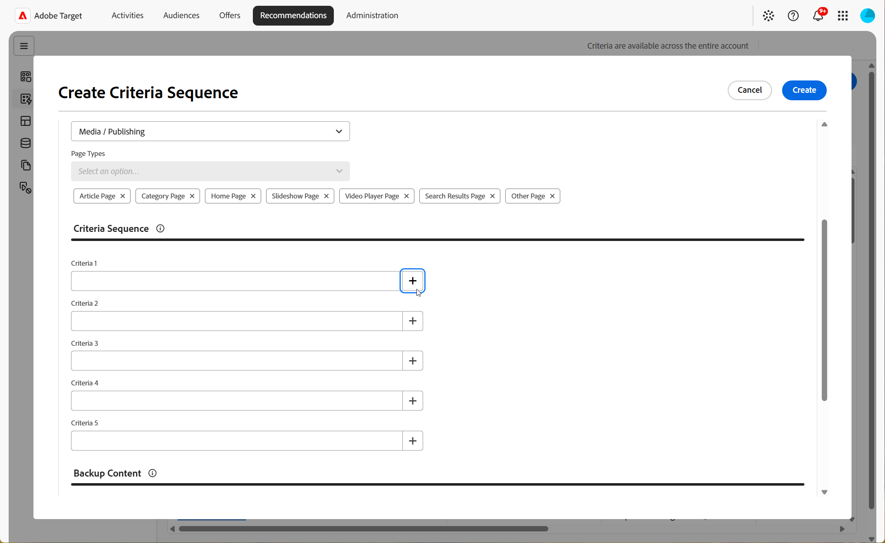

# Criar sequências de critérios {#create-criteria-sequence}

>[!BEGINSHADEBOX]

**Nesta página:** Saiba como criar sequências de critérios para controlar os itens que aparecem em [!DNL Adobe Target Recommendations] atividades.

>[!ENDSHADEBOX]

Sequências de até cinco critérios oferecem maior controle dos itens que aparecem nas atividades [!DNL Adobe Target] **[!UICONTROL Recommendations]**. O número de itens retornados também pode ser limitado (às vezes chamado de &quot;controle no nível do slot&quot;).

Quando um critério não retorna resultados suficientes para preencher o design, uma sequência de critérios fornece recomendações direcionadas adicionais em vez de recomendações de backup mais genéricas. Normalmente, uma sequência de critérios prossegue a partir de um direcionamento mais específico, que pode retornar menos resultados, para um direcionamento mais geral, que geralmente retorna mais resultados.

>[!NOTE]
>
>As sequências de critérios não podem ser usadas com as atividades **[!UICONTROL Recommendations]** criadas antes da versão de outubro de 2016 do [!DNL Target Premium].

Para criar uma sequência de critérios, primeiro crie os critérios a serem incluídos na sequência. Consulte [Criar critérios](/help/main/c-recommendations/c-algorithms/create-new-algorithm.md) para obter mais informações.

A ordem de uma sequência de critérios pode variar dependendo do tipo de página, conforme mostrado nos exemplos a seguir:

| Tipo de página | Ordem de sequência possível |
| --- | --- |
| Página do produto | <ol><li>Com base no item atual, da mesma marca</li><li>Baseado no item atual, de todas as marcas</li><li>Baseado na semelhança de conteúdo</li><li>Baseado nos mais vendidos</li><li>Baseado nos itens mais visualizados por todo site</li></ol> |
| Home page | <ol><li>Baseado na última compra do visitante </li><li>Baseado no item favorito do visitante</li><li>Baseado na categoria favorita do visitante</li><li>Baseado nos mais vendidos</li><li>Baseado nos mais visualizados por todo site</li></ol> |

## Criar uma sequência de critérios

As sequências de critérios são criadas a partir da tela **[!UICONTROL Criar sequência de critérios]**. Há várias maneiras de acessar essa tela. Algumas opções de tela variam dependendo de como a tela é atingida.

* Na tela de biblioteca **[!UICONTROL Recomendações]** > **[!UICONTROL Critérios]**, clique em **[!UICONTROL Criar critério]** > **[!UICONTROL Criar sequência de critérios]**. Os critérios criados aqui ficam disponíveis automaticamente para todas as atividades de **[!UICONTROL Recomendações]**.
* Ao criar uma atividade do **[!UICONTROL Recommendations]**, na tela **[!UICONTROL Selecionar critério]**, clique em **[!UICONTROL Criar novo]** > **[!UICONTROL Criar sequência de critérios]**. A nova sequência de critérios pode ser salva para uso com outras atividades de **[!UICONTROL Recomendações]**.
* Ao editar uma atividade do **[!UICONTROL Recommendations]**, clique em uma caixa de **[!UICONTROL Localização do Recommendations]** na página e selecione **[!UICONTROL Alterar critério]**. Na tela **[!UICONTROL Selecionar critério]**, clique em **[!UICONTROL Criar novo]** > **[!UICONTROL Criar sequência de critérios]**. Os novos critérios podem ser salvos para serem usados com outras atividades de **[!UICONTROL Recomendações]**.

As etapas a seguir pressupõem que a tela **[!UICONTROL Criar sequência de critérios]** seja acessada do menu **[!UICONTROL Critérios]**.

1. Clique em **[!UICONTROL Recomendações]** > **[!UICONTROL Critérios]**.

1. Clique em **[!UICONTROL Criar Critério]** > **[!UICONTROL Criar Sequência de Critérios]**.

   

1. Preencha as informações na seção [Informações Básicas](/help/main/c-recommendations/c-algorithms/create-new-algorithm.md#info).

1. Na seção **[!UICONTROL Sequência de Critérios]**, clique no sinal de adição ( + ) para adicionar uma ou mais sequências de critérios.

   A ordem de sequência define a ordem de preenchimento de um design. Se o Critério 1 não tiver recomendações suficientes para preencher o design, os slots restantes serão preenchidos com o Critério 2 e assim por diante.

   

1. Na tela **[!UICONTROL Selecionar critério]**, selecione um critério e clique em **[!UICONTROL Salvar]**.

   A caixa **[!UICONTROL Pesquisa]** e a opção de filtro podem ser usadas para localizar os critérios desejados.

1. (Opcional) Habilite **[!UICONTROL Limitar o número de itens retornados]** e especifique o número de itens (entre 1 e 50).

   

   Os seguintes casos de uso ilustram o valor da opção **[!UICONTROL Limitar o número de itens retornados]** (às vezes chamada de &quot;controle no nível do slot&quot;).

   +++ Casos de uso para limitar o número de itens retornados

   * **Caso de Uso 1**: uma combinação de diferentes tipos de itens em uma única bandeja de recomendações, por exemplo, uma combinação de roupas (jaquetas) e tops (camisas, camisetas). Para isso, use uma coleção para a atividade que inclua todos os tipos de produtos que podem aparecer em qualquer espaço do design. Em seguida, configure os primeiros critérios com um filtro estático que inclui somente roupas externas e os segundos critérios com um filtro estático que inclui somente tops. Por fim, adicione ambos os critérios a uma sequência de critérios e limite os primeiros critérios a 2 slots.

     A bandeja de recomendações pode ter esta aparência em um site:

     

   * **Caso de uso 2**: uma combinação de itens alternativos e complementares. Configure um critério para usar um algoritmo exibido/exibido e um filtro dinâmico que limite os itens recomendados à categoria do item atual. Configure os segundos critérios para usar um algoritmo exibido/comprado e um filtro dinâmico que inclua apenas itens recomendados que não correspondam à categoria do item atual. Por fim, adicione ambos os critérios a uma sequência e limite os primeiros critérios a 2 slots.

   +++

1. Continue adicionando critérios à sequência. Até cinco critérios podem ser adicionados a uma sequência.

1. Habilitar [opções de Conteúdo de Backup](/help/main/c-recommendations/c-algorithms/create-new-algorithm.md#content).

1. Clique em **[!UICONTROL Criar]**.

A sequência de critérios é exibida na lista de **[!UICONTROL Critérios]**.

Para obter mais informações sobre as opções de lógica de recomendação, consulte [Introdução aos critérios](/help/main/c-recommendations/c-algorithms/algorithms.md).
