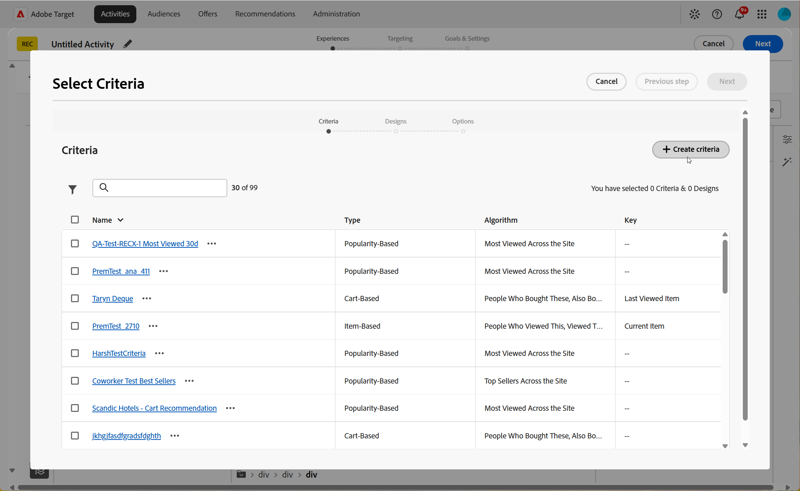
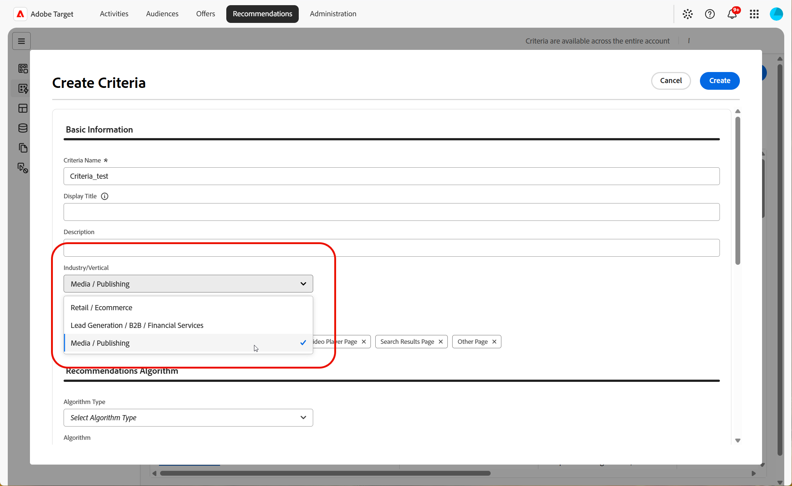
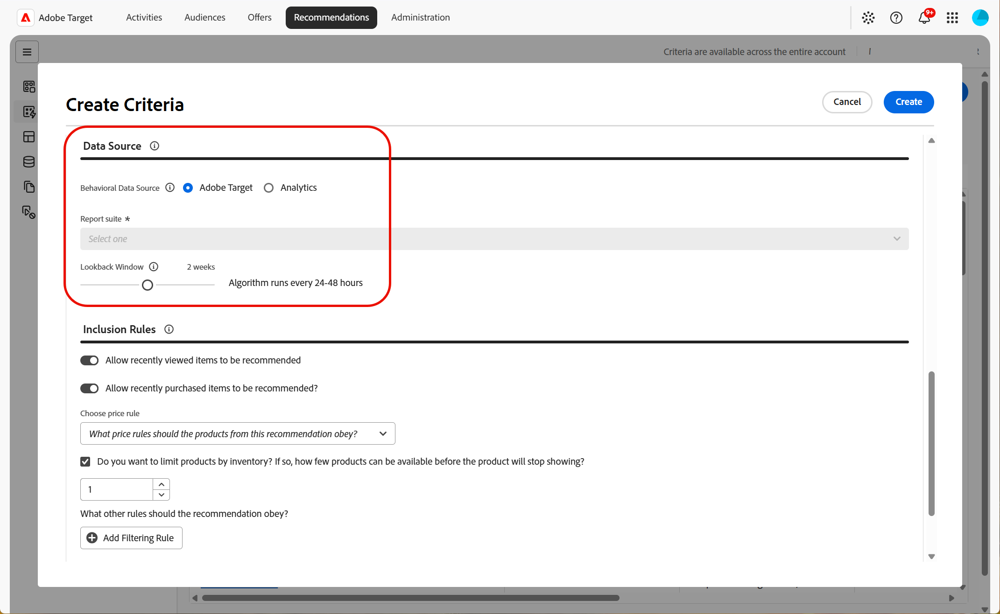

# Criar critérios {#create-criteria}

>[!BEGINSHADEBOX]

**Nesta página:** Saiba como criar critérios em [!DNL Adobe Target Recommendations] e como configurar cada seção de um critério.

>[!ENDSHADEBOX]

Critério em [!DNL Adobe Target] [!DNL Recommendations] controle o conteúdo de [!DNL Recommendations] atividades. Os critérios usam as ações do visitante para determinar qual conteúdo ou produtos exibir, de modo que os critérios adequados mostram as recomendações mais apropriadas para a atividade.

## Acessar a tela Criar novos critérios {#access-create-criteria}

Existem vários meios de alcançar a tela **[!UICONTROL Criar novos critérios]**. Algumas opções de tela variam dependendo de como a tela é atingida.

* Na tela da biblioteca **[!UICONTROL Recomendações]** > **[!UICONTROL Critérios]**, clique em **[!UICONTROL Criar Critérios]** > **[!UICONTROL Criar Critérios]**. Os critérios criados aqui ficam disponíveis automaticamente para todas as atividades de [!DNL Recommendations].

  

* Ao criar uma atividade do [!DNL Recommendations] usando o **[!UICONTROL Visual Experience Composer]** (VEC), a tela **[!UICONTROL Critérios de seleção]** é exibida imediatamente depois que um elemento na página é selecionado e a tela **[!UICONTROL Substituir com o Recommendations]**, **[!UICONTROL Inserir Recommendations antes do]** ou **[!UICONTROL Inserir Recommendations depois do]** é clicada. Selecione um critério disponível ou clique em **[!UICONTROL Criar critério]**. Um novo critério pode ser salvo para uso com outras atividades do [!DNL Recommendations]. Para obter mais informações, consulte [Criar uma atividade do Recommendations](/help/main/c-recommendations/t-create-recs-activity/create-recs-activity.md).

  

* Ao editar uma atividade de [!DNL Recommendations], clique em uma caixa de **[!UICONTROL Localização das recomendações]** na página e selecione **[!UICONTROL Alterar critérios]**. Na tela **[!UICONTROL Selecionar critério]**, clique em **[!UICONTROL Criar critério]**. Os novos critérios podem ser salvos para serem usados com outras atividades do [!DNL Recommendations].

## [!UICONTROL Informações Básicas] {#info}

As informações básicas identificam os critérios e os categorizam para reutilização em outras atividades.

1. Digite um **[!UICONTROL Nome do Critério]**.

   Este é o nome interno usado para descrever o critério. Por exemplo, um critério pode ser chamado de &quot;Produtos de margem mais alta&quot; sem que esse título seja exibido publicamente. O título voltado para o público é definido na próxima etapa.

1. Digite um **[!UICONTROL Título de exibição]** aberto ao público para aparecer na página para qualquer recomendação que use este critério.

   Por exemplo, &quot;Pessoas que viram isto viram aquilo&quot; ou &quot;Produtos semelhantes&quot; podem ser exibidos quando este critério é usado para mostrar recomendações.

1. Digite uma breve **[!UICONTROL Descrição]** dos critérios.

   A descrição deve ajudar a identificar os critérios e pode incluir informações sobre a sua finalidade.

1. Selecione um negócio vertical com base nas metas da atividade de recomendações.

   | Vertical do setor | Meta |
   |--- |--- |
   | **[!UICONTROL Varejo/Comércio eletrônico]** | Conversão resultando em compra |
   | **[!UICONTROL Geração de lead/B2B/Serviços financeiros]** | Conversão sem compra |
   | **[!UICONTROL Mídia/Publicação]** | Engajamento |

   Outras opções de critério mudam com base no vertical do setor selecionado.

   

1. Selecione um **[!UICONTROL Tipo de página]**.

   Vários tipos de página podem ser selecionados. Juntos, o negócio vertical e tipos de página ajudam a categorizar critérios salvos, tornando mais fácil o reuso de critérios para outras atividades do [!DNL Recommendations].

## [!UICONTROL Algoritmo de recomendações] {#rec-algo}

O algoritmo determina como os itens das recomendações são selecionados.

>[!CONTEXTUALHELP]
>id="target_recommendations_profile_attribute"
>title="Atributo de perfil"
>abstract="É possível criar um Atributo de perfil usando Scripts de perfil."

1. Selecione um **[!UICONTROL Tipo de Algoritmo]** e um **[!UICONTROL Algoritmo]**:

   

   | Tipo de algoritmo | Quando usar / Algoritmos disponíveis |
   | --- | --- |
   | **[!UICONTROL Baseado Em Carrinho]** | Faça recomendações com base no conteúdo do carrinho do usuário. <ul><li>**[!UICONTROL Pessoas que os visualizaram, também visualizaram]** </li><li>**[!UICONTROL Pessoas Que Os Visualizaram, Também Compraram]**</li><li>**[!UICONTROL Pessoas que Compraram Estes, Também Compraram]**</li></ul> |
   | **[!UICONTROL Com Base Em Popularidade]** | Faça recomendações com base na popularidade geral de um item em todo o site ou na popularidade de itens dentro da categoria, marca, gênero e assim por diante favoritas ou mais visualizadas do usuário. <ul><li>**[!UICONTROL Mais visualizados em todo o site]**</li><li>**[!UICONTROL Mais Visualizados por Categoria]**</li><li>**[!UICONTROL Mais Visualizados pelo Atributo de Item]**</li><li>**[!UICONTROL Mais visualizados por atributo de perfil]**</li><li>**[!UICONTROL Mais vendidos em todo o site]**</li><li>**[!UICONTROL Mais vendidos por categoria]**</li><li>**[!UICONTROL Mais vendidos por atributo de item]**</li><li>**[!UICONTROL Mais vendidos por atributo de perfil]**</li><li>**[!UICONTROL Métrica Top by Analytics]**</li></ul> |
   | **[!UICONTROL Baseado em Item]** | Fazer recomendações com base em itens semelhantes a um item que o usuário está visualizando atualmente ou que visualizou recentemente. <ul><li>**[!UICONTROL Pessoas Que Visualizaram Isto, Visualizaram Aquilo]**</li><li>**[!UICONTROL Pessoas que Visualizaram Isto, Compraram Aquilo]**</li><li>**[!UICONTROL Pessoas que Compraram Isto, Compraram Aquilo]**</li><li>**[!UICONTROL Itens com Atributos Semelhantes]**</li></ul> |
   | **[!UICONTROL Baseado em Usuário]** | Faça recomendações com base no comportamento do usuário.<ul><li>**[!UICONTROL Itens visualizados recentemente]**</li><li>**[!UICONTROL Recomendado para você]**</li></ul> |
   | **[!UICONTROL Critérios personalizados]** | Fazer recomendações com base em um arquivo personalizado carregado.<ul><li>Algoritmo personalizado</li></ul> |

   >[!NOTE]
   >
   >Quando **[!UICONTROL Itens]**/ **[!UICONTROL Mídia com Atributos Semelhantes]** é selecionado, as [regras de similaridade de conteúdo](#similarity) podem ser definidas.

1. Configure o algoritmo conforme necessário selecionando uma **[!UICONTROL Chave de recomendação]**, **[!UICONTROL Chave de Filtragem]**, **[!UICONTROL Base de Ocorrência Conjunta]**, **[!UICONTROL Métrica do Analytics]** e/ou **[!UICONTROL Atributo de Item]** e **[!UICONTROL Atributo de Perfil Correspondente]**. As opções de configuração disponíveis variam de acordo com o algoritmo selecionado.

   Para obter mais informações sobre como escolher uma **[!UICONTROL Chave de recomendação]**, consulte [Basear a recomendação em uma chave de recomendação](/help/main/c-recommendations/c-algorithms/base-the-recommendation-on-a-recommendation-key.md).

1. (Condicional) Para **[!UICONTROL Mais Visualizados pelo Atributo de Perfil]** ou **[!UICONTROL Mais Vendidos por Atributo de Perfil]**, selecione um **[!UICONTROL Atributo de Perfil]** para agrupar os dados de interação.

   Os atributos de perfil vêm de um script de perfil que captura uma característica do visitante, como região ou país. O nome do script deve ter o prefixo `recsAttribute`, de modo que seja armazenado como `user.recsAttribute<Name>`, por exemplo, `user.recsAttributeRegion`. No momento da entrega, [!DNL Target] fornece a cada visitante a lista classificada que corresponde ao seu próprio valor desse atributo.

## [!UICONTROL Conteúdo de Backup] {#content}

As regras de **[!UICONTROL Conteúdo de Backup]** determinam o que acontecerá se o número de itens recomendados não preencher o [design de recomendações](/help/main/c-recommendations/c-design-overview/design-overview.md). Os critérios podem retornar menos recomendações do que o design requer. Por exemplo, se o design tiver slots para quatro itens, mas os critérios fizerem com que apenas dois itens sejam recomendados, os slots restantes podem ser deixados vazios ou preenchidos com recomendações de backup, ou nenhuma recomendação pode ser exibida.

1. (Opcional) Habilite a opção **[!UICONTROL Renderização de Design Parcial]**.

   O máximo possível de slots está preenchido, mas o modelo de design pode incluir espaço em branco para os slots restantes. Se essa opção estiver desativada e não houver conteúdo suficiente para preencher todos os slots disponíveis, as recomendações não serão fornecidas e o conteúdo padrão será exibido.

   Habilite essa opção para atender às recomendações com espaços em branco. Para preencher os slots vazios com conteúdo semelhante ou popular do site, use as recomendações de backup, conforme explicado na próxima etapa.

1. (Opcional) Habilite a opção **[!UICONTROL Mostrar conteúdo do backup]**.

   As recomendações de backup preenchem todos os slots vazios restantes no design com uma seleção aleatória dos produtos mais visualizados em todo o site, de modo que o design sempre preenche todos os slots disponíveis. O exemplo a seguir usa um design 4 x 1:

   

   Se os critérios fizerem com que apenas dois itens sejam recomendados e a opção **[!UICONTROL Renderização de design parcial]** estiver habilitada, os dois primeiros slots serão preenchidos e os dois slots restantes permanecerão vazios. Se a opção **[!UICONTROL Mostrar Conteúdo do Backup]** estiver habilitada, os dois primeiros slots serão preenchidos com base nos critérios especificados e os dois slots restantes serão preenchidos com base nas recomendações de backup.

   +++ A matriz a seguir mostra o resultado de cada combinação das opções **[!UICONTROL Renderização de Design Parcial]** e **[!UICONTROL Conteúdo de Backup]**

   | Renderização parcial de design | Conteúdo de backup | Resultado |
   |--- |--- |--- |
   | Desativado | Desativado | Se forem retornadas menos recomendações do que o design solicita, o design das recomendações será substituído pelo conteúdo padrão, e nenhuma recomendação será exibida. |
   | Ativado | Desativado | O design é renderizado, mas pode incluir espaço em branco se menos recomendações forem retornadas do que as chamadas de design para. |
   | Ativado | Ativado | As recomendações de backup preenchem os &quot;slots&quot; de design disponíveis, renderizando totalmente o design. Se a aplicação de regras de inclusão às recomendações de backup limitar o número de recomendações de backup qualificadas ao ponto de não ser possível preencher o design, o design será parcialmente renderizado. Se os critérios não retornarem nenhuma recomendação e as regras de inclusão limitarem as recomendações de backup a zero, o design será substituído pelo conteúdo padrão. |
   | Desativado | Ativado | As recomendações de backup preenchem os &quot;slots&quot; de design disponíveis, renderizando totalmente o design. Se a aplicação de regras de inclusão às recomendações de backup limitar o número de recomendações de backup qualificadas ao ponto de não ser possível preencher o design, o design será substituído pelo conteúdo padrão, e nenhuma recomendação será exibida. |

   Para obter mais informações, consulte [Usar uma recomendação de backup](/help/main/c-recommendations/c-algorithms/backup-recs.md).
   +++

1. (Condicional) Se **[!UICONTROL Mostrar Conteúdo do Backup]** estiver habilitado, **[!UICONTROL Aplicar regras de inclusão às recomendações de backup]** também poderá ser habilitado.

   As regras de inclusão determinam quais itens são incluídos nas recomendações. As opções disponíveis dependem do negócio vertical.

   Para obter mais detalhes, consulte [Especificar regras de inclusão](#inclusion) abaixo.

## [!UICONTROL Source de dados] {#data-source}

A fonte de dados determina os dados comportamentais que o critério usa e o intervalo de tempo desses dados.

1. Selecione a **[!UICONTROL Source de Dados Comportamentais]** desejada: **[!UICONTROL Adobe Target]** ou **[!UICONTROL Analytics]**.

   >[!NOTE]
   >
   >A seção **[!UICONTROL Behavioral Data Source]** será exibida somente se a implementação usar o [Analytics for Target](/help/main/c-integrating-target-with-mac/a4t/a4t.md) (A4T).

   

   Para o **[!UICONTROL Analytics]**, selecione o conjunto de relatórios desejado.

   +++ Disponibilidade de critérios quando o Analytics é a fonte de dados

   Quando [!DNL Adobe Analytics] é a fonte de dados comportamentais, o tempo até que um novo critério esteja disponível dependerá se o conjunto de relatórios selecionado e a janela de lookback foram usados para quaisquer outros critérios:

   * **Configuração única do conjunto de relatórios**: a primeira vez que um conjunto de relatórios é usado com determinada janela de lookback do intervalo de dados, [!DNL Target Recommendations] pode levar de dois a sete dias para baixar completamente os dados comportamentais do conjunto de relatórios selecionado no [!DNL Analytics]. Este intervalo de tempo depende da carga do sistema [!DNL Analytics].
   * **Critérios novos ou editados usando um conjunto de relatórios já disponível**: ao criar um novo critério ou editar um critério existente, se o conjunto de relatórios selecionado já tiver sido usado com [!DNL Target Recommendations], com um intervalo de dados igual ou maior que o intervalo de dados selecionado, os dados serão imediatamente disponibilizados e a configuração única não será necessária. Nesse caso ou se as configurações de um algoritmo forem editadas, enquanto o conjunto de relatórios ou intervalo de dados selecionado não for modificado, o algoritmo será executado ou executado novamente em 12 horas.
   * **O algoritmo contínuo é executado**: os dados fluem do [!DNL Analytics] para [!DNL Target Recommendations] diariamente. Por exemplo, para a recomendação **[!UICONTROL Afinidade visualizada]**, quando um usuário exibe um produto, uma chamada de rastreamento de exibições do produto é passada para [!DNL Analytics] quase em tempo real. Os dados do [!DNL Analytics] são encaminhados para o [!DNL Target] no início do dia seguinte e o [!DNL Target] executa o algoritmo em menos de 12 horas.

   Para obter mais informações, consulte [Usar o Adobe Analytics com Recomendações do Target](/help/main/c-recommendations/c-algorithms/use-adobe-analytics-with-recommendations.md).

   +++

1. Defina a **[!UICONTROL Janela de pesquisa]** para determinar o intervalo de tempo de dados históricos disponíveis do comportamento do usuário, ao determinar quais recomendações serão mostradas. Esta opção está disponível para todos os algoritmos, com exceção de **[!UICONTROL Itens com Atributos Semelhantes]** e **[!UICONTROL Algoritmos Personalizados]**.

   Para um site com muito tráfego onde os comportamentos mudam frequentemente, escolha uma janela de dados mais curta. Uma janela menor torna o [!DNL Recommendations] mais responsivo às alterações no mercado e nos negócios. Por exemplo, o [!DNL Recommendations] detecta alterações no comportamento do visitante conforme os visitantes começam a fazer compras sazonais, como compras de volta às aulas ou de Natal, e recomenda itens apropriados para essas temporadas de compras.

   Se o site não tiver muitos dados ou se o comportamento do visitante não mudar com frequência, selecione uma janela mais longa. No entanto, para muitos sites, uma janela menor resulta em recomendações de maior qualidade.

   +++ Intervalos de dados disponíveis

   | Opção Janela de pesquisa | Frequência atualizada (exibida ao passar o mouse) | Algoritmos compatíveis |
   | --- | --- | --- |
   | Seis horas | O algoritmo é executado a cada 3-6 horas | **[!UICONTROL Algoritmos]** baseados em popularidade quando o **[!UICONTROL Source de Dados Comportamentais]** selecionado é [!DNL Adobe Target] |
   | Um dia | O algoritmo é executado a cada 12-24 horas | **[!UICONTROL Algoritmos]** com base em popularidade |
   | Dois dias | O algoritmo é executado a cada 12-24 horas | <ul><li>**[!UICONTROL Algoritmos]** com base em popularidade</li><li>**[!UICONTROL Algoritmos]** baseados em itens</li><li>**[!UICONTROL Algoritmos]** com base no usuário</li><li>**[!UICONTROL Algoritmos]** baseados em carrinho</li></ul> |
   | Uma semana | O algoritmo é executado a cada 24-48 horas | <ul><li>**[!UICONTROL Algoritmos]** com base em popularidade</li><li>**[!UICONTROL Algoritmos]** baseados em itens</li><li>**[!UICONTROL Algoritmos]** com base no usuário</li><li>**[!UICONTROL Algoritmos]** baseados em carrinho</li></ul> |
   | Duas semanas | O algoritmo é executado a cada 24-48 horas | <ul><li>**[!UICONTROL Algoritmos]** com base em popularidade</li><li>**[!UICONTROL Algoritmos]** baseados em itens</li><li>Todos os algoritmos **[!UICONTROL baseados em usuário]**</li><li>**[!UICONTROL Algoritmos]** baseados em carrinho</li></ul> |
   | Um mês (30 dias) | O algoritmo é executado a cada 24-48 horas | <ul><li>**[!UICONTROL Algoritmos]** com base em popularidade</li><li>**[!UICONTROL Algoritmos]** baseados em itens</li><li>**[!UICONTROL Algoritmos]** com base no usuário</li><li>**[!UICONTROL Algoritmos]** baseados em carrinho</li></ul> |
   | Dois meses (61 dias) | O algoritmo é executado a cada 24-48 horas | <ul><li>**[!UICONTROL Algoritmos]** com base em popularidade</li><li>**[!UICONTROL Algoritmos]** baseados em itens</li><li>**[!UICONTROL Algoritmos]** com base no usuário</li><li>**[!UICONTROL Algoritmos]** baseados em carrinho</li></ul> |

   +++

## Similaridade de conteúdo {#similarity}

Use as regras de **[!UICONTROL Similaridade de conteúdo]** para fazer recomendações baseadas em atributos de item ou mídia.

Similaridade de conteúdo compara palavras-chave de atributo do item e faz recomendações baseadas em quantas palavras-chave itens diferentes têm em comum. As recomendações baseadas em similaridade de conteúdo não exigem dados anteriores.

A similaridade de conteúdo é eficaz para novos itens, que provavelmente não serão exibidos nas recomendações usando *Pessoas que assistiram isto, também assistiram* e outra lógica baseada no comportamento anterior. Ele também pode gerar recomendações para novos visitantes, que não têm compras anteriores ou outros dados históricos.

Quando **[!UICONTROL Item-Based]**/ **[!UICONTROL Item com Atributos Similares]** é selecionado, regras podem ser criadas para aumentar ou diminuir a importância de atributos específicos do item em determinadas recomendações. Para itens como livros, a importância de atributos como *gênero*, *autor*, *série*, entre outros, pode ser aumentada para recomendar livros semelhantes.

A similaridade de conteúdo usa palavras-chave para comparar itens; portanto, alguns atributos, como *mensagem* ou *descrição*, podem introduzir &quot;ruído&quot; na comparação. As regras podem ser criadas para ignorar esses atributos.

Por padrão, todos atributos são definidos como *Linha de base*. Uma regra é necessária somente para alterar essa configuração.

>[!NOTE]
>
>O algoritmo de similaridade de conteúdo pode usar amostragem aleatória ao calcular a similaridade entre itens. Como resultado, as classificações de similaridade entre itens podem variar entre execuções de algoritmo.

## Regras de inclusão {#inclusion}

As regras de inclusão restringem os itens exibidos nas recomendações. Eles podem ser usados ao criar critérios ou promoções. As regras de inclusão são opcionais; no entanto, a configuração desses detalhes oferece mais controle sobre os itens que aparecem nas recomendações. Cada detalhe configurado restringe ainda mais os critérios de exibição.

Por exemplo, apenas sapatos femininos que tenham um inventário superior a 50 e um preço entre US$ 25 e US$ 45 podem ser exibidos. Cada atributo também pode ser ponderado para que os itens mais importantes para a empresa tenham maior probabilidade de aparecer. Como outro exemplo, as aberturas de emprego podem ser exibidas somente para visitantes que visitam o site de determinadas cidades e que têm os graus universitários necessários.

Opções de regras de inclusão variam pelo negócio vertical. Por padrão, regras de inclusão são aplicadas em recomendações de backup. As regras de inclusão são unidas com um AND, portanto, todas as regras devem ser atendidas para incluir um item em uma recomendação.

>[!IMPORTANT]
>
>Use as regras de inclusão com cuidado. Elas são úteis se, por exemplo, a organização tiver regras que exijam que uma marca não seja recomendada enquanto outra marca estiver sendo exibida. No entanto, esse recurso tem um custo de oportunidade: restringir itens que os critérios da atividade normalmente mostrariam poderia perder uma porcentagem do aumento.

As etapas a seguir criam uma regra de inclusão simples que exibe somente sapatos femininos que têm um inventário superior a 50 e um preço entre US$ 25 e US$ 45:

1. (Condicional) Habilitar **[!UICONTROL Permitir que itens adquiridos recentemente sejam recomendados]**.

   Esta configuração é baseada no `productPurchasedId`. O comportamento padrão é não recomendar itens comprados anteriormente. Na maioria dos casos, os itens que um cliente comprou recentemente não devem ser promovidos. A configuração é útil para itens que as pessoas normalmente compram apenas uma vez, como caiaques. Para itens que as pessoas compram repetidamente, como shampoo ou outros itens pessoais, ative essa opção.

1. Defina um intervalo de preços para os produtos a serem recomendados.

1. Defina o inventário mínimo para os produtos a serem recomendados.

1. Configure a recomendação para que exiba itens que satisfaçam os critérios.

   Os itens podem ser incluídos somente quando um dos atributos na lista atende ou não corresponde a uma ou mais condições especificadas.

   Os avaliadores disponíveis dependem do valor escolhido na primeira lista suspensa. Vários itens podem ser listados e são avaliados com OR. Regras múltiplas são combinadas com um AND.

   >[!NOTE]
   >
   >Essa opção limita os itens exibidos na recomendação. Isso não afeta em quais páginas a recomendação é exibida. Para limitar onde a recomendação é exibida, selecione as páginas no compositor de experiência.

Para obter mais informações, consulte [Usar regras de inclusão estática e dinâmica](/help/main/c-recommendations/c-algorithms/use-dynamic-and-static-inclusion-rules.md).

## Ponderação de atributos {#weighting}

Várias regras podem ser adicionadas para &quot;empurrar&quot; o algoritmo com base em informações importantes ou metadados sobre o catálogo de conteúdo, de modo que determinados itens tenham mais probabilidade de ser exibidos.

Por exemplo, uma ponderação mais alta pode ser aplicada aos itens à venda para que apareçam com mais frequência na recomendação. Itens que não estão em liquidação não são totalmente excluídos, mas aparecem com menos frequência. Podem ser aplicados muitos pesos ao mesmo algoritmo, e os pesos podem ser testados no tráfego dividido na recomendação.

1. Escolha um valor.

   O valor determina o tipo do item que é mais provável de ser exibido, baseado em um de vários critérios disponíveis.

1. Escolha um avaliador.

1. Insira a palavra-chave para completar os atributos da regra.

   Por exemplo, a regra completa pode ser &quot;Categoria contém sapatos de subsequência de caracteres&quot;.

1. Selecione o peso a ser designado à regra.

   Opções variam de 0 a 100 em incrementos de 25.

1. Adicione regras adicionais, se desejar.

Quando terminar, clique em **[!UICONTROL Criar]**.

Quando uma nova atividade **[!UICONTROL Recommendations]** é criada ou uma atividade existente é editada, a caixa de seleção **[!UICONTROL Salvar critérios para mais tarde]** é selecionada por padrão. Para impedir o uso dos critérios em outras atividades, desmarque a caixa de seleção antes de salvar.
