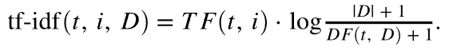
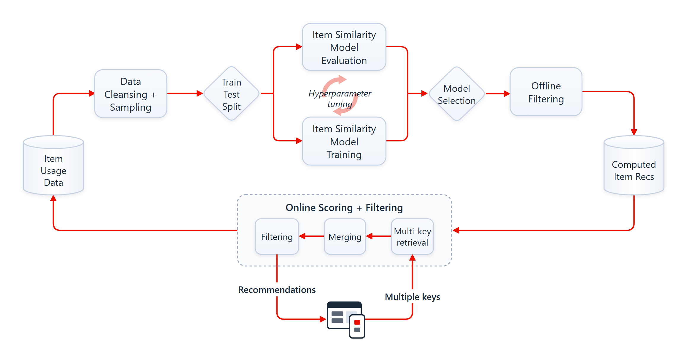

# A ciência por trás dos algoritmos de recomendações do Target {#recommendations-algorithms}

>[!BEGINSHADEBOX]

**Nesta página:** saiba como funcionam os algoritmos em [!DNL Adobe Target Recommendations], incluindo os detalhes lógicos e matemáticos do treinamento e fornecimento de modelos.

>[!ENDSHADEBOX]

O treinamento de modelo é o processo pelo qual os algoritmos de aprendizado do [!DNL Adobe Target] geram recomendações. A veiculação de modelos, também conhecida como entrega de conteúdo, é a forma como o [!DNL Target] fornece essas recomendações aos visitantes do site.

[!DNL Target] oferece os seguintes tipos de algoritmos em [!DNL Recommendations]:

* **Algoritmos baseados em itens**: siga a lógica &quot;As pessoas que visualizaram/compraram este item também visualizaram/compraram estes itens.&quot; Esses algoritmos são agrupados no termo filtragem colaborativa item-item. Este tipo também inclui os **[!UICONTROL Itens com algoritmos de Atributos similares]**.

* **Algoritmos baseados em usuário**: inclua os **[!UICONTROL Itens visualizados recentemente]** e **[!UICONTROL Recomendados para você]** algoritmos.

* **Algoritmos baseados em popularidade**: retorna os itens mais vistos ou comprados pelo site, por categoria ou atributo de item.

* **Algoritmos baseados em carrinho**: faça recomendações de vários itens com a lógica &quot;pessoas que visualizaram/compraram esses itens também visualizaram/compraram esses itens&quot;.

* **Critério personalizado**: use arquivos personalizados carregados em [!DNL Target] como fonte de recomendações.

Para obter mais informações sobre cada tipo de algoritmo e seus algoritmos, consulte [Basear a recomendação em uma chave de recomendação](/help/main/c-recommendations/c-algorithms/base-the-recommendation-on-a-recommendation-key.md).

Muitos desses algoritmos dependem de uma ou mais chaves, que [!DNL Target] usa no momento da entrega do conteúdo (quando recomendações são feitas) para recuperar itens semelhantes. As chaves especificadas pelo cliente podem ser o item atual que o visitante está visualizando, o último item visualizado ou comprado, o item mais visualizado, a categoria atual ou a categoria favorita do visitante. Outros algoritmos, como os algoritmos baseados no carrinho e no usuário, usam chaves implícitas que não podem ser configuradas pelo cliente. Para obter mais informações, consulte [Chaves de recomendação](/help/main/c-recommendations/c-algorithms/base-the-recommendation-on-a-recommendation-key.md#keys).

As chaves se aplicam somente no momento do fornecimento do modelo (entrega de conteúdo). Eles não afetam a lógica de treinamento do modelo offline.

As seções a seguir agrupam os algoritmos pela similaridade da lógica de treinamento do modelo, de modo que os grupos diferem ligeiramente dos tipos acima.

## Filtragem colaborativa de item-item

Os algoritmos incluem:

* **[!UICONTROL Pessoas Que Visualizaram Isto, Visualizaram Aquilo]**
* **[!UICONTROL Pessoas que Visualizaram Isto, Compraram Aquilo]**
* **[!UICONTROL Pessoas que Compraram Isto, Compraram Aquilo]**

Os algoritmos de filtragem colaborativa item-item usam os padrões comportamentais de muitos usuários (portanto, colaborativos) para recomendar itens relacionados a um determinado item, que filtra o catálogo de itens possíveis. Muitos algoritmos diferentes se enquadram no âmbito geral da filtragem colaborativa, e todos eles usam dados comportamentais como entrada. No [!DNL Target Recommendations], essas entradas são exibições e compras de itens por usuários.

Para os algoritmos &quot;pessoas que visualizaram/compraram esse item também visualizaram/compraram esses itens&quot;, o objetivo é calcular uma similaridade s(A,B) entre todos os pares de itens. Para um determinado item A, as principais recomendações são os itens ordenados por sua similaridade s(A,B).

Um exemplo de similaridade é a coocorrência entre itens: uma contagem dos usuários que compraram ambos os itens. Essa métrica é intuitiva, mas ingênua, porque é tendenciosa para recomendar itens populares. Por exemplo, em um supermercado onde a maioria das pessoas compra pão, o pão tem uma alta coocorrência com todos os itens, mas não é necessariamente uma boa recomendação. [!DNL Target] em vez disso, usa a LLR (taxa de probabilidade de log). Essa quantidade é grande quando a probabilidade de dois itens, A e B, coocorrendo é muito diferente da probabilidade deles não coocorrendo. Por exemplo, com o algoritmo **[!UICONTROL Pessoas que visualizaram isto, compraram aquilo]**, a similaridade do LLR é grande quando a probabilidade de alguém comprar B é *não* independentemente de alguém ter visualizado A.

O item B não é recomendado com o item A quando o seguinte é retido:

Para obter detalhes completos sobre o cálculo de similaridade da taxa de probabilidade de log, consulte [esta PDF](/help/main/c-recommendations/c-algorithms/assets/log-likelihood-ratios-recommendation-algorithms.pdf).

O diagrama esquemático a seguir mostra o fluxo lógico da implementação do algoritmo:

As etapas são as seguintes:

* **Dados de entrada**: dados comportamentais na forma de compras e exibições de visitantes, coletados ao [implementar o Target](https://experienceleague.adobe.com/docs/target-dev/developer/recommendations.html){target=_blank} ou no [Adobe Analytics](/help/main/c-recommendations/c-algorithms/use-adobe-analytics-with-recommendations.md){target=_blank}.

* **Treinamento de modelo**:

  * **Limpeza e amostragem de dados**: para algoritmos com retrospectiva de N dias, os dados comportamentais são filtrados pela primeira vez para incluir apenas esses N dias de dados. As regras de coleção e as exclusões globais são aplicadas para remover quaisquer itens que não devem ser recomendados. Por fim, os dados de uso de qualquer visitante que interagiu com mais de 1.000 itens são amostrados para 1.000 itens.
  * **Computação de similaridade de item**: a etapa computacional principal. [!DNL Target] calcula a similaridade da taxa de probabilidade de log entre todos os pares de itens candidatos e classifica os pares por essa pontuação.
  * **Filtragem offline**: qualquer outro filtro dinâmico aplicável é aplicado (por exemplo, exclusões de categoria dinâmica). As recomendações pré-calculadas são armazenadas em cache globalmente, prontas para uso.

* **Atendimento de modelos**: as recomendações são entregues pela [rede global &quot;Edge&quot;](/help/main/c-intro/how-target-works.md#concept_0AE2ED8E9DE64288A8B30FCBF1040934) de [!DNL Target]. Quando uma solicitação de mbox é feita para [!DNL Target] e é determinado que o conteúdo das recomendações deve ser entregue à página, a [chave de item](/help/main/c-recommendations/c-algorithms/base-the-recommendation-on-a-recommendation-key.md#keys) de que o algoritmo precisa é analisada a partir da solicitação ou pesquisada a partir do perfil do visitante. O [!DNL Target] usa essa chave para recuperar as recomendações computadas nas etapas anteriores, aplica mais filtros dinâmicos e renderiza o [design](/help/main/c-recommendations/c-design-overview/create-design.md) apropriado.

## Similaridade de conteúdo

Algoritmo incluído:

* **[!UICONTROL Itens com Atributos Semelhantes]**

Com este algoritmo, dois itens são relacionados se seus nomes e descrições textuais são semanticamente semelhantes. Diferentemente da maioria dos algoritmos de recomendações, que exigem dados comportamentais, os algoritmos de similaridade de conteúdo derivam a similaridade entre itens dos metadados do catálogo de produtos. [!DNL Target] pode, portanto, fazer recomendações nos chamados cenários de &quot;início frio&quot;, onde nenhum dado comportamental foi coletado ainda (por exemplo, no início de uma atividade [!DNL Target]).

O fornecimento de modelo e a entrega de conteúdo para algoritmos de similaridade de conteúdo são idênticos aos dos outros algoritmos baseados em itens. O treinamento do modelo é muito diferente: envolve uma série de etapas de processamento e pré-processamento de linguagem natural, mostradas no diagrama a seguir. O núcleo do cálculo de similaridade é a similaridade do cosseno de vetores tf-idf modificados que representam cada item no catálogo.

As etapas são as seguintes:

* **Dados de entrada**: este algoritmo usa apenas dados de catálogo, assimilados para [!DNL Target] por meio de um [feed de catálogo, da API de Entidades ou de atualizações na página](https://experienceleague.adobe.com/docs/target-dev/developer/recommendations.html){target=_blank}.

* **Treinamento de modelo**:

  * **Extração de atributo**: depois da aplicação de filtros estáticos, regras de catálogo e exclusões globais, o algoritmo extrai os campos de texto relevantes do esquema de entidade. [!DNL Target] usa automaticamente os campos de nome, mensagem e categoria dos atributos de entidade. Ele também tenta extrair campos de sequência de caracteres de [atributos de entidade](/help/main/c-recommendations/c-products/entity-attributes.md) personalizados. Um campo é tratado como um campo de sequência quando a maioria de seus valores não pode ser analisada como número, data ou booleano.
  * **Remoção de palavras-chave e palavras-chave**: para tornar mais precisa a correspondência de similaridade de texto, [!DNL Target] remove palavras &quot;stop&quot; muito comuns que não alteram significativamente o significado de um item (por exemplo, &quot;was&quot;, &quot;is&quot; e &quot;and&quot;). O radical reduz palavras com sufixos diferentes à palavra raiz, que tem um significado idêntico (por exemplo, &quot;conectar&quot;, &quot;conectar&quot; e &quot;conexão&quot; têm a palavra raiz &quot;conectar&quot;). [!DNL Target] usa o lematizador de Snowball. Ele executa a detecção automática de idioma primeiro, e pode remover palavras de interrupção para até 50 idiomas e executar a derivação para 18 idiomas.
  * **n-grama criação**: após as etapas anteriores, cada palavra é tratada como um token. A combinação de sequências contíguas de tokens em um único token é chamada de criação n-grama. [!DNL Target] considera até 2 gramas.
  * **computação de tf-idf**: a próxima etapa cria vetores de tf-idf que refletem a importância relativa de tokens na descrição do item. Para cada token ou termo t em um item i, em um catálogo D com |D| itens, [!DNL Target] primeiro calcula a frequência do termo TF(t, i), que é o número de vezes que o termo aparece no item i, e a frequência do documento DF(t, D), que é o número de itens nos quais o token t existe. A medida do tf-idf é então:

    

    [!DNL Target] usa a implementação de recurso *tf-idf* do Apache Spark, que coloca cada token em hash para um espaço de 218 tokens. Nesta etapa, o atributo de reforço e enterramento especificado nos [critérios](/help/main/c-recommendations/c-algorithms/create-new-algorithm.md#similarity) também é aplicado, ajustando as frequências dos termos em cada vetor.

  * **Computação de similaridade de item**: a similaridade de item final é computada com uma similaridade aproximada de cosseno. Para dois itens, *A* e *B*, com os vetores tA e tB, a similaridade do cosseno é definida como:

    

    Para evitar a complexidade significativa de calcular semelhanças entre todos os itens N x N, o vetor *tf-idf* é truncado em suas maiores 500 entradas e as semelhanças cosseno entre itens são computadas a partir dessa representação truncada. Essa abordagem é mais robusta para computações de similaridade de vetor esparso do que outras técnicas de vizinho mais próximo aproximado (ANN), como hash sensível à localidade.

* **Serviço de modelo**: esse processo é idêntico ao processo de filtragem colaborativa item-item, descrito na seção anterior.

## Recomendações de várias chaves

Os algoritmos incluem:

* Recomendações baseadas em carrinho
* **[!UICONTROL Recomendado para você]**

**[!UICONTROL Recomendado para você]** e os algoritmos baseados em carrinho usam técnicas de filtragem colaborativa para formar recomendações individuais baseadas em itens. No momento da entrega, vários itens são usados como chaves para recuperar essas recomendações baseadas em itens: os itens no histórico de navegação do visitante (para **[!UICONTROL Recomendado para você]**) ou no carrinho atual do visitante (para recomendações baseadas em carrinho). As recomendações recuperadas são mescladas para formar a lista final. Com um algoritmo de várias chaves, as recomendações estão disponíveis assim que um visitante tem um histórico de navegação e são atualizadas para refletir o comportamento mais recente do visitante.

Esses algoritmos se baseiam nas técnicas de filtragem colaborativa descritas na seção recomendações baseadas em itens e também usam o ajuste de hiperparâmetros para determinar a métrica de similaridade ideal entre itens. O algoritmo divide os dados comportamentais de cada usuário cronologicamente e treina modelos de recomendação nos dados anteriores, enquanto tenta prever os itens que o usuário visualiza ou compra posteriormente. Em seguida, é escolhida a métrica de similaridade com a melhor Precisão média.

O diagrama a seguir mostra a lógica das etapas de treinamento e pontuação do modelo:

As etapas são as seguintes:

* **Dados de entrada**: idênticos aos métodos de filtragem colaborativa (CF) item-item. Os algoritmos **[!UICONTROL Recomendado para você]** e Baseado em carrinho usam dados comportamentais na forma de exibições e compras do usuário, coletados ao [implementar o Target](https://experienceleague.adobe.com/docs/target-dev/developer/recommendations.html){target=_blank} ou da [Adobe Analytics](/help/main/c-recommendations/c-algorithms/use-adobe-analytics-with-recommendations.md){target=_blank}.

* **Treinamento de modelo**:

  * **Limpeza de dados e amostragem**: o mesmo para os métodos de filtragem colaborativa. A janela de pesquisa filtra os dados comportamentais para um intervalo de datas apropriado e, em seguida, as regras de catálogo e as exclusões globais são aplicadas. Para visitantes que interagiram com mais de 1.000 itens, somente os 1.000 usos mais recentes são considerados.
  * **Divisão do teste de treinamento**: os usos de cada usuário são divididos cronologicamente. Os primeiros 80% são alocados aos dados de treinamento e os 20% restantes aos dados de teste.
  * **Treinamento do modelo de similaridade de item**: a computação de similaridade de item principal difere entre **[!UICONTROL Recomendado para você]** e Baseado em carrinho em como os vetores de item candidatos são construídos. Para **[!UICONTROL Recomendado para Você]**, os vetores de item têm NUsers de dimensão, e cada entrada é a soma das classificações implícitas que o usuário deu ao item. As compras têm um peso 2x maior que o das visualizações. Para recomendações Baseadas em Carrinho, os vetores de item têm entradas binárias. Se somente o comportamento dentro da sessão for considerado, haverá uma entrada para cada sessão. Caso contrário, há uma entrada para cada visitante.

    A etapa de treinamento calcula vários tipos de similaridades de vetor: similaridade de LLR ([veja o PDF](/help/main/c-recommendations/c-algorithms/assets/log-likelihood-ratios-recommendation-algorithms.pdf)), similaridade de cosseno (definida anteriormente) e similaridade de L2 normalizada, definida como:

    

  * **Avaliação do modelo de similaridade de item**: as recomendações geradas na etapa anterior são avaliadas fazendo previsões no conjunto de dados de teste. A fase de pontuação online é mimetizada pela ordem cronológica dos usos dos itens de cada usuário no conjunto de dados de teste e, em seguida, fazendo 100 recomendações para subconjuntos ordenados de itens para prever exibições e compras subsequentes. A qualidade dessas recomendações é avaliada com a Precisão média média, uma métrica de recuperação de informações. Essa métrica leva em conta a ordem das recomendações e favorece itens relevantes mais altos na lista, o que é uma propriedade importante para os sistemas de classificação.
  * **Seleção de modelo**: após a avaliação offline, o modelo com a Maior Precisão Média é selecionado, e todas as recomendações individuais de item são computadas para ele.
  * **Filtragem offline**: o estágio final do treinamento de modelo aplica todos os filtros dinâmicos aplicáveis. As recomendações pré-calculadas são armazenadas em cache globalmente, prontas para uso.

* **Atendimento de modelos**: diferentemente dos algoritmos anteriores, que especificam uma única chave para recuperação e aplicação de regras de negócios, **[!UICONTROL Recomendado para você]** e Baseado em carrinho usam um processo de tempo de execução mais complexo:

  * **Recuperação e mesclagem de várias chaves**: para recomendações baseadas em carrinho, até dez itens passados no carrinho são usados como chaves de recuperação, e as recomendações de cada chave são igualmente ponderadas. Para **[!UICONTROL Recomendado para você]**, até os últimos cinco itens visualizados exclusivos e os últimos cinco itens comprados exclusivos são usados como chaves, e as recomendações de itens comprados são ponderadas duas vezes mais do que as recomendações de itens visualizados. Quando as recomendações são mescladas, as pontuações de similaridade ponderadas de um item que aparece em várias listas são adicionadas. O resultado é a lista mesclada de recomendações reponderadas, classificadas em ordem decrescente.
  * **Filtragem**: as regras de filtragem, como a remoção de itens visualizados ou comprados anteriormente e outras regras de negócios dinâmicas são aplicadas.

A imagem a seguir ilustra esses processos para um visitante que visualizou o item A e comprou o item B. As recomendações individuais são recuperadas com as pontuações de similaridade offline exibidas abaixo de cada rótulo de item e, em seguida, mescladas com as pontuações de similaridade ponderadas somadas. Por fim, quando o cliente tiver especificado que os itens visualizados e comprados anteriormente devem ser filtrados, a etapa de filtragem removerá os itens A e B da lista de recomendações.

## Baseado em popularidade

Os algoritmos incluem:

* **[!UICONTROL Mais visualizados em todo o site]**
* **[!UICONTROL Mais Visualizados por Categoria]**
* **[!UICONTROL Mais Visualizados pelo Atributo de Item]**
* **[!UICONTROL Mais visualizados por atributo de perfil]**
* **[!UICONTROL Mais vendidos em todo o site]**
* **[!UICONTROL Mais vendidos por categoria]**
* **[!UICONTROL Mais vendidos por atributo de item]**
* **[!UICONTROL Mais vendidos por atributo de perfil]**

O [!DNL Target] fornece algoritmos baseados em popularidade para os itens mais visualizados e para os itens mais vendidos, em todo o site ou detalhados por um atributo ou categoria de item. Esses algoritmos classificam os itens pelo número de sessões em que o item foi exibido ou comprado em um determinado período.

Todos esses algoritmos combinam dados comportamentais agregados que registram o número total de sessões em que os itens foram visualizados e comprados, em resoluções horárias e diárias. Cada algoritmo encontra os itens mais visualizados ou comprados para a janela de pesquisa configurada pelo cliente.

Os algoritmos diferem da seguinte maneira:

* **[!UICONTROL Mais Exibidos no Site]** e **[!UICONTROL Mais Vendidos no Site]** classificam os itens pela contagem agregada de sessões em que os itens foram exibidos ou comprados, respectivamente. A saída é uma lista única (sem chave) de itens recomendados.
* Mais Vendidos e Mais Vendidos por Categoria ou Atributo de Item também ordenam itens pelas contagens de sessão agregada, mas os agrupa por categoria de item ou por um atributo de item específico. A saída é a lista de itens recomendados, digitados pelos valores das categorias ou atributos do item.
* **[!UICONTROL Mais Visualizados pelo Atributo de Perfil]** e **[!UICONTROL Mais Vendidos pelo Atributo de Perfil]** também classificam itens por contagem de exibição agregada ou compra, mas são agrupados por um atributo de perfil de visitante, como país, região ou camada de associação, em vez de uma propriedade de item. A contagem de cada sessão é atribuída ao valor de perfil que o visitante tinha no momento da interação, não a qualquer atributo do item. O resultado é um conjunto de listas de recomendações chaveadas pelos valores distintos desse atributo de perfil.

## Visualizado recentemente

O algoritmo &quot;visualizado recentemente&quot; fornece personalização das recomendações na sessão. Não é necessário treinamento de modelo offline. Em vez disso, [!DNL Target] usa o [Perfil do Visitante](/help/main/c-target/c-visitor-profile/visitor-profile.md) exclusivo para manter uma lista em execução dos itens visualizados em uma sessão, e pode exibir esses itens em atividades de recomendações. Isso permite atualizações em tempo real para recomendações e personalização da próxima página.

## Critérios personalizados

Os critérios personalizados permitem que os clientes [carreguem suas próprias recomendações para o Target](/help/main/c-recommendations/c-algorithms/recommendations-csv.md), que fornece flexibilidade e permite recursos de &quot;trazer seu próprio modelo&quot;. Os critérios personalizados substituem a parte de treinamento offline das recomendações **[!UICONTROL Baseadas em Item]**. Durante a entrega de conteúdo online, eles se comportam como os algoritmos Baseados em itens: uma única chave é usada para recuperar recomendações, e as regras de negócios e os filtros são aplicados.
