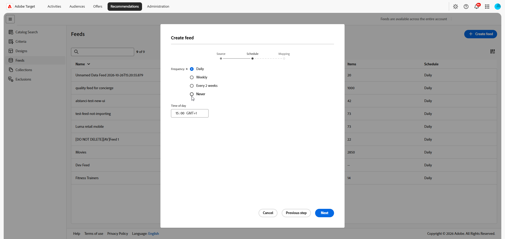

# Usar [!DNL Adobe Analytics] com [!DNL Recommendations] {#use-analytics-with-recommendations}

>[!BEGINSHADEBOX]

**Nesta página:** Saiba como usar [!DNL Adobe Analytics] como fonte de dados comportamentais em atividades [!DNL Adobe Target Recommendations].

>[!ENDSHADEBOX]

Usar [!DNL Adobe Analytics] como fonte de dados comportamentais permite que atividades de [!DNL Adobe Target Recommendations] usem dados comportamentais baseados em visualização e em compra de [!DNL Analytics]. Isso é útil quando a configuração do [!DNL Target Recommendations] é nova e o [!DNL Analytics] tem muitos dados históricos para usar. Os dados também podem incluir informações de uma fonte de terceiros ou feed que é compartilhado somente com [!DNL Analytics].

A fonte de dados é selecionada com a opção **[!UICONTROL Source de Dados Comportamentais]** ao [criar critérios](/help/main/c-recommendations/c-algorithms/create-new-algorithm.md#data-source) em [!DNL Recommendations]: **[!UICONTROL Adobe Target]** ou **[!UICONTROL Analytics]**.

>[!NOTE]
>
>Se essas duas opções não forem exibidas na conta, contate o [Atendimento ao cliente](/help/main/cmp-resources-and-contact-information.md#reference_ACA3391A00EF467B87930A450050077C).

## Casos de uso para dados [!DNL Analytics] em [!DNL Target] {#use-cases}

Usar [!DNL Analytics] como fonte de dados comportamentais também permite que casos de uso específicos sejam implantados sem marcar páginas de entidade com todos os parâmetros de entidade [!DNL Target]. Isso requer determinados pré-requisitos, e a disponibilidade das &quot;Variáveis de produto&quot; é a mais importante. eVars e Props comuns não são suficientes para [!DNL Analytics] e [!DNL Target] trocarem esses dados automaticamente.

[!DNL Analytics] pode ser usado como fonte de dados comportamentais para:

* Exibir recomendações em um site de varejo para usuários em uma página de detalhes do produto, com base no que outros usuários compraram da mesma categoria no mês passado, usando dados do [!DNL Analytics].
* Exiba conteúdo na tela inicial de um site de mídia para o conteúdo mais popular de uma determinada categoria que está em tendência no momento, com base nos dados [!DNL Analytics].

## Implementação em [!DNL Analytics]

### Pré-requisitos: configurar variáveis de produto no [!DNL Analytics] {#prerequisites}

Implemente variáveis de produto em [!DNL Analytics] com os atributos necessários para [!DNL Target Recommendations]. Um exemplo de formato de feed do [!DNL Target Recommendations] orienta quais atributos devem ser definidos nas variáveis de produto. Esses valores devem ser &quot;mapeados&quot; posteriormente na interface do usuário [!DNL Target] para os respectivos valores de entidade [!DNL Target].

>[!NOTE]
>
>Se for um site de conteúdo, as respectivas partes de conteúdo deverão ser tratadas como &quot;produtos&quot; e os atributos associados desse conteúdo deverão ser passados como atributos. Esses atributos podem incluir nome do autor, data de publicação, título do conteúdo, mês de lançamento e assim por diante. A empresa deve decidir a granularidade do nível de categoria ou dos tipos de categoria com base nos requisitos do caso de uso.

Para obter mais detalhes sobre como configurar variáveis de produto, consulte [produtos](https://experienceleague.adobe.com/docs/analytics/implementation/vars/page-vars/products.html) no guia *Implementar o Adobe Analytics*. Algumas das observações nessa documentação, por exemplo, sobre Categoria, exigem o julgamento da equipe que a implanta. É recomendável consultar [!DNL Adobe] antes desta atividade.

### Considerações {#considerations}

Os dados de [!DNL Analytics] são enviados por meio de um feed diário. Os resultados comportamentais podem levar até 24 horas para serem refletidos nos resultados das recomendações no site. Como em todas as configurações de critérios de [!DNL Recommendations], essa fonte de dados deve ser testada.

Para escolher uma origem de dados:

* Uma mbox [!DNL Target] é adequada quando muitos dados orgânicos são gerados todos os dias pelos usuários e pouca dependência de dados históricos é necessária.
* [!DNL Analytics] é um bom ajuste quando dados menos orgânicos foram gerados recentemente e os dados [!DNL Analytics] devem ser usados.

Os valores `entity.id` e `entity.categoryId` ainda devem ser passados na chamada de mbox [!DNL Target]. Os outros atributos podem ser passados por um feed do [!DNL Analytics], conforme descrito nesta página.

As regras de inclusão dinâmica, como a correspondência de um parâmetro de entidade a um atributo de perfil, podem ser usadas com a abordagem de feed [!DNL Analytics]. O método é semelhante ao uso do [!DNL Target] independente, mas o tempo deve ser considerado: as variáveis de entidade que devem corresponder às variáveis de perfil dependem da camada de dados, que pode aparecer muito mais tarde na página.

## Implementar em [!DNL Target] {#implement-target}

As variáveis de produto são mapeadas em [!DNL Target] para fornecer um fornecimento contínuo de dados comportamentais.

1. Em [!DNL Target], clique em **[!UICONTROL Recomendações]** e depois clique na guia **[!UICONTROL Feeds]**.

1. Clique em **[!UICONTROL Criar Feed]**.

   

1. Selecione **[!UICONTROL Classificações do Analytics]** e especifique o conjunto de relatórios.

1. Clique em **[!UICONTROL Avançar]** para avançar para as configurações de **[!UICONTROL Agenda]** e selecione uma frequência para o feed: **[!UICONTROL Diariamente]**, **[!UICONTROL Semanalmente]**, **[!UICONTROL A cada 2 semanas]** ou **[!UICONTROL Nunca]**. A hora do dia em que o feed será processado também pode ser selecionada.

   

1. Clique em **[!UICONTROL Avançar]** para avançar para as configurações de **[!UICONTROL Mapeamento]** e mapear os cabeçalhos de coluna de campo para os nomes de campo **[!UICONTROL Recomendações]** apropriados.

1. Clique em **[!UICONTROL Salvar]**.

Para obter mais informações sobre como criar um feed, consulte [Criar um feed](/help/main/c-recommendations/c-products/feeds.md#steps).
