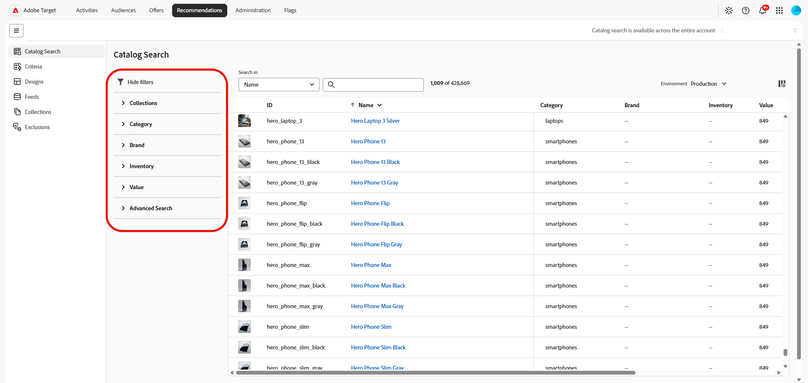
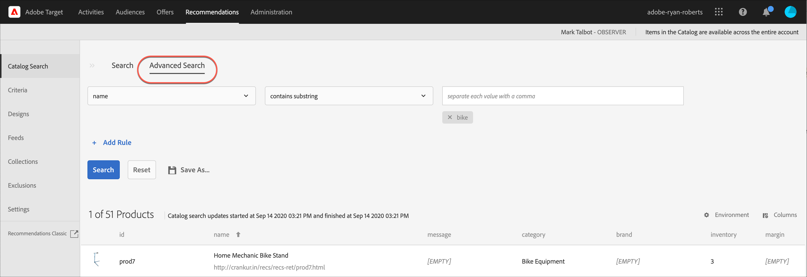

# [!UICONTROL Pesquisa no catálogo] {#catalog-search}

>[!BEGINSHADEBOX]

**Nesta página:** Saiba como pesquisar o catálogo no [!DNL Adobe Recommendations] para localizar produtos ou conteúdo e como filtrar, exibir e remover itens.

>[!ENDSHADEBOX]

A página **[!UICONTROL Pesquisa de Catálogo]** em [!DNL Adobe Recommendations] é usada para localizar os produtos ou conteúdo no catálogo. A tarefa mais básica desta página é procurar um item. A página também permite alterar o ambiente, filtrar aspectos, modificar as colunas na tabela e muito mais.

O catálogo inclui todo o conjunto de produtos (entidades). Ele pode conter muitas coleções, que organizam os produtos em grupos lógicos.

O índice do catálogo é criado automaticamente quando o primeiro feed é carregado e atualizado de acordo com o [agendamento especificado](/help/main/c-recommendations/c-products/feeds.md#steps).

O catálogo é atualizado automaticamente quando as atualizações são recebidas por meio de arquivos de feed, da API ou de atualizações de mbox. Normalmente, as atualizações são concluídas em uma hora. Se houver atualizações em andamento, será exibida a hora em que a atualização mais recente foi iniciada. Se não houver atualizações em andamento, será exibida a hora em que a atualização mais recente foi iniciada e finalizada.

## Pesquisar no catálogo

Use os resultados da pesquisa para revisar os itens no catálogo e, se necessário, remover itens dele.

1. Clique em **[!UICONTROL Recommendations]** > **[!UICONTROL Pesquisa no catálogo]**.

1. (Opcional) Para filtrar os resultados, clique no ícone **[!UICONTROL Mostrar filtros]** (  ) e selecione os filtros a serem aplicados. Os filtros disponíveis são **[!UICONTROL Ambiente]**, **[!UICONTROL Coleções]**, **[!UICONTROL Categoria]**, **[!UICONTROL Marca]**, **[!UICONTROL Inventário]** e **[!UICONTROL Valor]**.

   [Ambientes](/help/main/administrating-target/environments.md) organizam sites e ambientes de pré-produção para gerenciamento e relatórios separados. Para alterar o ambiente, selecione o ambiente desejado na lista suspensa **[!UICONTROL Ambiente]**.

   

1. Digite um termo de pesquisa no campo **[!UICONTROL Pesquisar em]**.

1. (Opcional) Refine a pesquisa selecionando uma opção de pesquisa no menu de opções, que é aberto na seta para baixo no campo **[!UICONTROL Pesquisar em]**.

   As opções de pesquisa incluem o seguinte:

   * ID
   * Nome
   * Mensagem

1. Clique no ícone **[!UICONTROL Personalizar Tabela]** (  ) para modificar as colunas ativas na página **[!UICONTROL Pesquisa de Catálogo]**.

   

1. Role pelos itens nos resultados da pesquisa para visualizar miniaturas e outras informações do produto.

   >[!NOTE]
   >
   >Em uma pesquisa de catálogo em um atributo personalizado com um valor numérico, os resultados tratam o atributo personalizado como um tipo de sequência em vez de um valor numérico.
   >
   >O tipo de um atributo não pode ser alterado no momento. Para solicitar uma alteração, [abra um problema do cliente](/help/main/cmp-resources-and-contact-information.md#reference_ACA3391A00EF467B87930A450050077C) referenciando os atributos cujo tipo deve mudar de sequência para numérico.

1. Clique em um item nos resultados da pesquisa para exibir seus detalhes, incluindo ID, nome, mensagem, categoria e muito mais.

   

1. Para remover o item do catálogo, clique em **[!UICONTROL Remover do Catálogo]**.

   Todas as informações sobre esse item são removidas do índice do catálogo. O item é incluído no catálogo novamente somente se for adicionado novamente em um feed de dados. Um item excluído também deve ser excluído separadamente dos feeds.

   

<!--
### Perform an advanced search {#advanced-search}

You can use [!UICONTROL Advanced Search] to further refine your search results or to save your search results as a [collection](/help/main/c-recommendations/c-products/collections.md) or [exclusion](/help/main/c-recommendations/c-products/exclusions.md).

1. Click the **[!UICONTROL Advanced Search]** link.

   

1. Use the drop-down lists to specify the parameter, operator, and values for your search.

1. (Optional) Click **[!UICONTROL Add Rule]** to add an additional search rule.

   Each additional search rule is joined with the AND operator.

1. Click **[!UICONTROL Search]**.

1. (Optional) Click **[!UICONTROL Save As]**, then click **[!UICONTROL Collection]** or **[!UICONTROL Exclusion]**.

   

   For more information, see [Create a collection or exclusion based on Advanced Search](#save-as) below.
-->

<!--
## Modify the Catalog Search page (filters and columns)

You can temporarily modify the available filters and columns on the [!UICONTROL Catalog Search] page for the current session.

### Modify filters

You can add additional filter facets to the [!UICONTROL Catalog Search] page.

1. In the **[!UICONTROL Filters]** panel, click **[!UICONTROL Modify]**.

   

1. Select the desired search facets (ID, name, message, etc.), then click **[!UICONTROL Save]**.

   

Keep in mind that the additional filter facets are available in the current session only.
-->

<!--
## Create a collection or exclusion based on Advanced Search {#save-as}

You can create [collections](/help/main/c-recommendations/c-products/collections.md) or [exclusions](/help/main/c-recommendations/c-products/exclusions.md) using [!UICONTROL Advanced Search] on the [!UICONTROL Catalog Search] page ([!UICONTROL Recommendations] > [!UICONTROL Catalog Search] > [!UICONTROL Advanced Search]).

1. Perform an [advanced search](#advanced-search).

1. Click **[!UICONTROL Save As]**, then click **[!UICONTROL Collection]** or **[!UICONTROL Exclusion]**.

   

   >[!IMPORTANT]
   >
   >The [!UICONTROL Advanced Search] functionality is case-insensitive; however, products returned at the time of delivery are based on case-sensitive search. This mismatch might lead to confusion. Ensure that you consider case-sensitivity when you create collections or exclusions based on results using the [!UICONTROL Advanced Search] functionality. For example, if you perform a search for "Holiday," that initial search lists results containing "Holiday" and "holiday." If you then create a catalog with the intent to return products containing "holiday," only products containing "holiday" are returned. Products containing "Holiday" are not returned. Exclusions are handled in a similar fashion.
-->
