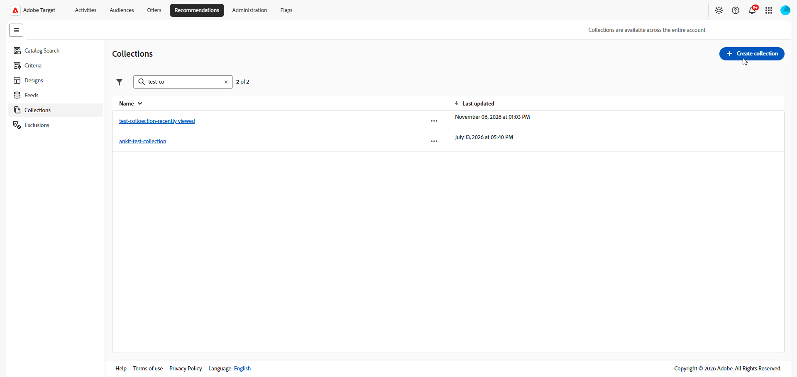

# Coleções {#collections}

>[!BEGINSHADEBOX]

**Nesta página:** Saiba como criar, gerenciar e usar coleções de itens em [!DNL Adobe Target Recommendations].

>[!ENDSHADEBOX]

Uma coleção é um conjunto de produtos ou itens que são qualificados para uma recomendação. Uma coleção é definida pelas condições que os itens devem atender para fazerem parte dela. Os itens podem ser agrupados de qualquer maneira que faça sentido para a empresa, como itens semelhantes ou relacionados, produtos em uma determinada faixa de preço ou cor ou itens que provavelmente serão interessantes em uma área geográfica específica.

As coleções organizam os produtos em compartimentos lógicos. Por exemplo, se alguns itens estiverem disponíveis em uma região, mas não em outra, uma coleção pode excluir os itens que não estão disponíveis na região do visitante. As coleções também podem organizar itens sazonais ou quaisquer outros parâmetros organizacionais que se apliquem ao negócio. Os itens podem ser agrupados em catálogos, e recomendações separadas podem ser criadas para cada coleção.

Os pontos a seguir descrevem como as coleções interagem com o restante de [!DNL Recommendations]:

* As [recomendações de backup](/help/main/c-recommendations/c-algorithms/backup-recs.md) geradas para cada critério também usam a coleção, para que sejam incluídos na recomendação de backup apenas os itens na coleção. Como resultado, somente os produtos que fazem sentido para uma localização são exibidos.
* As coleções são recriadas ou atualizadas cada vez que o critério for executado.
* As regras de coleta se aplicam a itens de recomendação gerados após a execução dos critérios. Elas afetam somente as Recomendações de entidade (ERs) na saída, não a chave.
* As coleções não são aplicadas quando você usa a chave de recomendação **[!UICONTROL Itens recentemente visualizados]**.
* Os critérios de inclusão podem produzir resultados semelhantes, mas devem ser configurados sempre que uma atividade for criada. Uma coleção é criada uma vez e pode ser reutilizada sem ser configurada novamente.
* Quando uma atividade [!DNL Recommendations] é criada ou editada, o nome da coleção aparece ao lado do rótulo **[!UICONTROL Critério]** no diagrama da atividade.

## Criar uma coleção {#task_1256DFF6842141FCAADD9E1428EF7F08}

As coleções estão disponíveis em toda a conta, portanto, uma coleção que é criada uma vez pode ser selecionada em qualquer atividade [!DNL Recommendations]. As regras são definidas na coleção para que não precisem ser configuradas novamente para cada atividade.

1. Clique em **[!UICONTROL Recomendações]** > **[!UICONTROL Coleções]** para exibir a lista de coleções existentes.

   Para editar, copiar ou excluir uma coleção existente, clique no ícone Mais Ações (  ) ao lado da coleção e clique na opção desejada.

   >[!NOTE]
   >
   >O &quot;Número de Itens&quot; relatado para cada coleção na exibição de lista das **[!UICONTROL Coleções]** é o número de produtos que correspondem às regras da coleção no [grupo de hosts](/help/main/administrating-target/hosts.md) (ambiente) padrão configurado no Recommendations. Consulte [Configurações](https://experienceleague.adobe.com/docs/target-dev/developer/recommendations.html){target=_blank} para alterar o grupo de hosts padrão.

1. Clique em **[!UICONTROL Criar coleção]**.

   

1. Digite um **[!UICONTROL Nome]** para a coleção. Uma **[!UICONTROL Descrição]** opcional também pode ser inserida.

1. (Condicional) Escolha um [ambiente](/help/main/administrating-target/environments.md) no filtro **[!UICONTROL Ambiente]** para visualizar o conteúdo da coleção nesse ambiente. Por padrão, os resultados do grupo de hosts padrão são exibidos.

1. Defina as regras usadas para criar a coleção.

   Uma coleção pode ser criada em torno de uma ID de produto ou categoria, margem ou qualquer outro parâmetro na lista. Adicione regras para usar vários parâmetros para definir uma coleção. Várias regras são unidas com um operador AND, portanto, todas as regras especificadas devem corresponder para que a coleção seja aplicada.

1. Clique em **[!UICONTROL Criar]**.

1. Após a criação da coleção, clique no ícone Mais Ações (  ) e selecione a opção apropriada: **[!UICONTROL Editar]**, **[!UICONTROL Copiar]** ou **[!UICONTROL Excluir]**.

   

<!--
## Create a collection using [!UICONTROL Advanced Search]

You can also create collections using [!UICONTROL Advanced Search] on the [Catalog Search](/help/main/c-recommendations/c-products/catalog-search.md#save-as) page ([!UICONTROL Recommendations] > [!UICONTROL Catalog Search] > [!UICONTROL Advanced Search]). 

After creating a search using "id > contains," for example, you can then click [!UICONTROL Save As] > [!UICONTROL Collection].

>[!IMPORTANT]
>
>The [!UICONTROL Advanced Search] functionality is case-insensitive; however, products returned at the time of delivery are based on case-sensitive search. This mismatch might lead to confusion. Ensure that you consider case-sensitivity when you create collections based on results using the [!UICONTROL Advanced Search] functionality. For example, if you perform a search for "Holiday," that initial search lists results containing "Holiday" and "holiday." If you then create a catalog with the intent to return products containing "holiday," only products containing "holiday" are returned. Products containing "Holiday" are not returned.
-->

## Usar uma coleção em uma atividade {#use-collection}

Uma coleção é selecionada para cada experiência de uma atividade [!DNL Recommendations]. A coleção determina quais itens estão qualificados para aparecer nas recomendações dessa experiência.

1. [Criar uma coleção](#task_1256DFF6842141FCAADD9E1428EF7F08).

   

1. Clique em **[!UICONTROL Atividades]** e [criar uma nova atividade do Recommendations](/help/main/c-recommendations/t-create-recs-activity/create-recs-activity.md) ou editar uma atividade existente.

   

1. Após selecionar um critério e um design, selecione a coleção desejada na página **[!UICONTROL Opções]**.

1. (Condicional) Para alterar a coleção de uma atividade existente, clique em um local de recomendações nas páginas **[!UICONTROL Experiências]**, clique em **[!UICONTROL Alterar coleção]** e selecione a coleção desejada.
