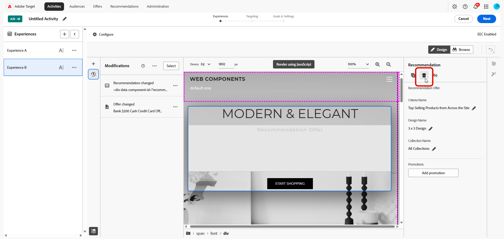

# Recomendações como oferta {#recommendations-as-an-offer}

>[!BEGINSHADEBOX]

**Nesta página:** Saiba como adicionar, editar e excluir uma recomendação como uma oferta em [!UICONTROL atividades de Teste A/B] e [!UICONTROL Direcionamento de experiência] (XT).

>[!ENDSHADEBOX]

Além das atividades de [!UICONTROL Recomendações], as recomendações podem ser incluídas nas atividades de [!UICONTROL Teste A/B] (incluindo [!UICONTROL Alocação automática] e [!UICONTROL Direcionamento automático]) e [!UICONTROL Direcionamento de experiência] (XT). Isso permite o seguinte:

* Teste e direcione conteúdo de recomendações e não recomendações em uma mesma atividade.
* Experimente a colocação de recomendações na página, incluindo a ordem de várias recomendações.
* Impulsione automaticamente o tráfego para a experiência do recommendations com melhor desempenho com **[!UICONTROL Alocação automática]**.
* Atribua de maneira dinâmica os visitantes a experiências de recomendação personalizadas com base em seus perfis com o **[!UICONTROL Direcionamento automático]**.

## Adicionar uma recomendação como uma oferta {#add-recs-offer}

Uma recomendação é adicionada como uma oferta enquanto uma experiência é criada com o [!UICONTROL Visual Experience Composer] (VEC) em uma atividade de [!UICONTROL Teste A/B] ou XT.

1. Inicie o fluxo de trabalho guiado de três etapas do VEC para criar uma atividade de [Teste A/B](/help/main/c-activities/t-test-ab/t-test-create-ab/test-create-ab.md) ou [Direcionamento de experiência](/help/main/c-activities/t-experience-target/t-xt-create/xt-create.md) (XT).

   >[!NOTE]
   >
   >Para Testes A/B, a opção [Alocação automática](/help/main/c-activities/automated-traffic-allocation/automated-traffic-allocation.md) envia automaticamente o tráfego para as recomendações com melhor desempenho, e a opção [Direcionamento automático](/help/main/c-activities/auto-target/auto-target-to-optimize.md) atribui os visitantes a experiências de recomendação personalizadas com base em seus perfis.

1. Ao criar uma [experiência](/help/main/c-experiences/c-visual-experience-composer/viztarget-options.md), adicione a recomendação como uma oferta de uma das seguintes maneiras:

   * Clique no elemento ao qual a recomendação é adicionada, clique em **[!UICONTROL Substituir conteúdo]** e selecione **[!UICONTROL Recomendação]**.

     

   * No painel **[!UICONTROL Componentes]**, selecione **[!UICONTROL Recomendação]** em **[!UICONTROL Dinâmica]**, passe o mouse sobre um elemento existente na página e clique em **[!UICONTROL Inserir antes]** ou **[!UICONTROL Inserir depois]** para colocar a recomendação antes ou depois desse elemento.

1. Acesse o menu **[!UICONTROL Mostrar propriedades]** e clique em **[!UICONTROL Selecionar uma recomendação]**.

1. Selecione os [critérios](/help/main/c-recommendations/c-algorithms/algorithms.md) desejados e clique em **[!UICONTROL Avançar]**.

1. Selecione o [design](/help/main/c-recommendations/c-design-overview/design-overview.md) desejado e clique em **[!UICONTROL Avançar]**.

1. Na caixa de diálogo **[!UICONTROL Opções]**, especifique o seguinte:

   * Escolha uma [coleção](/help/main/c-recommendations/c-products/collections.md).
   * Se necessário, configure as opções de [Promoção principal e Promoção secundária](/help/main/c-recommendations/t-create-recs-activity/adding-promotions.md).

1. Clique em **[!UICONTROL Salvar]**.

1. Termine de configurar a atividade de [!UICONTROL Teste A/B] ou XT com o fluxo de trabalho guiado de três etapas.

## Editar uma oferta do recommendations {#edit-recs-offer}

Os critérios, o design, a coleção e as promoções de uma oferta do recommendations podem ser alterados após a adição da oferta, no painel **[!UICONTROL Recomendação]**.

1. Clique na oferta para editar e navegar pelas opções no menu do painel direito.

   

1. Selecione uma das seguintes opções:

   * [Alterar critérios](/help/main/c-recommendations/c-algorithms/algorithms.md)
   * [Alterar design](/help/main/c-recommendations/c-design-overview/design-overview.md)
   * [Alterar coleção](/help/main/c-recommendations/c-products/collections.md)
   * [Alterar promoção](/help/main/c-recommendations/t-create-recs-activity/adding-promotions.md)

1. Faça as edições.

## Excluir uma oferta do Recomendações {#delete-recs-offer}

Uma oferta de recomendações que não é mais necessária pode ser excluída do painel **[!UICONTROL Recomendação]**.

Clique na oferta a ser removida e, em seguida, clique no ícone de compartimento (  ) no painel **[!UICONTROL Recomendação]**.

## Exibir o status de uma oferta do recommendations {#status}

O status da oferta de recomendações (algoritmo) é exibido na parte inferior da página **[!UICONTROL Visão geral]** para as atividades de [!UICONTROL Teste A/B] e XT que contêm ofertas de recomendações. O status é um dos seguintes:

* **[!UICONTROL Resultados prontos]**
* **[!UICONTROL Resultados Não Prontos]**
* **[!UICONTROL Falha do feed]**

## Vídeo de treinamento: Recomendações como oferta 

>[!VIDEO](https://video.tv.adobe.com/v/28878)
