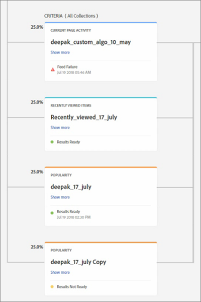

# Pré-visualizar e iniciar atividade do Recomendações {#preview-launch-recs-activity}

>[!BEGINSHADEBOX]

**Nesta página:** saiba como verificar o status do algoritmo, visualizar as recomendações e ativar uma atividade [!DNL Recommendations].

>[!ENDSHADEBOX]

A visualização das recomendações antes de iniciar uma atividade confirma que os resultados estão disponíveis. Isso se aplica às [!UICONTROL atividades do Recommendations], [!UICONTROL Teste A/B] e [!UICONTROL Direcionamento de experiência] (XT) que contêm [ofertas do Recommendations](/help/main/c-recommendations/recommendations-as-an-offer.md). [!DNL Target Recommendations] oferece várias maneiras de visualizar as recomendações.

## Verificar o status do algoritmo {#check-status}

Após a criação de uma atividade, o [!DNL Recommendations] executa um algoritmo para gerar as recomendações. Esse algoritmo pode levar algumas horas para ser executado.

O status do algoritmo é listado com os critérios no diagrama de atividades na página **[!UICONTROL Visão geral]** da atividade [!DNL Recommendations].

O status pode ser um dos seguintes:

* **[!UICONTROL Resultados prontos]**: o algoritmo retornou resultados.
* **[!UICONTROL Resultados Não Prontos]**: a execução do algoritmo não foi concluída.
* **[!UICONTROL Falha do feed]**: o arquivo de feed de critérios personalizados não pôde ser recuperado.

## Estimar o tempo de execução do algoritmo {#algorithm-run-time}

Depois que uma atividade que contém um critério é salva, o [!DNL Target] calcula as recomendações com base na coleção, critério, design e promoções selecionados. O tempo necessário depende da lógica da recomendação, do intervalo de dados, do número de itens no catálogo, da quantidade de dados comportamentais gerados pelos clientes e da fonte de dados comportamentais. A fonte de dados comportamentais tem o maior impacto no tempo de processamento.

### mboxes

Quando as mboxes são a fonte de dados comportamentais, os critérios são executados imediatamente após sua criação. Dependendo da quantidade de dados comportamentais e do tamanho do catálogo, o algoritmo pode levar até 12 horas para ser executado.

As alterações na configuração dos critérios geralmente fazem com que o algoritmo seja executado novamente. Dependendo da alteração, as recomendações calculadas anteriormente podem não estar disponíveis até que a nova execução seja concluída. Para alterações maiores, somente o backup ou o conteúdo padrão estará disponível até que a nova execução seja concluída.

Um algoritmo que não é modificado é executado novamente automaticamente por [!DNL Target] a cada 12-48 horas, dependendo do intervalo de dados selecionado.

### [!DNL Adobe Analytics]

Quando [!DNL Adobe Analytics] é a fonte de dados comportamentais, o tempo até que os critérios estejam disponíveis depende se o conjunto de relatórios selecionado e a janela de lookback já foram usados para outros critérios. Na primeira vez que um conjunto de relatórios é usado com determinada janela de pesquisa, [!DNL Target Recommendations] pode levar de dois a sete dias para baixar os dados comportamentais de [!DNL Analytics].

Para saber o tempo de execução de critérios novos ou editados e de execuções de algoritmo em andamento, consulte a **Disponibilidade dos critérios quando o Analytics for a fonte de dados** na [Source de dados](/help/main/c-recommendations/c-algorithms/create-new-algorithm.md#data-source).

>[!NOTE]
>
>**[!UICONTROL Os Itens Visualizados Recentemente]** não exigem a execução de um algoritmo offline e os resultados ficam disponíveis instantaneamente. Os algoritmos **[!UICONTROL Mais visualizados]** e **[!UICONTROL Mais vendidos]** com base em dados de mbox geralmente produzem resultados muito rapidamente porque o cálculo é mais simples. Esses algoritmos são boas opções para visualizar uma alteração de design ou confirmar que os dados comportamentais estão sendo coletados corretamente.

## Visualizar com um link de controle de qualidade {#preview-qa-link}

Depois que o algoritmo tiver os resultados prontos, os resultados poderão ser visualizados com a funcionalidade [Link de controle de qualidade](/help/main/c-activities/c-activity-qa/activity-qa.md) de [!DNL Adobe Target]. Os links de controle de qualidade estão disponíveis na seção **[!UICONTROL Localização da atividade]** da página de visão geral **[!UICONTROL Atividade]** e exibem as recomendações na página.

>[!NOTE]
>
>Por padrão, o [!DNL Target] adiciona automaticamente o usuário ao público-alvo necessário para o link de controle de qualidade. Se essa configuração estiver desativada e a atividade tiver regras de direcionamento, o perfil do usuário deverá atender a essas regras de direcionamento para ver a experiência que contém recomendações.

O modo de controle de qualidade tem os seguintes comportamentos:

* O modo de controle de qualidade do [!DNL Target] é salvo em um cookie e persiste nas páginas. Se o modo de controle de qualidade não for encerrado, os resultados do controle de qualidade continuarão sendo exibidos em todo o site. Para sair do modo de controle de qualidade, use o [bookmarklet](/help/main/c-activities/c-activity-qa/activity-qa-bookmark.md).
* Enquanto estiver no modo de controle de qualidade, navegar no site não afeta os **[!UICONTROL Itens visualizados recentemente]** ou os **[!UICONTROL Itens comprados recentemente]** do perfil. Esse comportamento é intencional, para evitar a poluição não intencional dos dados comportamentais de produção. Para visualizar os resultados de um critério de **[!UICONTROL Itens visualizados recentemente]** ou **[!UICONTROL Recomendações baseadas no usuário]**, primeiro navegue pelo site fora do modo de QA e, em seguida, use a mesma sessão para abrir um link de modo de QA.

## Visualizar com o download do CSV {#preview-csv}

Baixar os resultados permite que os itens recomendados específicos sejam auditados. Isso é particularmente útil para algoritmos como **[!UICONTROL Pessoas que assistiram isto, assistiram aquilo]**, em que os itens recomendados dependem do item que o visitante está visualizando no momento, e o catálogo pode conter milhares ou milhões de itens diferentes.

1. Aguarde até que o status **[!UICONTROL Resultados prontos]** seja exibido para pelo menos um algoritmo na atividade. Os resultados não estão disponíveis para download antes de .

1. Na página de visão geral da **[!UICONTROL Atividade]**, clique no ícone de menu no canto superior direito e clique em **[!UICONTROL Baixar dados]**.

   

1. Abra o arquivo CSV baixado para ver os itens recomendados.

   

O arquivo lista os itens recomendados da esquerda para a direita, neste exemplo, os mais frequentemente exibidos. As recomendações são separadas por ambiente. Neste exemplo, somente o ambiente de Produção tem recomendações.

Uma linha que começa com um asterisco (*) lista [itens de backup](/help/main/c-recommendations/c-algorithms/backup-recs.md). Os itens de backup são exibidos quando os itens recomendados do algoritmo (critérios) não podem preencher todos os slots de um design.

Para algoritmos baseados em um valor principal, como **[!UICONTROL Pessoas que assistiram isto, assistiram aquilo]**, os valores principais (os itens &quot;Isto&quot;) estão na coluna mais à esquerda. Os itens recomendados (os itens &quot;That&quot;) são listados da esquerda para a direita nas colunas Recommendation_X.

Para atividades com conjuntos de resultados muito grandes, a opção **[!UICONTROL Baixar dados]** poderá falhar com o erro `Error while fetching recommendation data file.`. Isso acontece quando o CSV gerado excede o tamanho da resposta que a interface do usuário pode retornar em um único download.

>[!NOTE]
>
>Os downloads de resultados não estão disponíveis para atividades que contêm um algoritmo **[!UICONTROL Recomendações baseadas no usuário]**, ou para critérios que usam a lógica de recomendação **[!UICONTROL Itens visualizados recentemente]**.

### Formato de download CSV para algoritmos baseados em chave e popularidade {#format}

O arquivo de download de CSV reflete consistentemente os resultados gerados após a execução dos critérios de backend.

* **Algoritmos baseados em popularidade (não baseados em chave)**: o arquivo inclui:

  * Uma linha de recomendações de backup com um asterisco (*)
  * Uma linha separada listando as recomendações com base nas configurações do algoritmo

* **Algoritmos baseados em chave**: o arquivo inclui:

  * Uma linha de backup, como para algoritmos baseados em popularidade
  * Várias linhas no formato de valor-chave, em que a primeira entrada é a ID de produto da chave, seguidas por IDs de produto separadas por vírgulas que representam os candidatos da recomendação

## Ativar a atividade {#activate-activity}

A ativação da atividade a inicia e seu status muda para **[!UICONTROL Live]**.

Na guia **[!UICONTROL Visão geral da atividade]**, clique na seta suspensa **[!UICONTROL Status]** e selecione **[!UICONTROL Ativar]**. Se a atividade estiver atualmente no estado **[!UICONTROL Inativa]**, a lista suspensa será rotulada como **[!UICONTROL Inativa]**. Após alguns segundos a alguns minutos, o status muda para **[!UICONTROL Ativo]**.

A mesma lista suspensa também pode ser usada para desativar ou arquivar a atividade.

## Evite interrupções ao alterar configurações {#avoid-disruptions}

Alterar as configurações de coleções, critérios, promoções ou design de [!DNL Recommendations] em uma atividade ativa pode invalidar os resultados do algoritmo e alterar o status de um algoritmo para **[!UICONTROL Resultados Não Prontos]**.

Para evitar a interrupção de uma atividade ativa, a abordagem recomendada é modificar uma cópia da atividade e substituir o original:

1. Duplique a atividade original (atividade 1) e os critérios para modificar, a fim de criar uma nova atividade (atividade 2).
1. Faça as alterações na atividade duplicada (atividade 2) e em seus critérios e aguarde o algoritmo gerar resultados.
1. Pré-visualize a atividade modificada (atividade 2) e confirme se os resultados foram os desejados.
1. Ative a nova atividade (atividade 2).
1. Desative a atividade original (atividade 1).

Quando os resultados históricos do relatório devem ser retidos na mesma atividade, é possível uma abordagem alternativa. Essa abordagem pode causar uma interrupção temporária na disponibilidade das recomendações:

1. Duplique a atividade original (atividade 1) e os critérios para modificar, a fim de criar uma nova atividade (atividade 2).
1. Faça as alterações na atividade duplicada (atividade 2) e em seus critérios e aguarde o algoritmo gerar resultados.
1. Pré-visualize a atividade modificada (atividade 2) e confirme se os resultados foram os desejados.
1. Pause a atividade modificada (atividade 2) e troque as configurações e os critérios pela atividade original (atividade 1).
1. Pré-visualize a atividade original (atividade 1) e confirme se os resultados foram os desejados.
1. Reative a atividade original (atividade 1).
